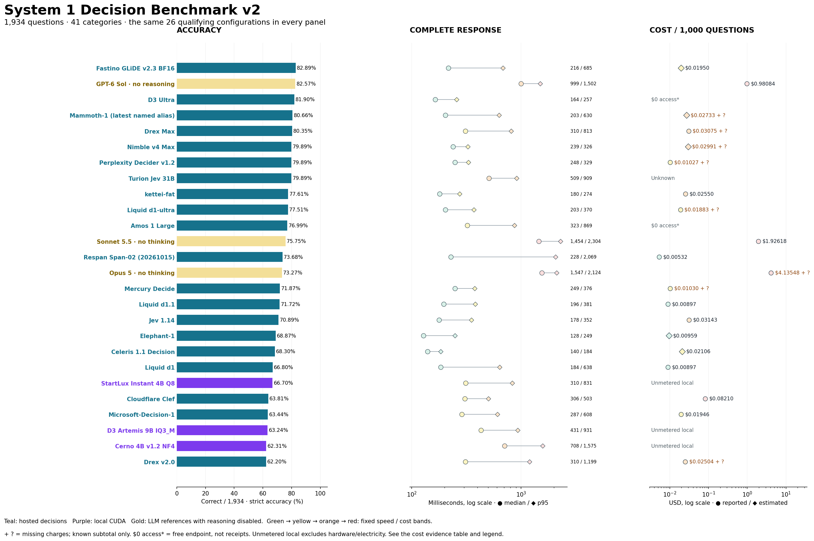
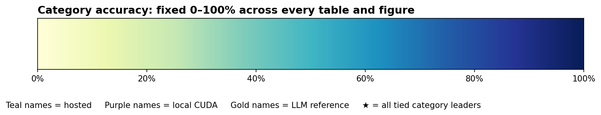
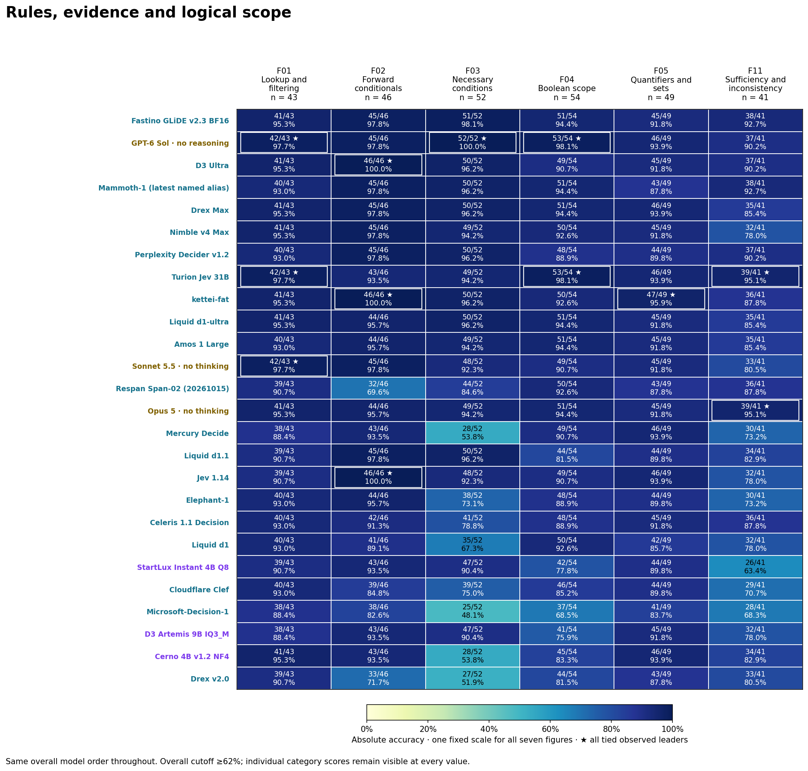
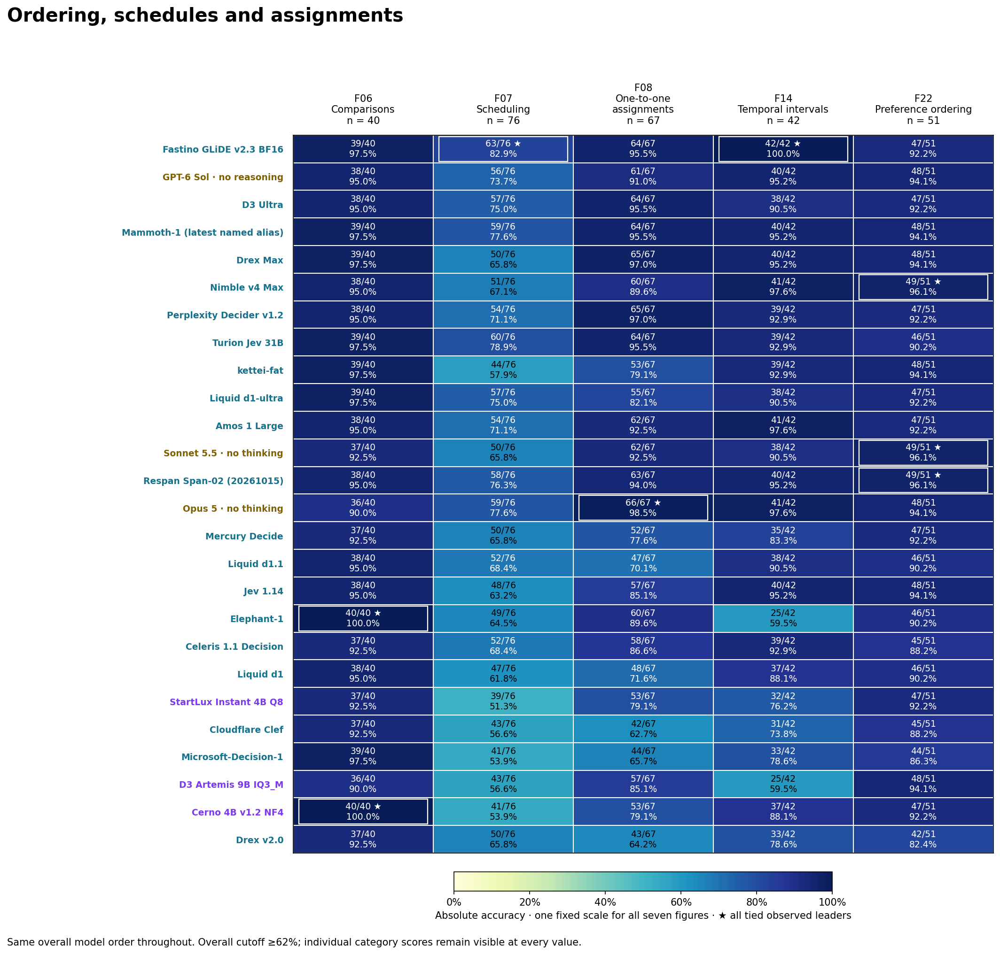
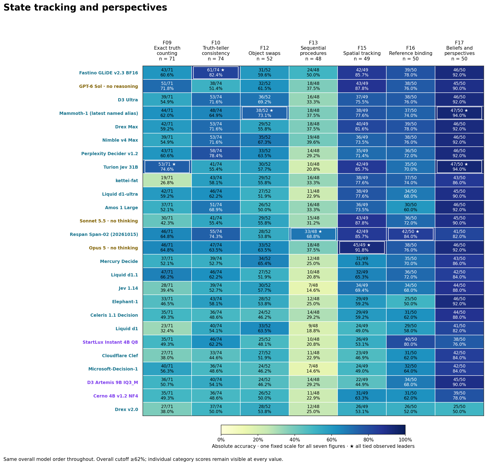
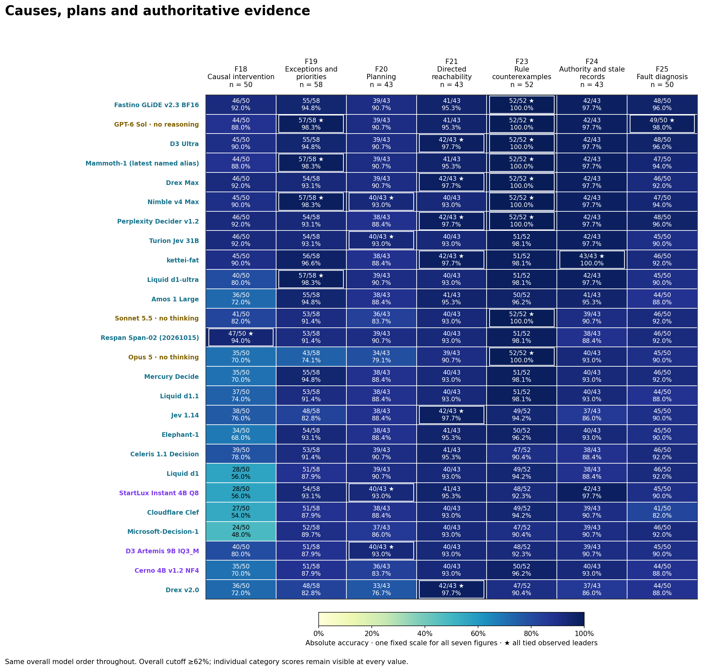
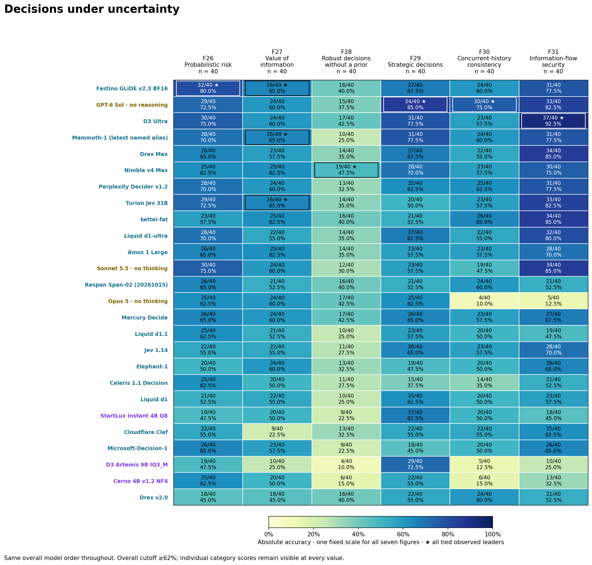
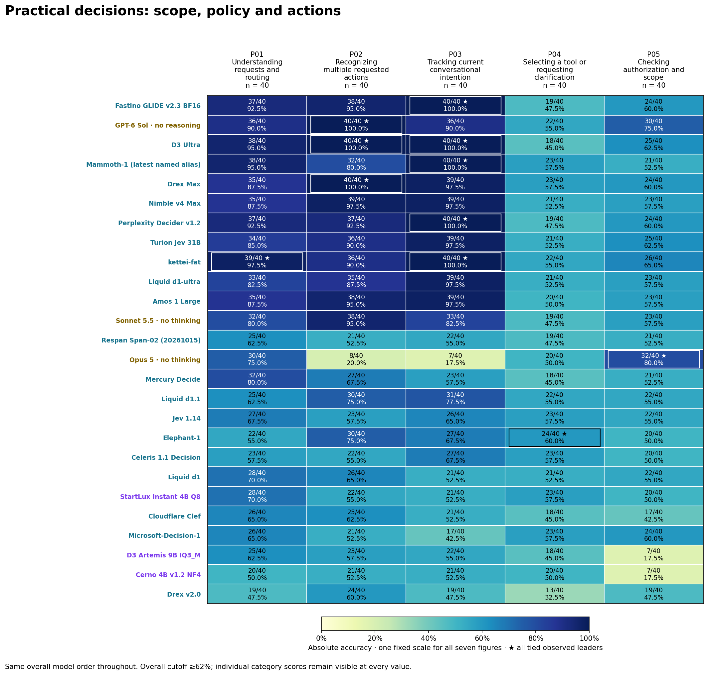
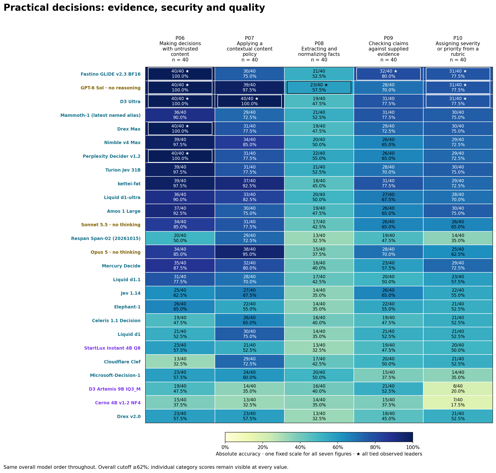

# System 1 Decision Benchmark v2

This benchmark asks a practical question: **how accurately, quickly and cheaply can a model choose the right action from a fixed set of options?** Every model receives the same native decision inputs. The tasks span logical constraints, state tracking, uncertainty, and practical choices about authorization, policy, evidence and tool use. Accuracy is measured alongside complete response time, coverage and cost, so a fast service that rejects hard inputs cannot look stronger simply by leaving them out.

V2 contains **1,934 questions across 41 categories**: the original 1,342 inputs, 192 additions to six existing categories, and 400 questions in ten new practical categories. The six expanded categories now contain 40 questions each; each new category also contains 40. The 120 companion diagnostics remain separate. The expansion provides more resolution and leaves headroom on harder decisions while preserving the earlier bank exactly.

The main comparison shows **26 configurations with at least 62% overall accuracy**: 20 hosted decision models, three local configurations and three reasoning-disabled LLM references. All 38 measurements remain downloadable. Model selection is applied once to overall accuracy; weak individual category results remain visible. These are measured configurations and routes, rather than a claim about every mode of a model family.

[Full interactive report](https://etsabary.github.io/system-1-decision-benchmark/report.html) · [Individual category rankings](https://etsabary.github.io/system-1-decision-benchmark/report.html#rankings) · [Cost evidence](https://etsabary.github.io/system-1-decision-benchmark/report.html#cost)



## How to read the colours



The colours answer different questions; their scales stay fixed across every model and category.

| Encoding | Meaning and rationale |
| --- | --- |
| Teal model names / bars | Hosted native decision models |
| Purple model names / bars | Local CUDA decision configurations |
| Gold model names / pale gold bars | Reasoning-disabled LLM reference configurations |
| Pale yellow → green → dark blue cells | Absolute category accuracy, fixed 0–100%. Each cell also prints correct / tested and percentage. Darker blue means more correct answers. Black or white text follows contrast. A border and ★ mark all tied leaders. |
| Blue → white → red in the relative-profile figure | Below → near → above the score expected after removing model and category averages. Fixed −30 to +30 percentage points. This shows descriptive specialties; it is a different scale from absolute accuracy. |
| Green / yellow / orange / red timing | ≤250 / ≤500 / ≤1,000 / >1,000 ms. Median and p95 are classified separately. |
| Green / yellow / orange / red cost | ≤$0.010 / ≤$0.025 / ≤$0.050 / >$0.050 per 1,000 questions. Uses the unrounded known subtotal / 1,934 × 1,000. |
| ● / ◆ cost marks | API-reported charges / captured tariff estimates. Free-access and local costs are labelled separately. |
| + ? / grey | Additional charges missing / no comparable monetary measurement. A partial cost is a known subtotal, not a complete price. |

These speed and cost bands restore the earlier fixed thresholds. They make slow tails and expensive configurations easy to find; they are descriptive bands, not statistical outlier tests or significance claims. Displayed numbers can round to a boundary. Role colours identify deployment, not quality; only accuracy cells encode correctness. Category leaders share a rank when their counts tie.

## Main comparison

| Configuration | Correct | Accuracy | Median | p95 | USD / 1,000 | Cost basis |
| --- | --- | --- | --- | --- | --- | --- |
| Fastino GLiDE v2.3 BF16 | 1603/1,934 | 82.89% | 🟩 216 ms | 🟧 685 ms | 🟨 $0.01950 | Tariff estimate / access terms |
| GPT-6 Sol · no reasoning | 1597/1,934 | 82.57% | 🟧 999 ms | 🟥 1,502 ms | 🟥 $0.98084 | API-reported charges |
| D3 Ultra | 1584/1,934 | 81.90% | 🟩 164 ms | 🟨 257 ms | ⬜ $0 access* | Public free access at collection; not a monetary receipt or future price promise |
| Mammoth-1 (latest named alias) | 1560/1,934 | 80.66% | 🟩 203 ms | 🟧 630 ms | 🟧 $0.02733 + ? | Tariff estimate / access terms; 1342 promotional free-access calls; 1 charges unknown (known subtotal only) |
| Drex Max | 1554/1,934 | 80.35% | 🟨 310 ms | 🟧 813 ms | 🟧 $0.03075 + ? | API-reported charges; 8 charges unknown (known subtotal only) |
| Nimble v4 Max | 1545/1,934 | 79.89% | 🟩 239 ms | 🟨 326 ms | 🟧 $0.02991 + ? | Tariff estimate / access terms; 1 charges unknown (known subtotal only) |
| Perplexity Decider v1.2 | 1545/1,934 | 79.89% | 🟩 248 ms | 🟨 329 ms | 🟨 $0.01027 + ? | API-reported charges; 1 charges unknown (known subtotal only) |
| Turion Jev 31B | 1545/1,934 | 79.89% | 🟧 509 ms | 🟧 909 ms | ⬜ Unknown | No monetary receipt or supported captured tariff |
| kettei-fat | 1501/1,934 | 77.61% | 🟩 180 ms | 🟨 274 ms | 🟧 $0.02550 | API-reported charges |
| Liquid d1-ultra | 1499/1,934 | 77.51% | 🟩 203 ms | 🟨 370 ms | 🟨 $0.01883 + ? | API-reported charges; 1 charges unknown (known subtotal only) |
| Amos 1 Large | 1489/1,934 | 76.99% | 🟨 323 ms | 🟧 869 ms | ⬜ $0 access* | Public free access at collection; not a monetary receipt or future price promise |
| Sonnet 5.5 · no thinking | 1465/1,934 | 75.75% | 🟥 1,454 ms | 🟥 2,304 ms | 🟥 $1.92618 | API-reported charges |
| Respan Span-02 (20261015) | 1425/1,934 | 73.68% | 🟩 228 ms | 🟥 2,069 ms | 🟩 $0.00532 | API-reported charges |
| Opus 5 · no thinking | 1417/1,934 | 73.27% | 🟥 1,547 ms | 🟥 2,124 ms | 🟥 $4.13548 + ? | API-reported charges; 183 charges unknown (known subtotal only) |
| Mercury Decide | 1390/1,934 | 71.87% | 🟩 249 ms | 🟨 376 ms | 🟨 $0.01030 + ? | API-reported charges; 1 charges unknown (known subtotal only) |
| Liquid d1.1 | 1387/1,934 | 71.72% | 🟩 196 ms | 🟨 381 ms | 🟩 $0.00897 | API-reported charges |
| Jev 1.14 | 1371/1,934 | 70.89% | 🟩 178 ms | 🟨 352 ms | 🟧 $0.03143 | API-reported charges |
| Elephant-1 | 1332/1,934 | 68.87% | 🟩 128 ms | 🟩 249 ms | 🟩 $0.00959 | Tariff estimate / access terms; 1342 promotional free-access calls |
| Celeris 1.1 Decision | 1321/1,934 | 68.30% | 🟩 140 ms | 🟩 184 ms | 🟨 $0.02106 | Tariff estimate / access terms |
| Liquid d1 | 1292/1,934 | 66.80% | 🟩 184 ms | 🟧 638 ms | 🟩 $0.00897 | API-reported charges |
| StartLux Instant 4B Q8 | 1290/1,934 | 66.70% | 🟨 310 ms | 🟧 831 ms | ⬜ Unmetered local | Hardware and electricity unmeasured; no API charge recorded |
| Cloudflare Clef | 1234/1,934 | 63.81% | 🟨 306 ms | 🟧 503 ms | 🟥 $0.08210 | API-reported charges |
| Microsoft-Decision-1 | 1227/1,934 | 63.44% | 🟨 287 ms | 🟧 608 ms | 🟨 $0.01946 | API-reported charges |
| D3 Artemis 9B IQ3_M | 1223/1,934 | 63.24% | 🟨 431 ms | 🟧 931 ms | ⬜ Unmetered local | Hardware and electricity unmeasured; no API charge recorded |
| Cerno 4B v1.2 NF4 | 1205/1,934 | 62.31% | 🟧 708 ms | 🟥 1,575 ms | ⬜ Unmetered local | Hardware and electricity unmeasured; no API charge recorded |
| Drex v2.0 | 1203/1,934 | 62.20% | 🟨 310 ms | 🟥 1,199 ms | 🟧 $0.02504 + ? | API-reported charges; 92 charges unknown (known subtotal only) |

## What the larger benchmark demonstrates

Fastino GLiDE v2.3 has the highest observed full-bank score: **1603/1,934 (82.89%)**, compared with GPT-6 Sol's **1597 (82.57%)**. The six-answer gap is small: 147 questions favor Fastino and 141 favor Sol; the paired exact test gives **p=0.768**. A 95% paired item-resampling interval for the accuracy gap spans -1.40 to +2.02 percentage points. The category-mixture interval is wider, from -2.67 to +3.68 points. These intervals describe hypothetical bank mixtures, not inference repeatability or independent template sampling. This is not evidence of a general intelligence advantage.

Equal-weight category accuracy reverses the narrow lead: **Sol 82.83%**, Fastino **82.52%**. On the 192 logical additions both score 129; on the 400 practical additions Sol scores 325 and Fastino 312. Fastino's clearer measured advantage is latency: **216 ms median versus 999 ms**, about 4.6 times faster under these collection conditions.

**D3 Ultra leads the 592 additions with 460/592 (77.70%)**, including 138/192 logical additions. It reaches 81.90% overall with a 164 ms median. Neither the overall ranking nor practical-only scores fully describe this profile.

**StartLux Instant leads the eight measured local configurations on the full bank:** 1290/1,934 (66.70%), 310 ms median, and usable responses on all 1,934 inputs. It ties for the planning lead at 40/43. Among Artemis's 1,765 usable inputs, Instant scores 1,226 and Artemis 1,223. On the 1,699 inputs without a context rejection from any of the eight locals, Artemis scores 1,190 and Instant 1,187. These selected subsets show a near-tie; Instant's full-bank lead also reflects broader input coverage. Untested local models cannot be ranked from this run.

### Distinct observed specialties

| Model | Strong category | Limitation or weaker category |
| --- | --- | --- |
| Fastino | Truth-teller consistency 61/74, versus Sol 38/74 | Robust decisions without a prior 16/40; tool/clarification selection 19/40 |
| Sol, no reasoning | Practical additions 325/400; contextual policy 39/40 | Sequential procedures 18/48; truth-teller consistency 38/74 |
| D3 Ultra | Information-flow security 37/40; contextual policy 40/40 | Sequential procedures 16/48 |
| Respan Span-02 | Sequential procedures 33/48, ahead of the next observed 24/48 | Fact extraction/normalization 13/40; severity rubric 14/40 |
| Turion Jev 31B | Exact truth counting 53/71 | Sequential procedures 10/48 |
| Kettei-fat | Request routing 39/40; source authority 43/43 | Exact truth counting 19/71 |
| Opus 5, no thinking | Authorization/scope 32/40; one-to-one assignments 66/67 |185 declared refusals affect full-bank coverage |

Category specialties are exploratory across many comparisons, generally based on 40–76 questions. Narrow leads do not establish general expertise. All leader/tie tables use the same 26 qualifying configurations.

The additions retain headroom: the best observed score is 19/40 for robust decisions without a prior and 23/40 for fact extraction/normalization. Low accuracy alone is not a validation of question quality; these are the frozen, previously reviewed tasks used for this evaluation.

## Category results in detail

Each matrix uses the same overall model order and fixed accuracy scale. Correct / tested and percentage are printed in every cell. The border and ★ mark all tied observed leaders. [Open the sorted, coloured individual rankings](https://etsabary.github.io/system-1-decision-benchmark/report.html#rankings).

### Rules, evidence and logical scope

F01 Lookup and filtering; F02 Forward conditionals; F03 Necessary conditions; F04 Boolean scope; F05 Quantifiers and sets; F11 Sufficiency and inconsistency.



### Ordering, schedules and assignments

F06 Comparisons; F07 Scheduling; F08 One-to-one assignments; F14 Temporal intervals; F22 Preference ordering.



### State tracking and perspectives

F09 Exact truth counting; F10 Truth-teller consistency; F12 Object swaps; F13 Sequential procedures; F15 Spatial tracking; F16 Reference binding; F17 Beliefs and perspectives.



### Causes, plans and authoritative evidence

F18 Causal intervention; F19 Exceptions and priorities; F20 Planning; F21 Directed reachability; F23 Rule counterexamples; F24 Authority and stale records; F25 Fault diagnosis.



### Decisions under uncertainty

F26 Probabilistic risk; F27 Value of information; F28 Robust decisions without a prior; F29 Strategic decisions; F30 Concurrent-history consistency; F31 Information-flow security.



### Practical decisions: scope, policy and actions

P01 Understanding requests and routing; P02 Recognizing multiple requested actions; P03 Tracking current conversational intention; P04 Selecting a tool or requesting clarification; P05 Checking authorization and scope.



### Practical decisions: evidence, security and quality

P06 Making decisions with untrusted content; P07 Applying a contextual content policy; P08 Extracting and normalizing facts; P09 Checking claims against supplied evidence; P10 Assigning severity or priority from a rubric.



## Cost: receipts, estimates and access terms

Costs now use the selected primary calls on the same 1,934 inputs as the scores. The answer-free cost ledger joins to all 73,492 timing records by model, item, native-input hash and source-record hash. Warmups, probes, recovery attempts, model reviews and account balances are excluded. USD per 1,000 is the known run subtotal divided by 1,934 and multiplied by 1,000; it is not the bill for a separate 1,000-call run.

**Reported charges and estimates are different evidence.** Reported charges retain the provider's recorded monetary amount, including cache accounting where supplied. Estimates use captured per-call usage and tariffs at collection, including tariff changes between baseline and additions. They are not recalculated at today's prices. Recorded zero-dollar receipts, when present, remain receipts; a public or promotional free endpoint without a receipt is labelled free access instead.

**Missing charges stay missing.** Opus has 1,751 monetary records and 183 missing charges; its displayed $4.13548 per 1,000 is only the known subtotal, followed by + ?. This is separate from its 185 declared refusals. Fastino and Celeris use tariff estimates. Mammoth and Elephant mix a promotional free baseline with priced additions and therefore have positive estimated totals. D3 Ultra and Amos used free public access, not metered receipts. Turion has no supported monetary total. Local hardware and electricity were not measured and are never shown as $0 inference.

The comparison describes these captured routes, input lengths, collection dates and access terms. It does not promise future tariffs or equivalent production bills. Cost-status records are available for all 38 measured configurations; the main cost chart and table retain the same 26-model selection as the accuracy comparison. Identity/telemetry metadata preserves the initial v2 capture unchanged; its original “cost not consolidated” note is superseded by these separate cost summaries and ledger.

## Timing, coverage and validity

Medians and p95s pool all 1,934 primary response times, including failures. They are never averages of category or phase medians. Wrong usable answers, context limits, declared refusals and service failures are distinguished. Routes, precision, hardware and collection dates differ; see the report for provenance.

The bank includes related generated variants and model-guided development, including Jev and retained Microsoft/Drex feedback. It is a development benchmark with limited independent generalization. Category specialties are descriptive, and narrow leads need not be reliable. These reasoning-disabled LLM configurations do not represent the same models with reasoning enabled. Public checks reproduce input hashes, timing, coverage, monetary aggregation and category totals; the scoring key, model choices, probabilities and individual correctness remain private.

All 38 v2 measurements remain available. The main graphs use the same 26 configurations with at least 62% overall. Eleven measurements score below that cutoff; adaptive AutoThink is archival. Kev 4B, Nemotron, plain H2O, Qwen and older Jev are outside the main selection. [Brief catalogue](results/releases/system1_v2_presentation_2026-11-01/not_in_main.html).

## Download the test and evidence

- [Exact native questions (JSONL)](results/releases/system1_v2_presentation_2026-11-01/questions_1934.jsonl)
- [Questions CSV](results/releases/system1_v2_presentation_2026-11-01/questions_1934.csv)
- [Readable questions](results/releases/system1_v2_presentation_2026-11-01/questions_1934.txt)
- [Item/category metadata](results/releases/system1_v2_presentation_2026-11-01/metadata_core.jsonl)
- [Bank manifest](results/releases/system1_v2_presentation_2026-11-01/bank_manifest.json)
- [Main results](results/releases/system1_v2_presentation_2026-11-01/statistics.json)
- [All 38 measurements](results/releases/system1_v2_presentation_2026-11-01/all_statistics.json)
- [Category scores](results/releases/system1_v2_presentation_2026-11-01/category_scores.csv)
- [Model profiles](results/releases/system1_v2_presentation_2026-11-01/model_profiles.csv)
- [Timing/status evidence](results/releases/system1_v2_presentation_2026-11-01/timing_evidence.csv.gz)
- [Cost evidence](results/releases/system1_v2_presentation_2026-11-01/cost_evidence.csv.gz)
- [Cost summaries](results/releases/system1_v2_presentation_2026-11-01/cost_statistics.json)
- [Audit receipt](results/releases/system1_v2_presentation_2026-11-01/audit_receipt.json)
- [Release checksums](results/releases/system1_v2_presentation_2026-11-01/manifest.json)

## Rebuild and validate offline

The [scripts/](scripts/README.md) use public captures and require no API keys or live inference.

```sh
python3 -m pip install -r scripts/requirements-reports.txt python-dotenv
python3 scripts/validate_system1_v2.py
python3 scripts/validate_system1_v2_presentation.py
python3 scripts/publish_system1_v2_presentation.py --output /tmp/system1-v2-presentation-rebuild
```

Historical check: `python3 scripts/validate_october21_release.py`. This presentation-only release preserves the questions, scores, timings and selection from the [initial v2 capture](results/releases/system1_v2_2026-11-01/report.html). [Previous 1,342-question report](results/releases/local_updates_2026-10-31/report.html). All dated releases retain their original evidence and denominators.
