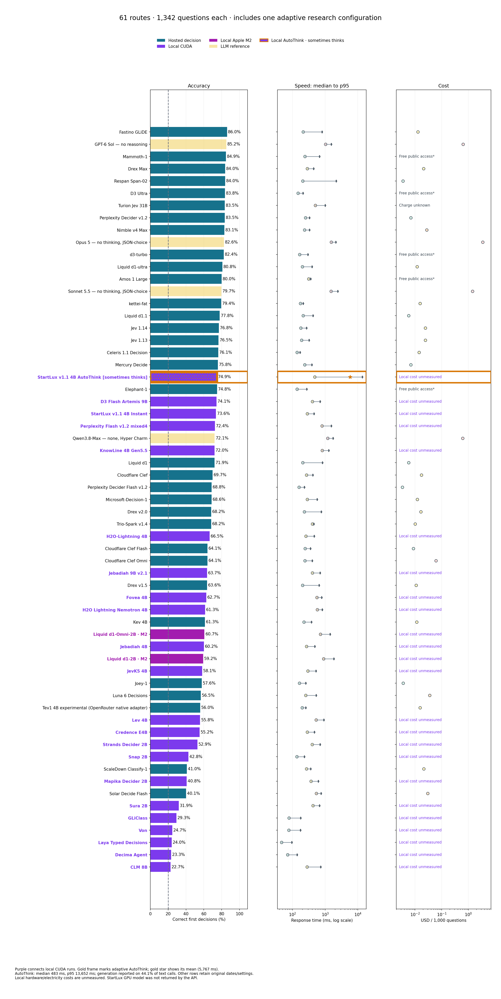
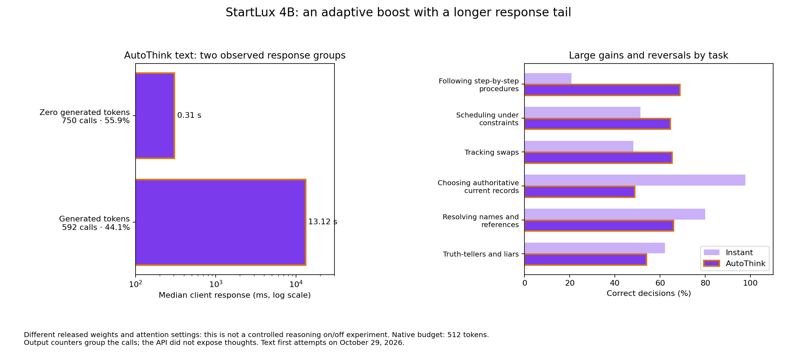
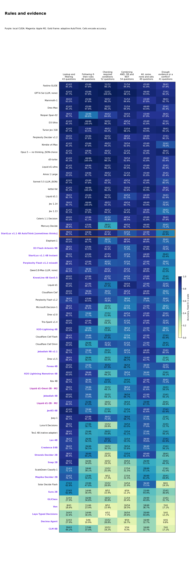
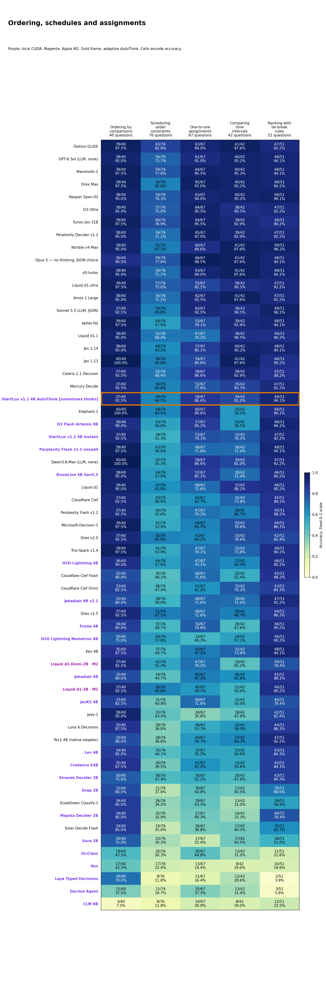
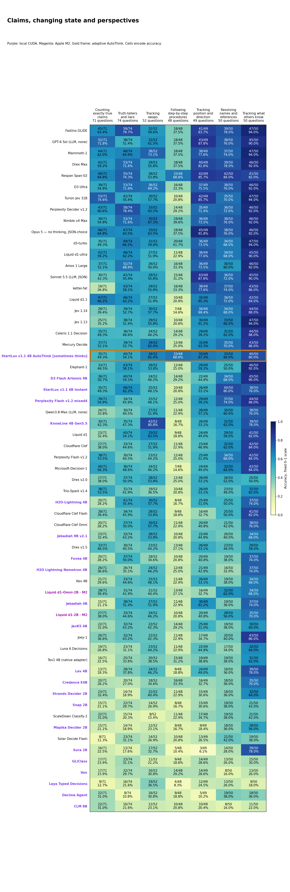
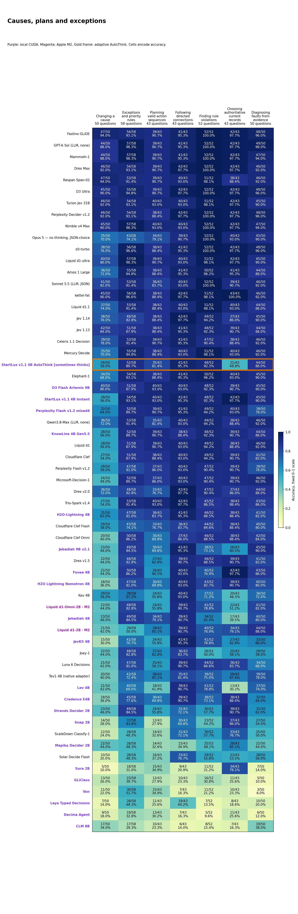
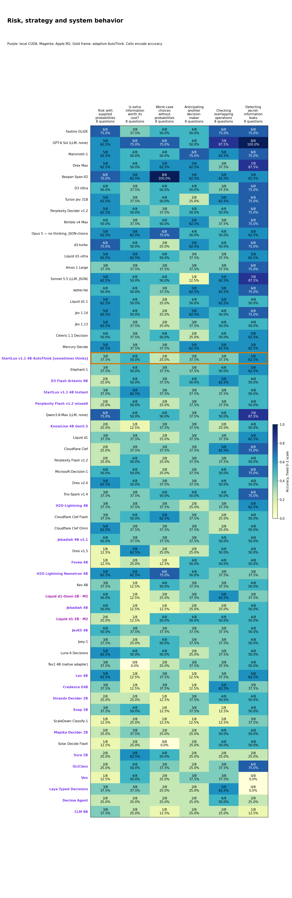

# System 1 Decision Benchmark

**61 configurations on the same 1,342 text questions across 31 categories:** 33 hosted decision models, 23 immediate local configurations, one adaptive local AutoThink model, and four selected no-reasoning LLM references. Updated October 30, 2026.

**Fastino GLiDE leads overall at 86.0%. D3 Flash Artemis leads the immediate local configurations at 74.1%. StartLux AutoThink reaches 74.9% with generation on 44.1% of text calls.**

[Interactive report](https://etsabary.github.io/system-1-decision-benchmark/report.html) · [AutoThink: immediate decisions and adaptive generation](https://etsabary.github.io/system-1-decision-benchmark/report.html#adaptive) · [Named categories](https://etsabary.github.io/system-1-decision-benchmark/report.html#functions)

Purple connects the local CUDA runs; magenta identifies Apple M2; blue identifies hosted decisions; pale yellow identifies LLM references. **The purple AutoThink bar has a gold frame and dot pattern because it sometimes generates.** Speed/cost bands and accuracy colors retain their fixed meanings. Hardware, routes and dates stay labelled.

## Complete comparison

| Model | Setting | Correct / 1342 | Accuracy | Mean | Median | p95 | Cost / 1000 | Bank cost / basis |
| --- | --- | --- | --- | --- | --- | --- | --- | --- |
| Fastino GLiDE | Hosted decision | 1154/1342 | 86.0% | 343 ms | 213 ms | 802 ms | ~$0.012960 | ~$0.017392 |
| GPT-6 Sol — no reasoning | 🟡 LLM reference | 1143/1342 | 85.2% | — | 1,023 ms | 1,546 ms | $0.632112 | $0.848294 |
| Mammoth-1 | Hosted decision | 1139/1342 | 84.9% | 301 ms | 240 ms | 666 ms | Promotional free access* | Promotional free access* |
| Drex Max | Hosted decision | 1127/1342 | 84.0% | 290 ms | 286 ms | 445 ms | $0.021180 | $0.028423 |
| Respan Span-02 | Hosted decision | 1127/1342 | 84.0% | — | 206 ms | 2,157 ms | $0.003537 | $0.004746 |
| D3 Ultra | Hosted decision | 1124/1342 | 83.8% | 174 ms | 148 ms | 211 ms | Free public access* | Free public access* |
| Turion Jev 31B | Hosted decision | 1121/1342 | 83.5% | 567 ms | 502 ms | 1,006 ms | Unknown monetary charge | Unknown monetary charge |
| Perplexity Decider v1.2 | Hosted decision | 1120/1342 | 83.5% | — | 249 ms | 332 ms | $0.007000 + ? | $0.009394 + ? |
| Nimble v4 Max | Hosted decision | 1115/1342 | 83.1% | — | 235 ms | 329 ms | $0.027633 | ~$0.037084 |
| Opus 5 — no thinking, JSON-choice | 🟡 LLM reference | 1109/1342 | 82.6% | 1,581 ms | 1,538 ms | 2,109 ms | $3.458320 + ? | $4.641065 + ? |
| d3-turbo | Hosted decision | 1106/1342 | 82.4% | 182 ms | 165 ms | 298 ms | Free public access* | Free public access* |
| Liquid d1-ultra | Hosted decision | 1084/1342 | 80.8% | — | 200 ms | 393 ms | $0.012124 + ? | $0.016270 + ? |
| Amos 1 Large | Hosted decision | 1074/1342 | 80.0% | 306 ms | 311 ms | 360 ms | Free public access* | Free public access* |
| Sonnet 5.5 — no thinking, JSON-choice | 🟡 LLM reference | 1070/1342 | 79.7% | — | 1,506 ms | 2,424 ms | $1.433613 | $1.923908 |
| kettei-fat | Hosted decision | 1066/1342 | 79.4% | 179 ms | 174 ms | 214 ms | $0.015433 | $0.020711 |
| Liquid d1.1 | Hosted decision | 1044/1342 | 77.8% | 255 ms | 212 ms | 424 ms | $0.005773 | $0.007748 |
| Jev 1.14 | Hosted decision | 1030/1342 | 76.8% | — | 179 ms | 269 ms | $0.024571 | $0.032974 |
| Jev 1.13 | Hosted decision | 1026/1342 | 76.5% | — | 189 ms | 323 ms | $0.024571 | $0.032974 |
| Celeris 1.1 Decision | Hosted decision | 1021/1342 | 76.1% | 155 ms | 138 ms | 170 ms | ~$0.014347 | ~$0.019253 |
| Mercury Decide | Hosted decision | 1017/1342 | 75.8% | — | 238 ms | 388 ms | $0.006956 | $0.009334 |
| StartLux v1.1 4B AutoThink | ✦ Local CUDA · adaptive | 1005/1342 | 74.9% | 5,767 ms | 483 ms | 13,652 ms | Local compute cost unmeasured | Local compute cost unmeasured |
| Elephant-1 | Hosted decision | 1004/1342 | 74.8% | 164 ms | 139 ms | 272 ms | Promotional free access* | Promotional free access* |
| D3 Flash Artemis 9B | 🟣 RTX 2060 | 995/1342 | 74.1% | 441 ms | 408 ms | 701 ms | Local compute cost unmeasured | Local compute cost unmeasured |
| StartLux v1.1 4B Instant | 🟣 Local CUDA · Q8 | 988/1342 | 73.6% | 293 ms | 282 ms | 455 ms | Local compute cost unmeasured | Local compute cost unmeasured |
| Perplexity Flash v1.2 mixed4 | 🟣 RTX 2060 | 971/1342 | 72.4% | 875 ms | 798 ms | 1,526 ms | Local compute cost unmeasured | Local compute cost unmeasured |
| Qwen3.8-Max — none, Hyper Charm | 🟡 LLM reference | 967/1342 | 72.1% | — | 1,191 ms | 1,731 ms | $0.614821 + ? | $0.825090 + ? quota |
| KnowLine 4B Gen5.5 | 🟣 RTX 2060 | 966/1342 | 72.0% | 848 ms | 812 ms | 1,281 ms | Local compute cost unmeasured | Local compute cost unmeasured |
| Liquid d1 | Hosted decision | 965/1342 | 71.9% | — | 206 ms | 827 ms | $0.005773 | $0.007748 |
| Cloudflare Clef | Hosted decision | 936/1342 | 69.7% | — | 268 ms | 417 ms | $0.017594 | $0.023611 |
| Perplexity Decider Flash v1.2 | Hosted decision | 923/1342 | 68.8% | — | 159 ms | 231 ms | $0.003406 + ? | $0.004570 + ? |
| Microsoft-Decision-1 | Hosted decision | 921/1342 | 68.6% | — | 283 ms | 566 ms | $0.012237 | $0.016422 |
| Drex v2.0 | Hosted decision | 915/1342 | 68.2% | — | 232 ms | 755 ms | $0.016661 + ? | $0.022359 + ? |
| Trio-Spark v1.4 | Hosted decision | 915/1342 | 68.2% | 411 ms | 407 ms | 451 ms | $0.01016704 | $0.01364416 · trial included |
| H2O-Lightning 4B | 🟣 RTX 2060 | 892/1342 | 66.5% | 289 ms | 259 ms | 459 ms | Local compute cost unmeasured | Local compute cost unmeasured |
| Cloudflare Clef Flash | Hosted decision | 860/1342 | 64.1% | — | 245 ms | 353 ms | $0.008797 | $0.011806 |
| Cloudflare Clef Omni | Hosted decision | 860/1342 | 64.1% | — | 241 ms | 400 ms | $0.061511 + ? | $0.082547 + ? |
| Jebadiah 9B v2.1 | 🟣 RTX 2060 | 855/1342 | 63.7% | 440 ms | 405 ms | 694 ms | Local compute cost unmeasured | Local compute cost unmeasured |
| Drex v1.5 | Hosted decision | 853/1342 | 63.6% | — | 203 ms | 649 ms | $0.011160 | $0.014976 |
| Fovea 4B | 🟣 RTX 2060 | 841/1342 | 62.7% | 588 ms | 558 ms | 779 ms | Local compute cost unmeasured | Local compute cost unmeasured |
| H2O Lightning Nemotron 4B | 🟣 RTX 2060 | 823/1342 | 61.3% | 596 ms | 574 ms | 810 ms | Local compute cost unmeasured | Local compute cost unmeasured |
| Kev 4B | Hosted decision | 822/1342 | 61.3% | — | 225 ms | 377 ms | $0.011718 | $0.015725 |
| Liquid d1-Omni-2B · M2 | 🟣 Apple M2 | 814/1342 | 60.7% | 797 ms | 717 ms | 1,406 ms | Local compute cost unmeasured | Local compute cost unmeasured |
| Jebadiah 4B | 🟣 RTX 2060 | 808/1342 | 60.2% | 298 ms | 270 ms | 479 ms | Local compute cost unmeasured | Local compute cost unmeasured |
| Liquid d1-2B · M2 | 🟣 Apple M2 | 795/1342 | 59.2% | 989 ms | 898 ms | 1,848 ms | Local compute cost unmeasured | Local compute cost unmeasured |
| JevK5 4B | 🟣 RTX 2060 | 780/1342 | 58.1% | 323 ms | 296 ms | 525 ms | Local compute cost unmeasured | Local compute cost unmeasured |
| Joey-1 | Hosted decision | 773/1342 | 57.6% | 179 ms | 163 ms | 256 ms | $0.003610 | $0.004845 |
| Luna 6 Decisions | Hosted decision | 758/1342 | 56.5% | — | 254 ms | 527 ms | $0.035840 + ? | $0.048097 + ? |
| Tev1 4B experimental (OpenRouter native adapter) | Hosted decision | 751/1342 | 56.0% | — | 198 ms | 253 ms | $0.015657 | $0.021011 |
| Lev 4B | 🟣 RTX 2060 | 749/1342 | 55.8% | 570 ms | 532 ms | 914 ms | Local compute cost unmeasured | Local compute cost unmeasured |
| Credence E4B | 🟣 RTX 2060 | 741/1342 | 55.2% | 315 ms | 284 ms | 464 ms | Local compute cost unmeasured | Local compute cost unmeasured |
| Strands Decider 2B | 🟣 RTX 2060 | 710/1342 | 52.9% | 435 ms | 403 ms | 703 ms | Local compute cost unmeasured | Local compute cost unmeasured |
| Snap 2B | 🟣 RTX 2060 | 574/1342 | 42.8% | 157 ms | 136 ms | 229 ms | Local compute cost unmeasured | Local compute cost unmeasured |
| ScaleDown Classify-1 | Hosted decision | 550/1342 | 41.0% | — | 268 ms | 362 ms | $0.021388 | $0.028703 |
| Mapika Decider 2B | 🟣 RTX 2060 | 547/1342 | 40.8% | 381 ms | 371 ms | 613 ms | Local compute cost unmeasured | Local compute cost unmeasured |
| Solar Decide Flash | Hosted decision | 538/1342 | 40.1% | — | 540 ms | 747 ms | $0.030203 + ? | $0.040532 + ? |
| Sura 2B | 🟣 RTX 2060 | 428/1342 | 31.9% | 436 ms | 425 ms | 672 ms | Local compute cost unmeasured | Local compute cost unmeasured |
| GLiClass | 🟣 RTX 2060 | 393/1342 | 29.3% | 92 ms | 79 ms | 178 ms | Local compute cost unmeasured | Local compute cost unmeasured |
| Von | 🟣 RTX 2060 | 331/1342 | 24.7% | 96 ms | 77 ms | 174 ms | Local compute cost unmeasured | Local compute cost unmeasured |
| Laya Typed Decisions | 🟣 RTX 2060 | 322/1342 | 24.0% | 53 ms | 46 ms | 95 ms | Local compute cost unmeasured | Local compute cost unmeasured |
| Decima Agent | 🟣 RTX 2060 | 313/1342 | 23.3% | 81 ms | 71 ms | 138 ms | Local compute cost unmeasured | Local compute cost unmeasured |
| CLM 8B | 🟣 RTX 2060 | 304/1342 | 22.7% | 324 ms | 282 ms | 726 ms | Local compute cost unmeasured | Local compute cost unmeasured |

Median is the midpoint response time. p95 is the time within which 95% of measured responses completed; it exposes slower responses that a median can hide. The plot uses a gold star for AutoThink’s mean. Local compute costs are unmeasured; unknown charges are not treated as zero.

## October 30: Joey-1 and an extraction-model comparison

Joey-1 scored **773/1,342 (57.6%)**, with a **179 ms mean, 163 ms median and 256 ms p95**. All first attempts returned usable native decisions. OpenRouter reported **$0.00484453** for the full bank, or **$0.00360993 per 1,000 questions**. The reported output-token counter was one per decision; the native endpoint returned no prose or reasoning trace.

The larger Baseten models remain substantially more accurate: **Mammoth-1 84.9%** and **Elephant-1 74.8%**. Their recorded medians were 240 and 139 ms. Those October 21 runs used Baseten directly; Joey used OpenRouter on October 30. Dates and routes remain visible, so these speeds do not isolate model size. The earlier promotional access is not a permanent production price.

Joey was strong on comparisons (**38/40**) and forward conditionals (**42/46**). One-to-one assignments, such as matching people to roles under constraints, fell to **24/67**, versus Mammoth's 64 and Elephant's 60. Sequential procedures scored **11/48**. Its lower cost did not approach the leading models' accuracy on this bank.

**Clairic is reported separately as an extraction adapter.** It returned an integer option ID through OpenRouter's Extractions API and scored **729/1,342 (54.3%)**, with **293 / 263 / 444 ms mean / median / p95** and **$0.05851030** reported cost. Six returned numbers outside the supplied option IDs and count as unsuccessful. Directed reachability, following one-way paths, scored **40/43**; Boolean scope **13/54**, sequential procedures **12/48** and exact truth counting **21/71**. This measures the adapted interface, not a native choice endpoint.

The leaders and their earlier measurements are unchanged. [Clairic's labelled results and category scores](results/releases/native_additions_2026-10-30/clairic.html) are outside the native decision ranking.

## The overall leaders remain unchanged

Fastino GLiDE leads at **1,154/1,342 (86.0%)**, followed by GPT-6 Sol without reasoning at **1,143 (85.2%)** and Mammoth-1 at **1,139 (84.9%)**. Turion Jev 31B adds **1,121 (83.5%)**: one answer above Perplexity Decider v1.2, three below D3 Ultra, and six below both Respan Span-02 and Drex Max. These are results on this bank, with their original test dates and routes retained.

**D3 Flash Artemis remains the highest-scoring immediate local configuration at 995/1,342 (74.1%)** on the deliberately older RTX 2060 with 6 GB VRAM. StartLux AutoThink reaches 1,005 (74.9%) with adaptive generation, shown in the same local purple with a gold frame. StartLux Instant reaches 988 (73.6%) with a shorter 282 ms median. The StartLux API confirmed CUDA execution but did not identify the precise GPU model, so its badge records CUDA and Q8 rather than assigning unverified hardware.

## Turion handles combined rules better than multi-step procedures

Turion answered **53/54** questions about Boolean scope, **51/52** rule counterexamples and **64/67** one-to-one assignments correctly. Boolean scope asks whether conditions must hold together or whether either is enough. A rule counterexample asks which case disproves a stated claim. One-to-one assignment asks how to match people or objects when each can be used once.

It scored **10/48** on sequential procedures, **41/74** on truth-teller consistency and **30/52** on object swaps. Following a sequence of updates remains a different ability from applying a well-specified logical rule. Its mean / median / p95 were **567 / 502 / 1,006 ms**. All 1,342 responses were usable. Monetary charges were not returned, so the cost is recorded as unknown.

## Trio-Spark is fast and inexpensive, with a lower overall score

Trio-Spark scored **915/1,342 (68.2%)**, with **411 / 407 / 451 ms** mean / median / p95. Its strongest results include following directed links **42/43**, comparisons **39/40**, and lookup **40/43**. Object swaps scored **19/52**, truth-teller consistency **31/74**, and sequential procedures **10/48**.

The requested v1.3 alias returned `trio-spark-2026-10-28`; MachineFi identifies that served release as v1.4. One HTTP 429 and one context-length HTTP 413 remain unsuccessful first attempts. No scored questions were retried or shortened. The recorded charge was **$0.013644162 for the bank**, including 99 free trial calls; normalized to 1,000 questions, **$0.01016704**. At the listed tariff, the same recorded input-token total before the trial allowance is $0.01478757.

## AutoThink keeps the immediate path and sometimes adds generation

The [StartLux implementation](https://github.com/StartLuxLabs/StartLux-Decision) describes a probability gate: an AutoThink model can return an immediate decision when sufficiently sure, or generate a thought and read the answer again. This creates an adaptive route between immediate decisions and deliberation. The exact gate used by this local adapter was not exposed.

In these text calls, **750/1,342 (55.9%) reported zero generated tokens**, with a **306 ms median**. **592 (44.1%) reported generation**, with a **13.12 s median**. AutoThink remains in the main comparison because it retains an immediate decision path, with its adaptive status visible on every view. Generation occurred often enough here that “occasional boost” needs the measured proportion alongside it.

Its overall **483 ms median** hides a long tail: **5,767 ms mean** and **13,652 ms p95**. Its mean was **19.7 times Instant's**. The API reported 288,706 output tokens; 491 calls reported exactly the native 512-token budget. It did not expose the thought or a budget-exhaustion flag. Counts alone do not show the content of the reasoning or whether a thought was unfinished.

## The adaptive variant changes which tasks succeed

AutoThink scored **33/48** on sequential procedures, compared with Instant's **10/48**. These questions require applying instructions through successive changes—for example, updating counters in order when a later action depends on the new value. Scheduling rose **39/76 → 49/76**, object swaps **25/52 → 34/52**, and spatial tracking **26/49 → 33/49**.

There were reversals: choosing which authorised record governs fell **42/43 → 21/43**, reference binding **40/50 → 33/50**, and truth-teller consistency **46/74 → 40/74**. AutoThink uniquely answered 122 questions correctly, Instant uniquely answered 105, both answered 883 correctly, and both missed 232. The net gain is **17 answers, or 1.27 percentage points**.

AutoThink's procedure score ties **Respan's 33/48**, the highest observed here. Respan reached that score without reported generation. The result supports investigating selective extra computation, but does not establish that generation is necessary for these tasks. Instant and AutoThink are different released weights with different prompt attention; this is a comparison of the two served variants, rather than a controlled reasoning toggle on identical weights.

## Images are relevant as a separate matched subset

Trio-Spark and both local StartLux routes accept one image per request. They completed the same **177 single-image questions**; **23 multi-image questions** were unsupported. Trio scored **106/177 (59.9%)**, Instant **101 (57.1%)**, and AutoThink **108 (61.0%)**. AutoThink's image median was **8.36 s**, compared with Instant's **387 ms**, and it reported generation on 99/177 calls. Its image run completed under the explicit adaptive-research speed exception.

On those same 177 items, earlier Amos scored **138 (78.0%)**, Fastino **136 (76.8%)**, and D3 Turbo **132 (74.6%)**, recomputed from their existing records. These subset results appear in the [image report](https://etsabary.github.io/visual-decision-benchmark/report.html#single-image-subset), alongside the separate full 200-question ranking. Turion failed the image-binding probes on the tested endpoint and received no image score.

## Category scores and explanations

The 31 categories are grouped below so the labels and values remain readable. These are reading groups, not new scored categories. All 61 routes remain in overall-score order. Every cell shows **correct / questions and percentage**. Darker blue means higher accuracy on a fixed 0-100% scale; uniform random guessing averages 20%. Different category sizes mean that percentages alone do not show how much evidence is available.

[Open the color-coded, selectable tables](https://etsabary.github.io/system-1-decision-benchmark/report.html#functions), with a pinned model-name column and individual category rankings.

### Rules and evidence

Which facts meet a rule, which conclusions follow, and when is the evidence insufficient?

| Category | Questions | What it tests and a simple example |
| --- | --- | --- |
| Lookup and filtering (F01) | 43 | Select records that meet stated conditions Example: Which listed request is both signed and marked urgent? |
| Following if-then rules (F02) | 46 | Apply an implication from its trigger Example: If an active badge grants entry and this badge is active, what follows? |
| Checking required conditions (F03) | 52 | Reason backward from a missing required condition Example: Every approved request needs a valid ticket; can one without a ticket be approved? |
| Combining AND, OR and NOT (F04) | 54 | Track combinations such as both, either and exactly one Example: Which choice satisfies exactly one of two stated conditions? |
| All, some, none and sets (F05) | 49 | Track all, some, none and overlapping groups Example: All teal tokens are marked; no marked token is blank; which relation follows? |
| Enough evidence or a conflict? (F11) | 41 | Determine whether facts force an answer or contradict one another Example: Is a proposed arrangement determined, impossible or still underdetermined? |

[Full-size SVG](results/releases/native_additions_2026-10-30/rules.svg) · [Color-coded table and category rankings](https://etsabary.github.io/system-1-decision-benchmark/report.html#group-rules)

### Ordering, schedules and assignments

Can the model combine comparisons, fit a schedule, assign unique partners and apply tie-break rules?

| Category | Questions | What it tests and a simple example |
| --- | --- | --- |
| Ordering by comparisons (F06) | 40 | Combine ordered comparisons Example: A is taller than B and B than C; how do A and C compare? |
| Scheduling under constraints (F07) | 76 | Fit events around order and exclusion rules Example: Which timetable puts one meeting before another without overlapping a break? |
| One-to-one assignments (F08) | 67 | Give each item a unique partner while satisfying clues Example: Assign three people different desks using location restrictions. |
| Comparing time intervals (F14) | 42 | Compare starts, ends and overlapping periods Example: Which interval overlaps a specified event without containing it? |
| Ranking with tie-break rules (F22) | 51 | Rank candidates using explicit tie-break rules Example: Rank by priority first, then age when priorities tie. |

[Full-size SVG](results/releases/native_additions_2026-10-30/ordering.svg) · [Color-coded table and category rankings](https://etsabary.github.io/system-1-decision-benchmark/report.html#group-ordering)

### Claims, changing state and perspectives

Can the model count true statements, update a changing situation and separate what different observers know?

| Category | Questions | What it tests and a simple example |
| --- | --- | --- |
| Counting exactly true claims (F09) | 71 | Count precisely how many statements hold Example: Under the supplied facts, how many of six claims are true? |
| Truth-tellers and liars (F10) | 74 | Find a consistent pattern of truthful and false statements Example: Which assignment of honest and dishonest speakers fits their claims? |
| Tracking swaps (F12) | 52 | Update locations after repeated exchanges Example: A red token starts in box A; several box contents are swapped; where does it end? |
| Following step-by-step procedures (F13) | 48 | Apply each ordered edit to the current state Example: Toggle one flag, swap two values, then conditionally reset another flag. |
| Tracking position and direction (F15) | 49 | Update position or direction from described movement Example: Follow successive turns and moves, then identify the final direction. |
| Resolving names and references (F16) | 50 | Resolve chains of names, roles and references Example: Identify the mentor of the colleague named in a nested description. |
| Tracking what others know (F17) | 50 | Distinguish what different observers witnessed Example: An object moves while one observer is absent; where will that observer look? |

[Full-size SVG](results/releases/native_additions_2026-10-30/state.svg) · [Color-coded table and category rankings](https://etsabary.github.io/system-1-decision-benchmark/report.html#group-state)

### Causes, plans and exceptions

Which actions work, which consequences change, and which rule or source controls when information conflicts?

| Category | Questions | What it tests and a simple example |
| --- | --- | --- |
| Changing a cause (F18) | 50 | Recompute consequences of changing a specified input Example: Force a switch off while holding other inputs fixed; which lamp now lights? |
| Exceptions and priority rules (F19) | 58 | Apply a rule, its exception and stated precedence Example: A badge permits entry unless a higher-priority suspension applies. |
| Planning valid action sequences (F20) | 43 | Choose an action sequence whose requirements are met Example: Obtain a key before opening a locked door, with limited moves available. |
| Following directed connections (F21) | 43 | Follow arrows in their permitted direction Example: Can node A reach node D through the listed directed links? |
| Finding rule violations (F23) | 52 | Find a case that violates a stated rule Example: Which listed record disproves the claim that every approved item is signed? |
| Choosing authoritative current records (F24) | 43 | Select the valid source rather than an outdated conflicting one Example: Two records disagree; which controls under the stated authority and date policy? |
| Diagnosing faults from evidence (F25) | 50 | Match observed symptoms to explicit fault rules Example: Which fault is consistent with the supplied test results? |

[Full-size SVG](results/releases/native_additions_2026-10-30/causes.svg) · [Color-coded table and category rankings](https://etsabary.github.io/system-1-decision-benchmark/report.html#group-causes)

### Risk, strategy and system behavior

These decisions involve uncertain outcomes, another actor, overlapping operations or possible information leaks.

**Worst-case choices without probabilities** means choosing under a specified worst-case loss or regret rule when the likelihoods of possible situations are not supplied. There is no probability distribution to average over. Each of these six categories has eight questions, so one answer changes its score by 12.5 percentage points.

| Category | Questions | What it tests and a simple example |
| --- | --- | --- |
| Risk with supplied probabilities (F26) | 8 | Choose the action with the lowest probability-weighted cost, using the supplied likelihoods and costs. Example: Which action minimizes the expected cost of a possible delay? |
| Is extra information worth its cost? (F27) | 8 | Decide whether paying for a test before choosing an action reduces the probability-weighted cost enough to cover the test price. Example: Should you buy a sensor reading before choosing an action, or is acting without the extra information cheaper overall? |
| Worst-case choices without probabilities (F28) | 8 | Follow the stated worst-case rule when likelihoods are not supplied. Minimize either the largest possible loss or the largest regret (extra loss compared with the best action for each situation), as the question specifies. Do not invent probabilities. Example: A route costs 4 in either situation; another costs 1 or 9. With no probabilities and a smallest-worst-case-cost rule, which route should be chosen? |
| Anticipating another decision-maker (F29) | 8 | Choose an action while accounting for the specified choices or payoff-maximizing response of another decision-maker. Example: Which first move gives the best result after the other player chooses their own best reply? |
| Checking overlapping operations (F30) | 8 | Decide whether overlapping operations and their reported results can fit a permitted one-at-a-time order that respects the specified timing and object rules. Example: Two processes read and change the same stored value. Could their reported results fit an allowed one-at-a-time order? |
| Detecting secret-information leaks (F31) | 8 | Check whether changing a protected secret can change an observable result in a way the stated policy forbids. Example: If public inputs stay the same, could public output distinguish two secret values that the policy says must remain indistinguishable? |

[Full-size SVG](results/releases/native_additions_2026-10-30/uncertainty.svg) · [Color-coded table and category rankings](https://etsabary.github.io/system-1-decision-benchmark/report.html#group-uncertainty)

Counts are exact; displayed percentages are rounded. A perfect result on a small sample is not a reliability guarantee. [Download the full category matrix](results/releases/native_additions_2026-10-30/category_scores.csv).

## Method and evidence

The October 30 addition uses the unchanged frozen 1,342 questions through OpenRouter, pinned to BaseTen for Joey. All 1,342 first attempts are usable. Clairic uses a separately labelled integer extraction field; six out-of-range IDs count as unsuccessful. Raw responses, request hashes, identity, coverage and category totals were reconciled offline with the frozen private key. The new answer-free timing export includes both models; no scored calls were retried.

Every full text row contains the same 1,342 first attempts across 31 categories. All 56 earlier model records retain their exact scores, timings, costs and dates. The question bank and scoring rules are unchanged. Categories have unequal sizes; the six newest have eight questions each. Related variants and author-development qualifications remain in the earlier releases.

The October 29 runs used the frozen native state, instructions and five original options, in the existing seeded order. One request at a time within each route; local models ran sequentially over direct wired LAN. Timers span request transfer through the complete response; preparation, pacing, loading and warm-ups are excluded. All dispatches were resolved. No tools, scored retries or agentic iteration. AutoThink's internal generation is explicitly included and labelled. Turion and Instant reported zero output tokens. Trio returned native typed decisions without explanatory text; its text endpoint did not return an output-token counter.

The normal two-second cumulative-median speed screen after at least 20 calls remained in effect for immediate-decision routes. AutoThink completed under a user-authorized research exception; its full accuracy, mean, median and p95 remain visible even when deliberation is slow. The native local budget was 512 tokens, with an advertised maximum of 1,024; it was not tuned during the test. Token counters are observations, not visible reasoning traces.

StartLux ran through Ollaya 0.17.0, CUDA, Q8_0, with 2,048-token context. Instant used bidirectional prompt attention; AutoThink used causal attention. Precise GPU model, driver and system RAM were not returned by this route. Previous RTX 2060 measurements retain their original confirmed user-supplied hardware label, chosen deliberately as an older accessible setup; Apple M2 measurements retain their separate magenta label. Sharing a purple local-CUDA color does not assert identical hardware. No projected speed on newer hardware is included. Local hardware and electricity costs are unmeasured.

Trio's cost is the API-reported charge including the trial allowance. Turion's monetary charge is unknown. Earlier free-access and tariff-estimate qualifications remain attached to each model. Provider load, deployment, precision, dates and network paths vary, so latency differences do not isolate model architecture. Selected LLM references retain their earlier reasoning-off settings and limitations.

Private offline audits bound the frozen answer key, reconstructed requests and reconciled category totals. Public exports supply aggregates and answer-free timing and request/response hashes, with no keys or per-item model choices. Public checks reproduce coverage, timing, token counts, cost arithmetic and category sums; they cannot independently rescore private answers. The question bank remains publicly downloadable without the scoring key.

[Aggregate statistics](results/releases/native_additions_2026-10-30/statistics.json) · [Model CSV](results/releases/native_additions_2026-10-30/model_statistics.csv) · [Category CSV](results/releases/native_additions_2026-10-30/category_scores.csv) · [New answer-free timing evidence](results/releases/native_additions_2026-10-30/october30_timing_evidence.csv) · [Execution settings](results/releases/native_additions_2026-10-30/execution_protocol.json) · [Audit receipt](results/releases/native_additions_2026-10-30/audit_receipt.json).

[Previous 56-route analysis](results/releases/local_m2_2026-10-28/analysis.md) · [Question bank](results/releases/consolidated_2026-10-19/questions_1342.csv) · [scripts/](scripts/README.md). Historical check: `python3 scripts/validate_october21_release.py`.
