# System 1 Decision Benchmark v4

This benchmark compares accuracy, latency, coverage and cost for fixed-option decision tasks. V4 contains **2,157 questions across 43 categories**: the unchanged 2,017-question v3 bank plus 140 source-key-supported AQuA questions. The 23 numerical-pattern and 200 quantitative questions are borrowed; the earlier project bank is predominantly project-developed. The previously measured 26 configurations remain in the downloads; newly measured models are added on the same full bank. Main comparisons use a 62% operational-accuracy cutoff.

**Source and rights:** AQuA-RAT is crowdsourced admissions-style mathematics under its repository’s Apache-2.0 terms; it is not a set of authenticated official GRE or SAT questions. MAIQ’s repository declares MIT, but its authors collected questions from human IQ tests and the original rights holders for these 23 sequences are not established. The owner elected to include the sequences with that qualification. The project MIT license does not supersede these sources’ terms. [Detailed provenance and notices](results/releases/system1_v4_prism_2026-11-05/SOURCE_AND_LICENSES.md).

[Interactive v4 report](https://etsabary.github.io/system-1-decision-benchmark/v4/report.html) · [Category rankings](https://etsabary.github.io/system-1-decision-benchmark/v4/report.html#rankings) · [Cost evidence](https://etsabary.github.io/system-1-decision-benchmark/v4/report.html#cost)

## Reading the comparison

Teal, purple and gold denote hosted decision, local and reasoning-disabled LLM configurations. The category scale is fixed from 0–100%; each cell shows correct/total, and ★ marks all tied leaders. Speed and cost use 🟩 green / 🟨 yellow / 🟧 orange / 🟥 red bands: median or p95 ≤250 / ≤500 / ≤1,000 / >1,000 ms; cost ≤$0.010 / ≤$0.025 / ≤$0.050 / >$0.050 per 1,000 questions. ⬜ means the cost is unmetered or unknown. “+ ?” denotes missing charges; known totals may include tariff estimates rather than receipts.

## Main comparison

### Accuracy

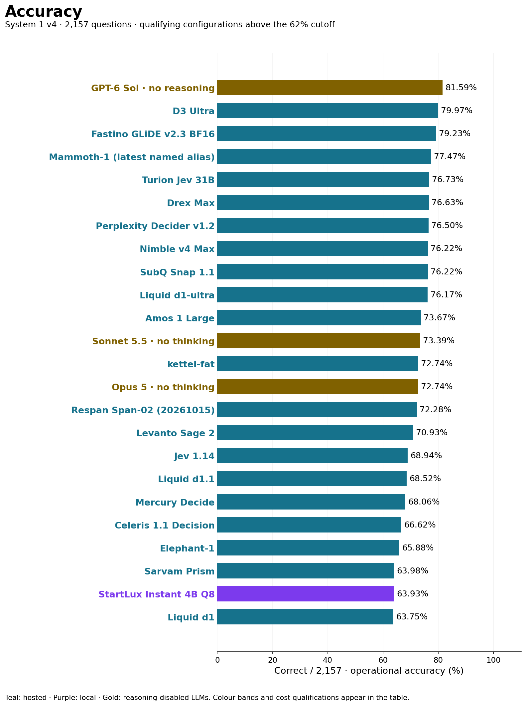

| Configuration | Correct / 2,157 | Accuracy | Median | p95 | Total known cost | Cost / 1,000 | Usable | Cost evidence |
|---|---:|---:|---:|---:|---:|---:|---:|---|
| GPT-6 Sol · no reasoning | 1760/2,157 | 81.59% | 🟧 992 ms | 🟥 1,527 ms | 🟥 $1.96117 | 🟥 $0.90921 | 2157/2,157 | 2157 reported; 0 estimates; 0 free-access; 0 unknown |
| D3 Ultra | 1725/2,157 | 79.97% | 🟩 163 ms | 🟨 298 ms | ⬜ Free access + ? | ⬜ Free access + ? | 2157/2,157 | 0 reported; 0 estimates; 1934 free-access; 223 unknown |
| Fastino GLiDE v2.3 BF16 | 1709/2,157 | 79.23% | 🟩 213 ms | 🟧 602 ms | 🟨 $0.03905 | 🟨 $0.01811 | 2157/2,157 | 0 reported; 2157 estimates; 0 free-access; 0 unknown |
| Mammoth-1 (latest named alias) | 1671/2,157 | 77.47% | 🟩 199 ms | 🟧 691 ms | 🟨 $0.05286 + ? | 🟨 $0.02451 + ? | 2156/2,157 | 0 reported; 591 estimates; 1342 free-access; 224 unknown |
| Turion Jev 31B | 1655/2,157 | 76.73% | 🟧 505 ms | 🟥 1,006 ms | 🟩 $0.00110 + ? | 🟩 $0.00051 + ? | 2156/2,157 | 140 reported; 0 estimates; 0 free-access; 2017 unknown |
| Drex Max | 1653/2,157 | 76.63% | 🟨 317 ms | 🟥 1,106 ms | 🟧 $0.06185 + ? | 🟧 $0.02867 + ? | 2148/2,157 | 2148 reported; 0 estimates; 0 free-access; 9 unknown |
| Perplexity Decider v1.2 | 1650/2,157 | 76.50% | 🟩 247 ms | 🟨 374 ms | 🟩 $0.02064 + ? | 🟩 $0.00957 + ? | 2156/2,157 | 2156 reported; 0 estimates; 0 free-access; 1 unknown |
| Nimble v4 Max | 1644/2,157 | 76.22% | 🟩 238 ms | 🟨 342 ms | 🟧 $0.05784 + ? | 🟧 $0.02681 + ? | 2156/2,157 | 0 reported; 1933 estimates; 0 free-access; 224 unknown |
| SubQ Snap 1.1 | 1644/2,157 | 76.22% | 🟩 177 ms | 🟩 208 ms | 🟨 $0.04130 | 🟨 $0.01915 | 2157/2,157 | 0 reported; 2157 estimates; 0 free-access; 0 unknown |
| Liquid d1-ultra | 1643/2,157 | 76.17% | 🟩 203 ms | 🟨 427 ms | 🟨 $0.03743 + ? | 🟨 $0.01735 + ? | 2155/2,157 | 2155 reported; 0 estimates; 0 free-access; 2 unknown |
| Amos 1 Large | 1589/2,157 | 73.67% | 🟨 327 ms | 🟧 912 ms | ⬜ Free access + ? | ⬜ Free access + ? | 2157/2,157 | 0 reported; 0 estimates; 1934 free-access; 223 unknown |
| Sonnet 5.5 · no thinking | 1583/2,157 | 73.39% | 🟥 1,430 ms | 🟥 2,303 ms | 🟥 $3.91583 | 🟥 $1.81540 | 2157/2,157 | 2157 reported; 0 estimates; 0 free-access; 0 unknown |
| kettei-fat | 1569/2,157 | 72.74% | 🟩 180 ms | 🟨 310 ms | 🟨 $0.05042 | 🟨 $0.02338 | 2157/2,157 | 2157 reported; 0 estimates; 0 free-access; 0 unknown |
| Opus 5 · no thinking | 1569/2,157 | 72.74% | 🟥 1,551 ms | 🟥 2,157 ms | 🟥 $8.47216 + ? | 🟥 $3.92775 + ? | 1972/2,157 | 1974 reported; 0 estimates; 0 free-access; 183 unknown |
| Respan Span-02 (20261015) | 1559/2,157 | 72.28% | 🟨 256 ms | 🟥 2,143 ms | 🟩 $0.01069 | 🟩 $0.00496 | 2157/2,157 | 2157 reported; 0 estimates; 0 free-access; 0 unknown |
| Levanto Sage 2 | 1530/2,157 | 70.93% | 🟩 228 ms | 🟨 345 ms | 🟨 $0.04674 | 🟨 $0.02167 | 2157/2,157 | 0 reported; 2157 estimates; 0 free-access; 0 unknown |
| Jev 1.14 | 1487/2,157 | 68.94% | 🟩 177 ms | 🟨 416 ms | 🟧 $0.06461 | 🟧 $0.02995 | 2157/2,157 | 2157 reported; 0 estimates; 0 free-access; 0 unknown |
| Liquid d1.1 | 1478/2,157 | 68.52% | 🟩 195 ms | 🟨 472 ms | 🟩 $0.01783 + ? | 🟩 $0.00827 + ? | 2156/2,157 | 2156 reported; 0 estimates; 0 free-access; 1 unknown |
| Mercury Decide | 1468/2,157 | 68.06% | 🟩 250 ms | 🟧 604 ms | 🟩 $0.02067 + ? | 🟩 $0.00958 + ? | 2156/2,157 | 2156 reported; 0 estimates; 0 free-access; 1 unknown |
| Celeris 1.1 Decision | 1437/2,157 | 66.62% | 🟩 140 ms | 🟩 218 ms | 🟨 $0.04073 + ? | 🟨 $0.01888 + ? | 2157/2,157 | 0 reported; 1934 estimates; 0 free-access; 223 unknown |
| Elephant-1 | 1421/2,157 | 65.88% | 🟩 127 ms | 🟨 269 ms | 🟩 $0.01856 + ? | 🟩 $0.00860 + ? | 2157/2,157 | 0 reported; 592 estimates; 1342 free-access; 223 unknown |
| Sarvam Prism | 1380/2,157 | 63.98% | 🟨 407 ms | 🟨 465 ms | 🟨 $0.04194 | 🟨 $0.01944 | 2157/2,157 | 0 reported; 2157 estimates; 0 free-access; 0 unknown |
| StartLux Instant 4B Q8 | 1379/2,157 | 63.93% | 🟨 306 ms | 🟧 850 ms | ⬜ Unmetered local | ⬜ Unmetered local | 2157/2,157 | Hardware and electricity unmeasured |
| Liquid d1 | 1375/2,157 | 63.75% | 🟩 183 ms | 🟧 759 ms | 🟩 $0.01784 | 🟩 $0.00827 | 2157/2,157 | 2157 reported; 0 estimates; 0 free-access; 0 unknown |

**Prism cost and retries:** Prism’s selected answers used an estimated ₹3.774356 in input-token charges, using the published ₹4 per million input tokens; USD comparisons use Sarvam’s illustrative ₹90 per USD. This is an estimate, excluding tax and charges for failed requests, not a billing receipt. 129 no-answer transient failures preceded selected answers; their latency and retry waits are excluded from response times.

**Sage 2 response detail:** Two returned choices disagreed with the highest probability in the same response; both returned choices were incorrect and were scored as received. Substituting the highest probabilities would add two correct answers.

Operational accuracy counts unusable requests as not correct; it does not establish what answer a model would have given. The report shows coverage and results among usable responses. Timings pool individual primary records and include failed requests and network time. Data were collected on different dates and routes. A coloured known cost with + ? is only a subtotal.

## Comparison graphs

Each graph uses the same overall ordering and is shown separately so its labels remain readable.

### Response time

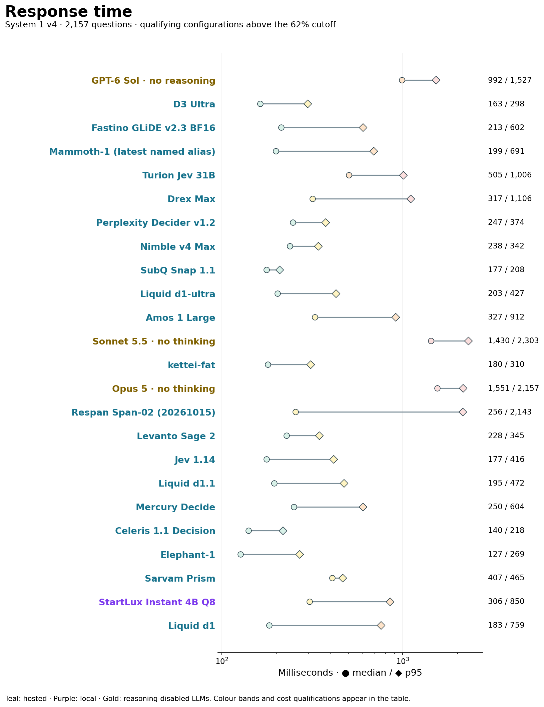

### Cost per 1,000 questions

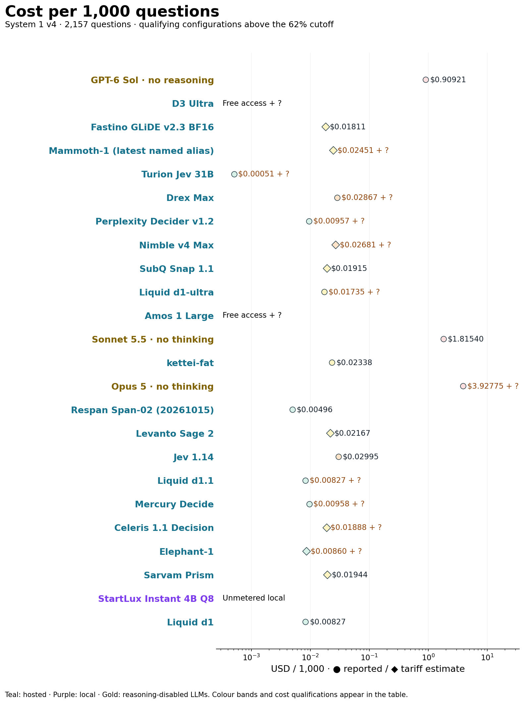

## Category results


### Rules, evidence and logical scope

F01 Lookup and filtering; F02 Forward conditionals; F03 Necessary conditions; F04 Boolean scope; F05 Quantifiers and sets; F11 Sufficiency and inconsistency.

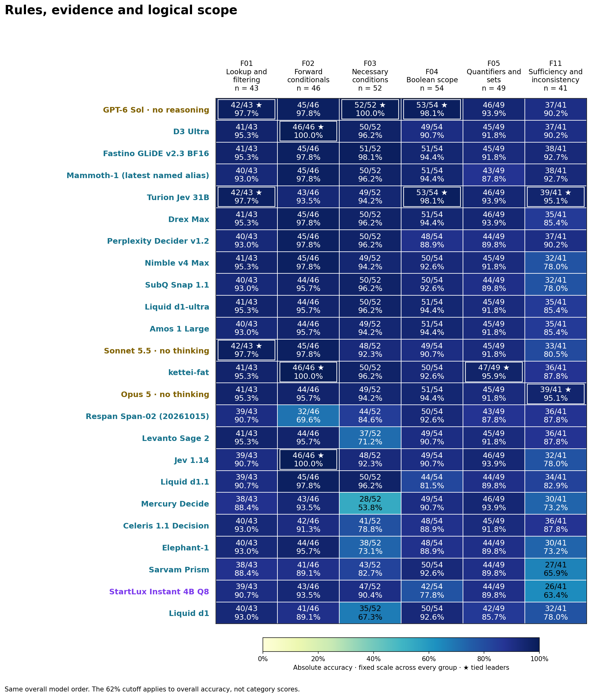

### Ordering, schedules and assignments

F06 Comparisons; F07 Scheduling; F08 One-to-one assignments; F14 Temporal intervals; F22 Preference ordering.

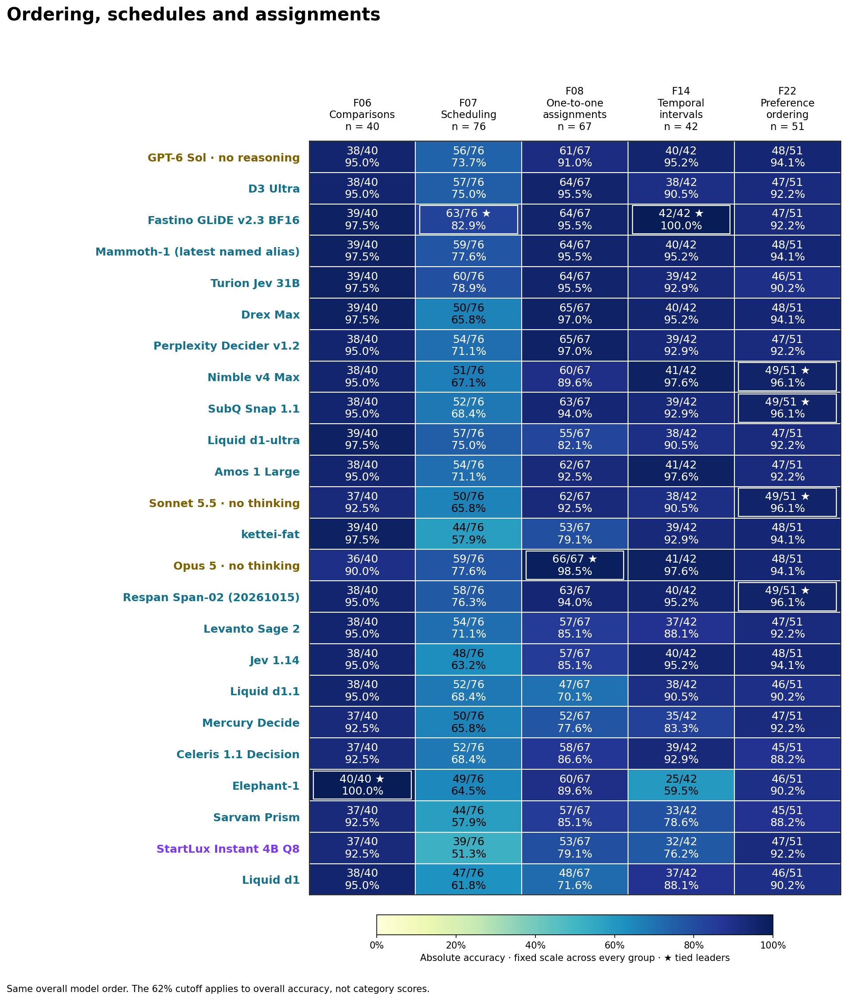

### State tracking and perspectives

F09 Exact truth counting; F10 Truth-teller consistency; F12 Object swaps; F13 Sequential procedures; F15 Spatial tracking; F16 Reference binding; F17 Beliefs and perspectives.

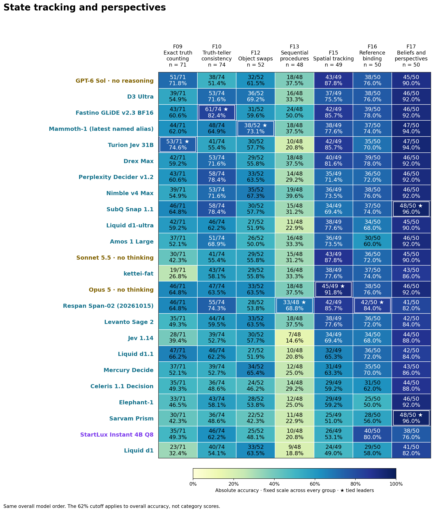

### Causes, plans and authoritative evidence

F18 Causal intervention; F19 Exceptions and priorities; F20 Planning; F21 Directed reachability; F23 Rule counterexamples; F24 Authority and stale records; F25 Fault diagnosis.

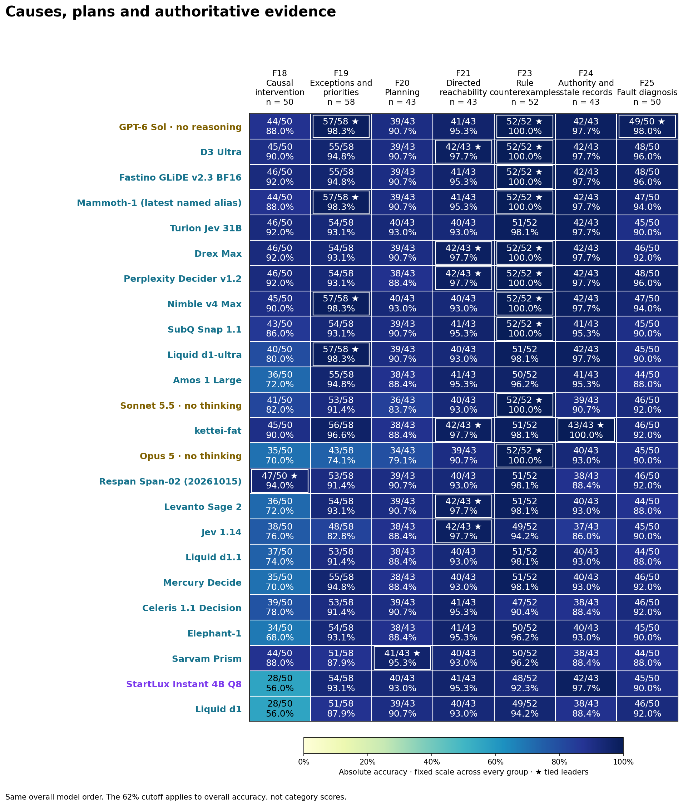

### Decisions under uncertainty

F26 Probabilistic risk; F27 Value of information; F28 Robust decisions without a prior; F29 Strategic decisions; F30 Concurrent-history consistency; F31 Information-flow security.

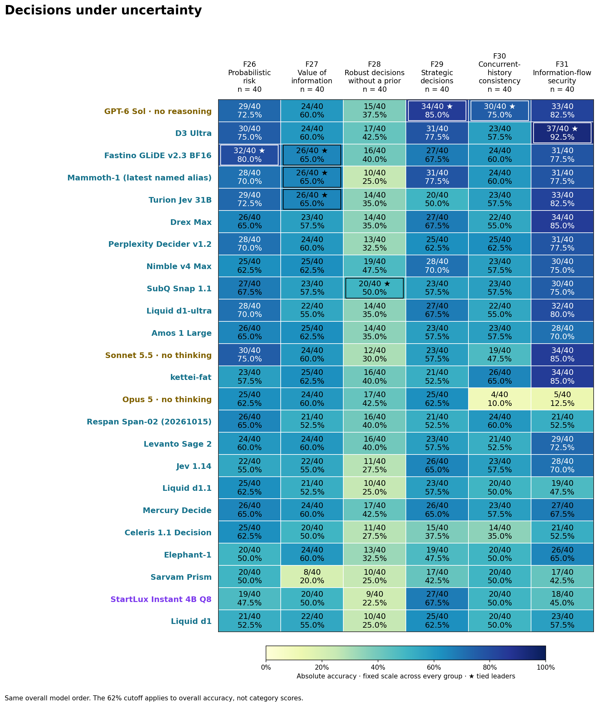

### Practical decisions: scope, policy and actions

P01 Understanding requests and routing; P02 Recognizing multiple requested actions; P03 Tracking current conversational intention; P04 Selecting a tool or requesting clarification; P05 Checking authorization and scope.

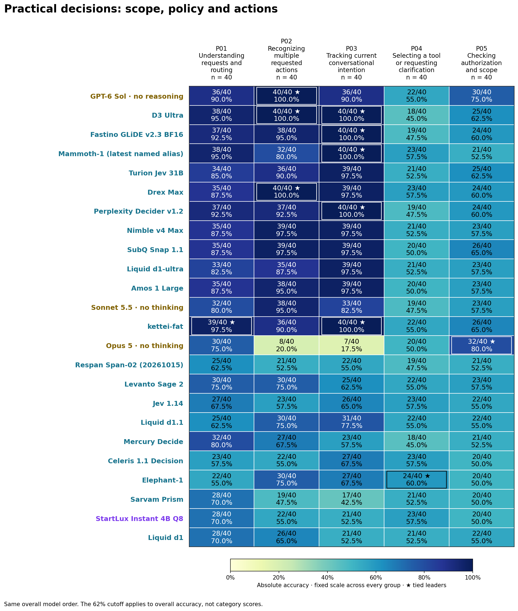

### Practical decisions: evidence, security and quality

P06 Making decisions with untrusted content; P07 Applying a contextual content policy; P08 Extracting and normalizing facts; P09 Checking claims against supplied evidence; P10 Assigning severity or priority from a rubric.

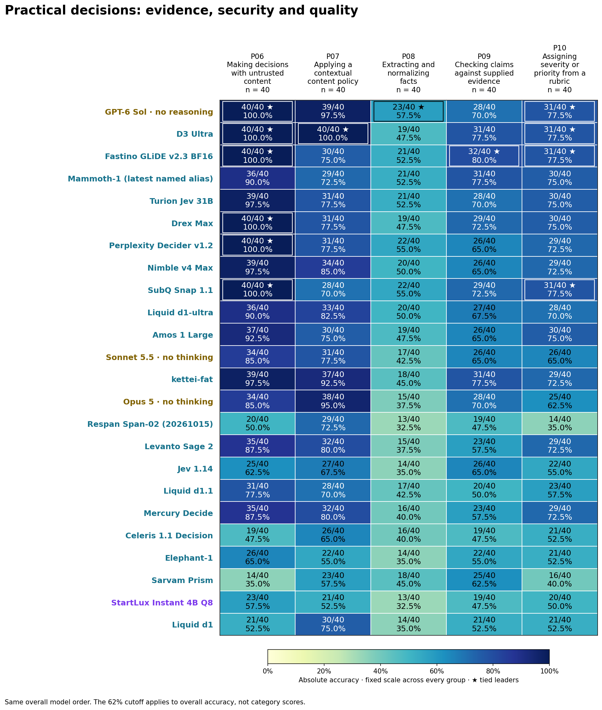

### IQ sequences and admissions-style mathematics

F32 Numerical pattern recognition; F33 Quantitative reasoning.

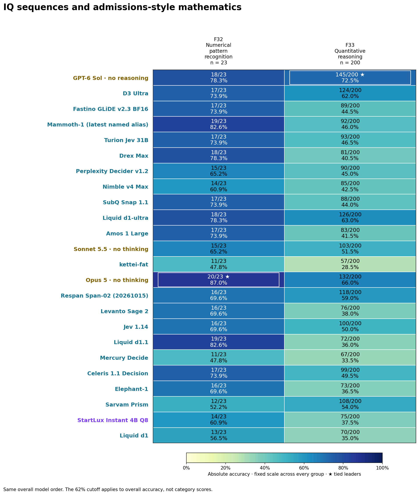

## Below the cutoff

- D3 Artemis 9B IQ3_M: 1322/2,157 (61.29%); coverage 92.17%.
- Microsoft-Decision-1: 1315/2,157 (60.96%); coverage 100.00%.
- Cloudflare Clef: 1299/2,157 (60.22%); coverage 100.00%.
- Drex v2.0: 1296/2,157 (60.08%); coverage 95.69%.
- Cerno 4B v1.2 NF4: 1276/2,157 (59.16%); coverage 93.00%.
- meraGPT Decider 1: 620/2,157 (28.74%); coverage 100.00%.

**Strike 1 — incomplete 100-question screen:** 57/100 correct (57%); SubQ scored 77/100 and Sage 2 scored 74/100 on the same inputs. Median response time was 626 ms; all responses reported zero EUR charges. This is not a full-bank score or a 62% cutoff classification. [Screen method and details](results/releases/system1_v4_prism_2026-11-05/STRIKE_SCREEN_NOTES.md).

**Hanzo Kai 1.9 — stopped partial test:** 46/244 correct (18.85%); SubQ scored 190/244 (77.87%) on the same inputs. This is an incomplete sample, not a full-bank score or a 62% cutoff classification. Hanzo first limited the free run to 50 answers, then imposed an eight-hour usage window after prepaid credits were purchased. The user stopped testing. The API marked 31 inputs beyond its stated training length. [Usage limits and method](results/releases/system1_v4_prism_2026-11-05/KAI_CASE_NOTE.md).

**Additional incomplete local screens:** THIS/THAT 1.2 (FP16) stopped at 32/100 correct, with a 282 ms median; SubQ scored 77/100 on the same inputs. GLiNER2.5-Decide (FP32, 512-token limit) stopped after 4 correct of 14 usable answers and 6 length rejections in 20 attempts; its 116 ms median covers usable answers only. These partial screens are not full-bank scores or cutoff classifications. [Screen methods and limits](results/releases/system1_v4_prism_2026-11-05/LOCAL_SCREEN_NOTES.md).

**Further incomplete local screens:** Hindsight FP16: 29/100 correct, 273 ms median; Lumma v2 NF4: 452/799 attempts correct, including one unavailable request, 549 ms median on usable answers. These are partial screens, not full-bank scores or cutoff classifications. [Methods and limitations](results/releases/system1_v4_prism_2026-11-05/NEW_LOCAL_SCREEN_NOTES.md).

## Question selection

The quantitative category includes 60 questions selected for errors by Fastino and D3 Artemis and 140 selected for errors by at least one of Fastino, Mammoth, GPT-6 Sol without reasoning, D3 Ultra and Drex Max. Selection using these models' answers can affect comparisons involving them; using several models distributes, but does not eliminate, this selection bias.

## Download and reproducibility

- [Answer-free questions](results/releases/system1_v4_prism_2026-11-05/questions_2157.jsonl)
- [Question-level origins and terms](results/releases/system1_v4_prism_2026-11-05/source_metadata_2157.jsonl)
- [Source and license notes](results/releases/system1_v4_prism_2026-11-05/SOURCE_AND_LICENSES.md)
- [All model summaries](results/releases/system1_v4_prism_2026-11-05/statistics.json)
- [All model/category scores](results/releases/system1_v4_prism_2026-11-05/all_category_scores.csv)
- [Timing and status evidence](results/releases/system1_v4_prism_2026-11-05/timing_evidence.csv.gz)
- [Cost evidence](results/releases/system1_v4_prism_2026-11-05/cost_evidence.csv.gz)
- [Cost summaries](results/releases/system1_v4_prism_2026-11-05/cost_statistics.json)
- [Category guide](results/releases/system1_v4_prism_2026-11-05/category_guide.json)
- [Prior no-answer HTTP 429 recovery evidence](results/releases/system1_v4_prism_2026-11-05/transport_recoveries.json)
- [New-model recovery evidence](results/releases/system1_v4_prism_2026-11-05/model_collection_recoveries.json)
- [New-model context diagnostics](results/releases/system1_v4_prism_2026-11-05/model_context_diagnostics.json)
- [Incomplete exploratory model results](results/releases/system1_v4_prism_2026-11-05/partial_models.json)
- [Audit receipt](results/releases/system1_v4_prism_2026-11-05/audit_receipt.json)
- [Release checksums](results/releases/system1_v4_prism_2026-11-05/manifest.json)

The original [v4 release](results/releases/system1_v4_2026-11-02/report.html), [v3 release](results/releases/system1_v3_presentation_2026-11-01/report.html) and [v2 release](results/releases/system1_v2_presentation_2026-11-01/report.html) remain unchanged. The separate 120 companion diagnostics are not included. Model choices and the scoring key remain private. Public questions may occur in training data; scores are not human IQ norms.

The [scripts/](scripts/README.md) support offline validation without model credentials:

```sh
python3 scripts/validate_system1_v4_hosted.py results/releases/system1_v4_prism_2026-11-05 results/releases/system1_v4_2026-11-02
python3 scripts/validate_october21_release.py
```
