# System 1 Decision Benchmark v3

This benchmark compares accuracy, latency, coverage and cost for fixed-option decision tasks. V3 contains **2,017 questions across 43 categories**: the unchanged 1,934-question v2 bank, 23 borrowed number-sequence questions and 60 borrowed quantitative questions. Of the 26 configurations measured for v2’s main comparison, **23 meet the 62% operational-accuracy cutoff** on v3; all 26 remain in the downloads.

**Selection bias:** all 60 quantitative additions were selected because Fastino and D3 Artemis previously missed them. Their scores on that subset—and their v3 totals—are affected by this selection and are not unbiased measures of general quantitative ability.

**Source and rights:** AQuA-RAT is crowdsourced admissions-style mathematics under its repository’s Apache-2.0 terms; it is not a set of authenticated official GRE or SAT questions. MAIQ’s repository declares MIT, but its authors collected questions from human IQ tests and the original rights holders for these 23 sequences are not established. The owner elected to include the sequences with that qualification. The project MIT license does not supersede these sources’ terms. [Detailed provenance and notices](results/releases/system1_v3_presentation_2026-11-01/SOURCE_AND_LICENSES.md).

[Interactive v3 report](https://etsabary.github.io/system-1-decision-benchmark/v3/report.html) · [Category rankings](https://etsabary.github.io/system-1-decision-benchmark/v3/report.html#rankings) · [Cost evidence](https://etsabary.github.io/system-1-decision-benchmark/v3/report.html#cost) · [Readability audit](documents/V3_PRESENTATION_READABILITY_AUDIT_2026_11_01.md)

## Reading the comparison

Teal, purple and gold denote hosted decision, local and reasoning-disabled LLM configurations. The category scale is fixed from 0–100%; each cell shows correct/total, and ★ marks all tied leaders. Speed and cost use 🟩 green / 🟨 yellow / 🟧 orange / 🟥 red bands: median or p95 ≤250 / ≤500 / ≤1,000 / >1,000 ms; cost ≤$0.010 / ≤$0.025 / ≤$0.050 / >$0.050 per 1,000 questions. ⬜ means the cost is unmetered or unknown. “+ ?” denotes missing charges; known totals may include tariff estimates rather than receipts.

## Main comparison

| Configuration | Correct / 2,017 | Accuracy | Median | p95 | Total known cost | Cost / 1,000 | Usable | Cost evidence |
|---|---:|---:|---:|---:|---:|---:|---:|---|
| GPT-6 Sol · no reasoning | 1658/2,017 | 82.20% | 🟧 999 ms | 🟥 1,547 ms | 🟥 $1.92014 | 🟥 $0.95198 | 2017/2,017 | 2017 reported; 0 estimates; 0 free-access; 0 unknown |
| D3 Ultra | 1631/2,017 | 80.86% | 🟩 165 ms | 🟨 300 ms | ⬜ Free access + ? | ⬜ Free access + ? | 2017/2,017 | 0 reported; 0 estimates; 1934 free-access; 83 unknown |
| Fastino GLiDE v2.3 BF16 | 1620/2,017 | 80.32% | 🟩 214 ms | 🟧 666 ms | 🟨 $0.03820 | 🟨 $0.01894 | 2017/2,017 | 0 reported; 2017 estimates; 0 free-access; 0 unknown |
| Mammoth-1 (latest named alias) | 1601/2,017 | 79.38% | 🟩 206 ms | 🟧 710 ms | 🟧 $0.05286 + ? | 🟧 $0.02621 + ? | 2016/2,017 | 0 reported; 591 estimates; 1342 free-access; 84 unknown |
| Drex Max | 1586/2,017 | 78.63% | 🟨 313 ms | 🟥 1,067 ms | 🟧 $0.06033 + ? | 🟧 $0.02991 + ? | 2008/2,017 | 2008 reported; 0 estimates; 0 free-access; 9 unknown |
| Turion Jev 31B | 1577/2,017 | 78.19% | 🟧 509 ms | 🟥 1,015 ms | ⬜ Unknown | ⬜ Unknown | 2016/2,017 | 2017 charges unknown |
| Perplexity Decider v1.2 | 1575/2,017 | 78.09% | 🟩 249 ms | 🟨 380 ms | 🟩 $0.02014 + ? | 🟩 $0.00999 + ? | 2016/2,017 | 2016 reported; 0 estimates; 0 free-access; 1 unknown |
| Nimble v4 Max | 1572/2,017 | 77.94% | 🟩 239 ms | 🟨 348 ms | 🟧 $0.05784 + ? | 🟧 $0.02867 + ? | 2016/2,017 | 0 reported; 1933 estimates; 0 free-access; 84 unknown |
| Liquid d1-ultra | 1545/2,017 | 76.60% | 🟩 204 ms | 🟨 441 ms | 🟨 $0.03677 + ? | 🟨 $0.01823 + ? | 2015/2,017 | 2015 reported; 0 estimates; 0 free-access; 2 unknown |
| kettei-fat | 1526/2,017 | 75.66% | 🟩 181 ms | 🟨 319 ms | 🟨 $0.04970 | 🟨 $0.02464 | 2017/2,017 | 2017 reported; 0 estimates; 0 free-access; 0 unknown |
| Amos 1 Large | 1516/2,017 | 75.16% | 🟨 324 ms | 🟧 917 ms | ⬜ Free access + ? | ⬜ Free access + ? | 2017/2,017 | 0 reported; 0 estimates; 1934 free-access; 83 unknown |
| Sonnet 5.5 · no thinking | 1505/2,017 | 74.62% | 🟥 1,453 ms | 🟥 2,326 ms | 🟥 $3.79540 | 🟥 $1.88171 | 2017/2,017 | 2017 reported; 0 estimates; 0 free-access; 0 unknown |
| Opus 5 · no thinking | 1470/2,017 | 72.88% | 🟥 1,548 ms | 🟥 2,157 ms | 🟥 $8.17224 + ? | 🟥 $4.05168 + ? | 1832/2,017 | 1834 reported; 0 estimates; 0 free-access; 183 unknown |
| Respan Span-02 (20261015) | 1469/2,017 | 72.83% | 🟩 237 ms | 🟥 2,157 ms | 🟩 $0.01044 | 🟩 $0.00517 | 2017/2,017 | 2017 reported; 0 estimates; 0 free-access; 0 unknown |
| Liquid d1.1 | 1418/2,017 | 70.30% | 🟩 198 ms | 🟧 505 ms | 🟩 $0.01752 + ? | 🟩 $0.00869 + ? | 2016/2,017 | 2016 reported; 0 estimates; 0 free-access; 1 unknown |
| Mercury Decide | 1415/2,017 | 70.15% | 🟨 251 ms | 🟧 678 ms | 🟨 $0.02019 + ? | 🟨 $0.01001 + ? | 2016/2,017 | 2016 reported; 0 estimates; 0 free-access; 1 unknown |
| Jev 1.14 | 1408/2,017 | 69.81% | 🟩 179 ms | 🟨 430 ms | 🟧 $0.06219 | 🟧 $0.03083 | 2017/2,017 | 2017 reported; 0 estimates; 0 free-access; 0 unknown |
| Elephant-1 | 1359/2,017 | 67.38% | 🟩 129 ms | 🟨 275 ms | 🟩 $0.01856 + ? | 🟩 $0.00920 + ? | 2017/2,017 | 0 reported; 592 estimates; 1342 free-access; 83 unknown |
| Celeris 1.1 Decision | 1358/2,017 | 67.33% | 🟩 140 ms | 🟩 225 ms | 🟨 $0.04073 + ? | 🟨 $0.02019 + ? | 2017/2,017 | 0 reported; 1934 estimates; 0 free-access; 83 unknown |
| Liquid d1 | 1318/2,017 | 65.34% | 🟩 186 ms | 🟧 794 ms | 🟩 $0.01752 | 🟩 $0.00869 | 2017/2,017 | 2017 reported; 0 estimates; 0 free-access; 0 unknown |
| StartLux Instant 4B Q8 | 1315/2,017 | 65.20% | 🟨 312 ms | 🟧 859 ms | ⬜ Unmetered local | ⬜ Unmetered local | 2017/2,017 | Hardware and electricity unmeasured |
| Cloudflare Clef | 1255/2,017 | 62.22% | 🟨 310 ms | 🟧 599 ms | 🟥 $0.16340 | 🟥 $0.08101 | 2017/2,017 | 2017 reported; 0 estimates; 0 free-access; 0 unknown |
| Microsoft-Decision-1 | 1252/2,017 | 62.07% | 🟨 289 ms | 🟧 759 ms | 🟨 $0.03801 | 🟨 $0.01884 | 2017/2,017 | 2017 reported; 0 estimates; 0 free-access; 0 unknown |

Operational accuracy counts unusable requests as not correct; it does not establish what answer a model would have given. The report shows coverage and results among usable responses. Timings pool individual primary records and include failed requests and network time. Data were collected on different dates and routes. A coloured known cost with + ? is only a subtotal.

## Comparison graphs

Each graph uses the same overall ordering and is shown separately so its labels remain readable.

### Accuracy

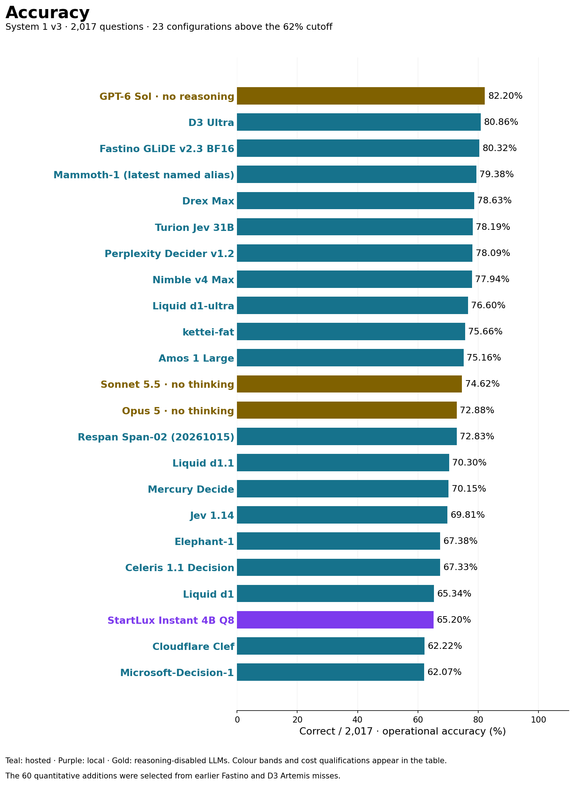

### Response time

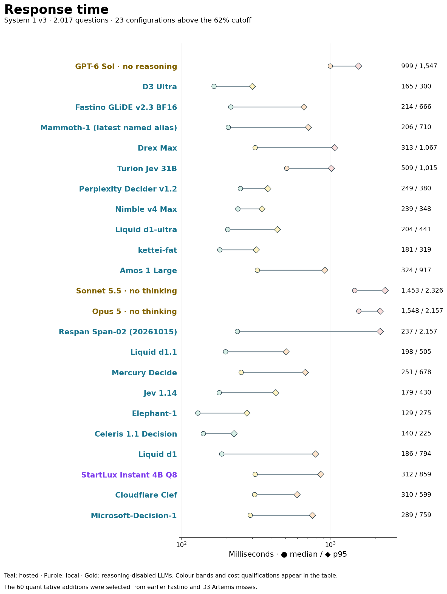

### Cost per 1,000 questions

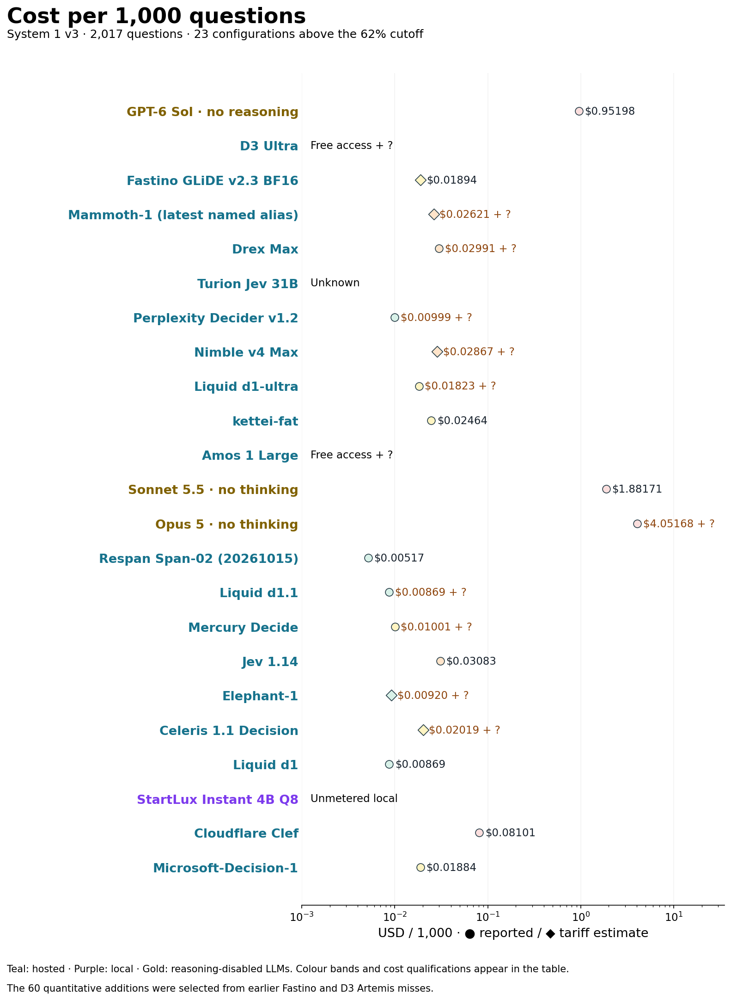

## Category results


### Rules, evidence and logical scope

F01 Lookup and filtering; F02 Forward conditionals; F03 Necessary conditions; F04 Boolean scope; F05 Quantifiers and sets; F11 Sufficiency and inconsistency.

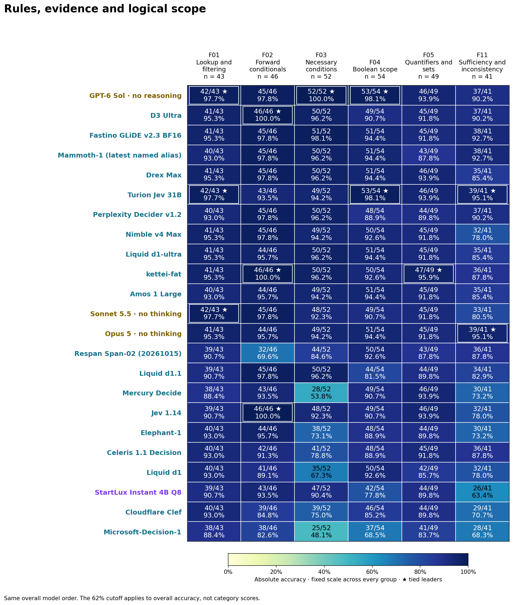

### Ordering, schedules and assignments

F06 Comparisons; F07 Scheduling; F08 One-to-one assignments; F14 Temporal intervals; F22 Preference ordering.

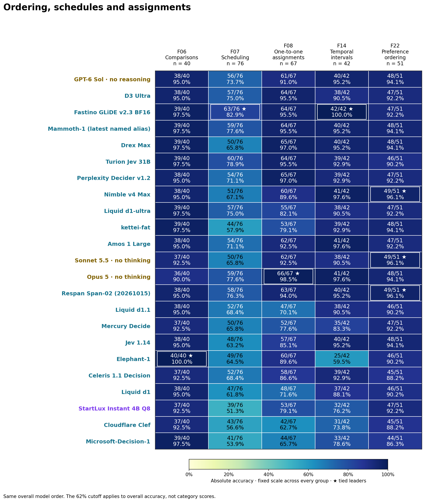

### State tracking and perspectives

F09 Exact truth counting; F10 Truth-teller consistency; F12 Object swaps; F13 Sequential procedures; F15 Spatial tracking; F16 Reference binding; F17 Beliefs and perspectives.

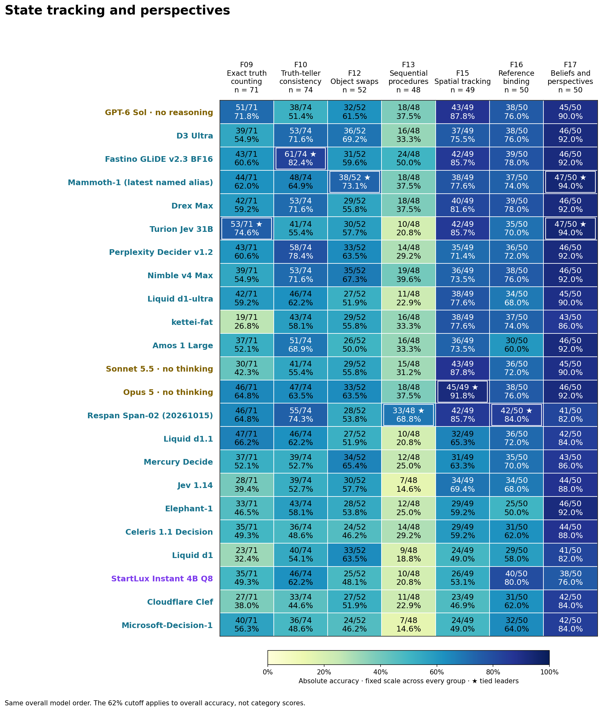

### Causes, plans and authoritative evidence

F18 Causal intervention; F19 Exceptions and priorities; F20 Planning; F21 Directed reachability; F23 Rule counterexamples; F24 Authority and stale records; F25 Fault diagnosis.

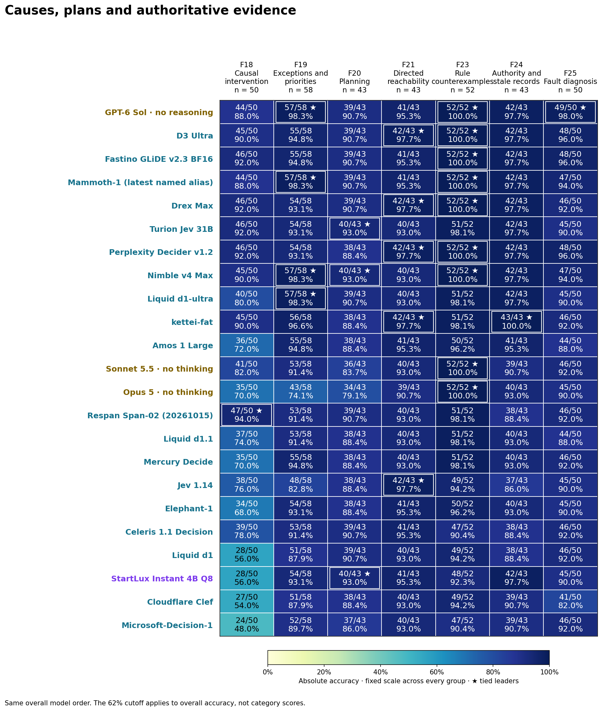

### Decisions under uncertainty

F26 Probabilistic risk; F27 Value of information; F28 Robust decisions without a prior; F29 Strategic decisions; F30 Concurrent-history consistency; F31 Information-flow security.

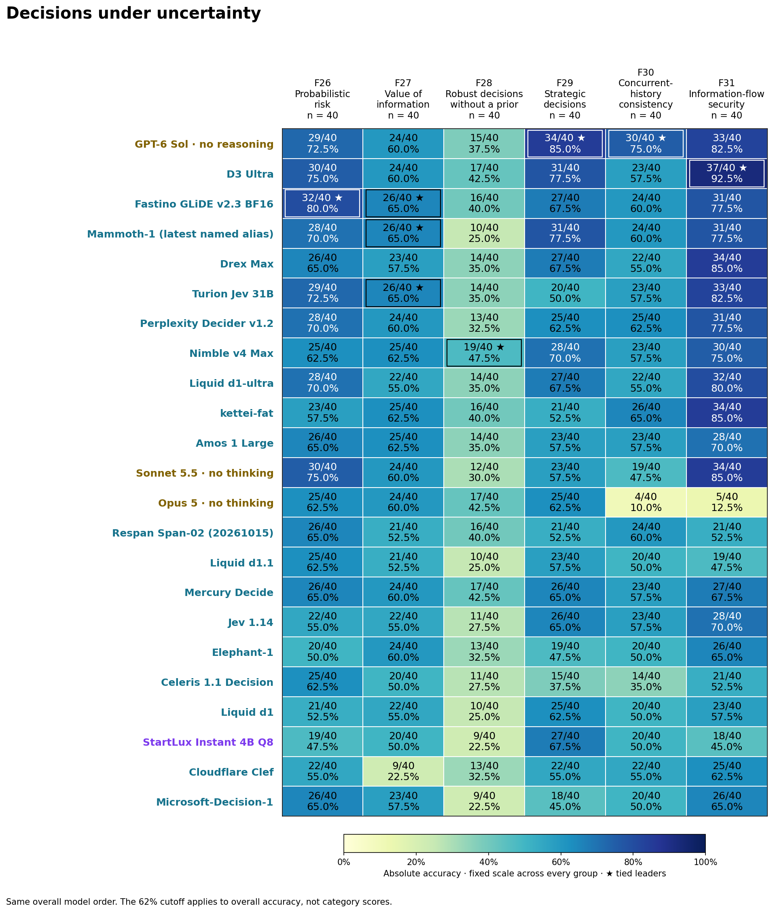

### Practical decisions: scope, policy and actions

P01 Understanding requests and routing; P02 Recognizing multiple requested actions; P03 Tracking current conversational intention; P04 Selecting a tool or requesting clarification; P05 Checking authorization and scope.

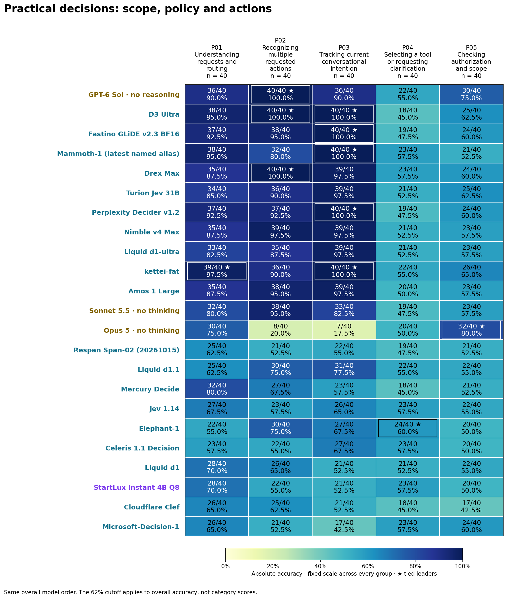

### Practical decisions: evidence, security and quality

P06 Making decisions with untrusted content; P07 Applying a contextual content policy; P08 Extracting and normalizing facts; P09 Checking claims against supplied evidence; P10 Assigning severity or priority from a rubric.

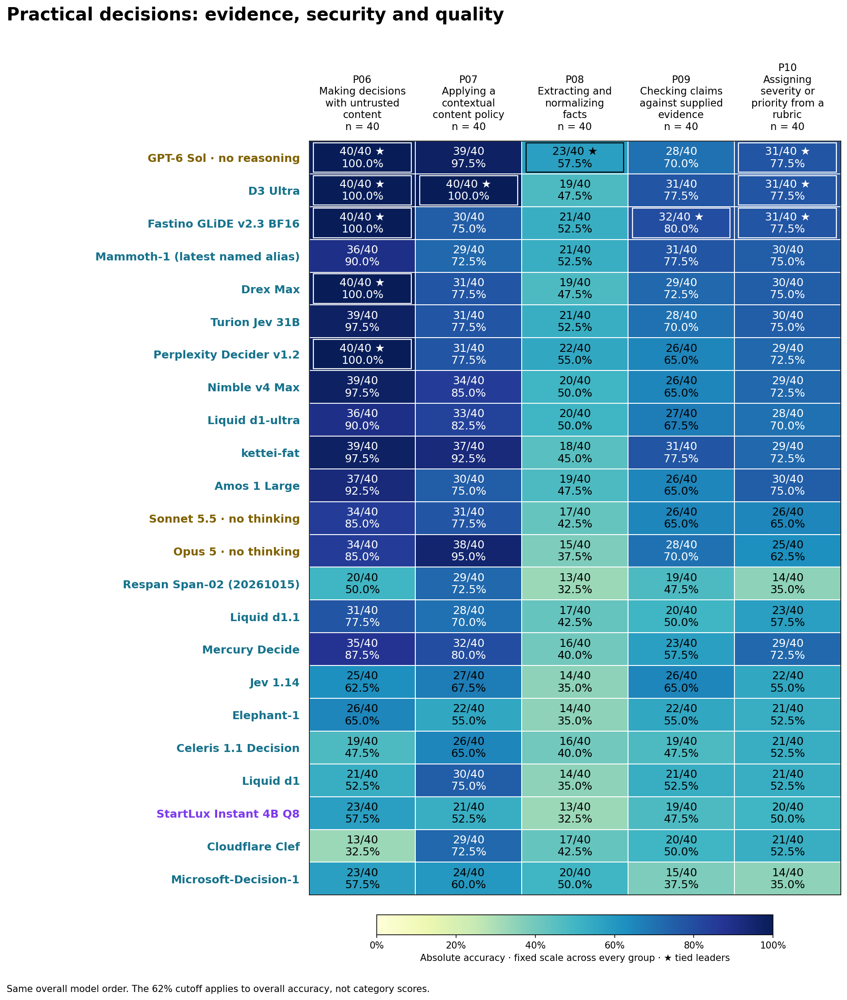

### IQ sequences and admissions-style mathematics

F32 Numerical pattern recognition; F33 Quantitative reasoning.

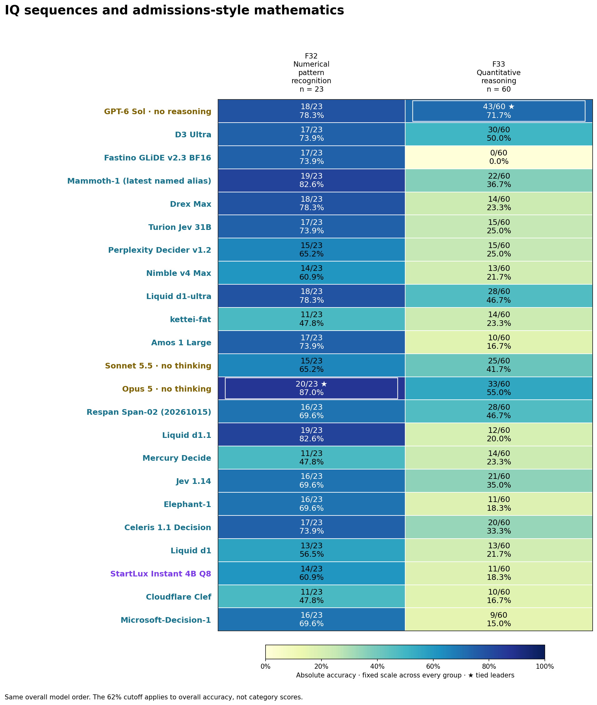

## Below the cutoff

- D3 Artemis 9B IQ3_M: 1235/2,017 (61.23%); coverage 91.62%.
- Drex v2.0: 1231/2,017 (61.03%); coverage 95.39%.
- Cerno 4B v1.2 NF4: 1229/2,017 (60.93%); coverage 92.51%.

## Download and reproducibility

- [Answer-free questions](results/releases/system1_v3_presentation_2026-11-01/questions_2017.jsonl)
- [Question-level origins and terms](results/releases/system1_v3_presentation_2026-11-01/source_metadata_2017.jsonl)
- [Source and license notes](results/releases/system1_v3_presentation_2026-11-01/SOURCE_AND_LICENSES.md)
- [All 26 model summaries](results/releases/system1_v3_presentation_2026-11-01/statistics.json)
- [All model/category scores](results/releases/system1_v3_presentation_2026-11-01/all_category_scores.csv)
- [Timing and status evidence](results/releases/system1_v3_presentation_2026-11-01/timing_evidence.csv.gz)
- [Cost evidence](results/releases/system1_v3_presentation_2026-11-01/cost_evidence.csv.gz)
- [Cost summaries](results/releases/system1_v3_presentation_2026-11-01/cost_statistics.json)
- [Category guide](results/releases/system1_v3_presentation_2026-11-01/category_guide.json)
- [Audit receipt](results/releases/system1_v3_presentation_2026-11-01/audit_receipt.json)
- [Release checksums](results/releases/system1_v3_presentation_2026-11-01/manifest.json)

The original [v3 release](results/releases/system1_v3_2026-11-01/report.html) and [v2 report](results/releases/system1_v2_presentation_2026-11-01/report.html) remain unchanged. The separate 120 companion diagnostics are not included in the 2,017 questions. Model choices and the scoring key remain private. Public material may be present in model training data; scores are not human IQ norms.

The [scripts/](scripts/README.md) support offline validation without model credentials:

```sh
python3 scripts/validate_system1_v3.py results/releases/system1_v3_presentation_2026-11-01 results/releases/system1_v2_presentation_2026-11-01
python3 scripts/validate_october21_release.py
```
