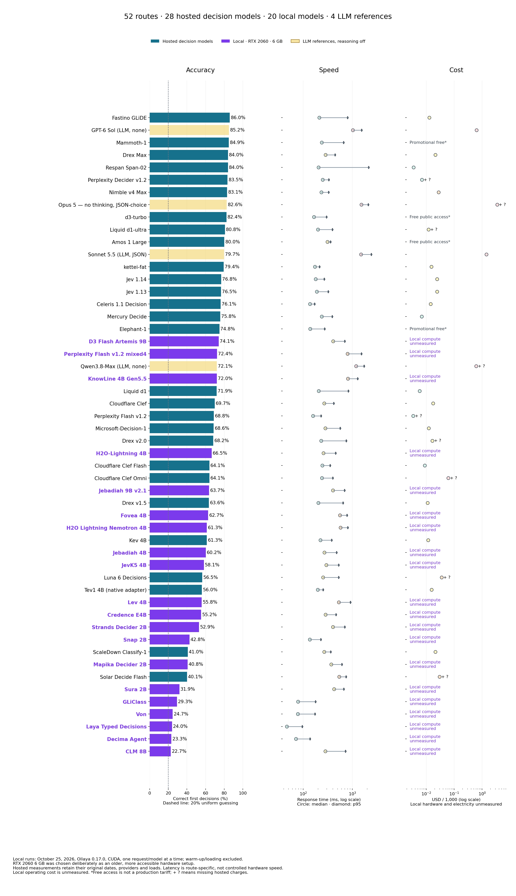
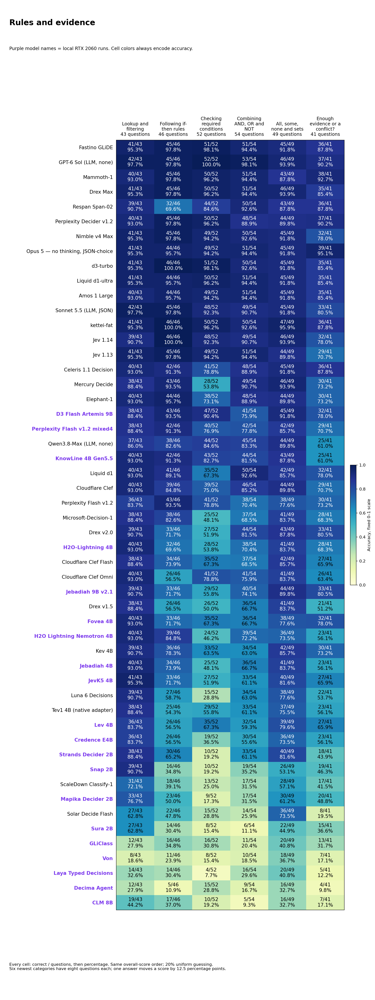
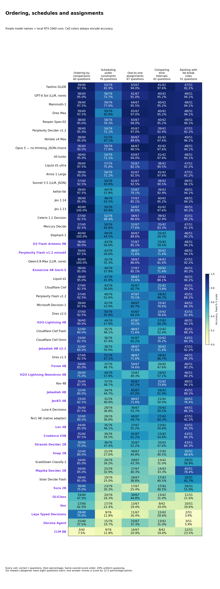
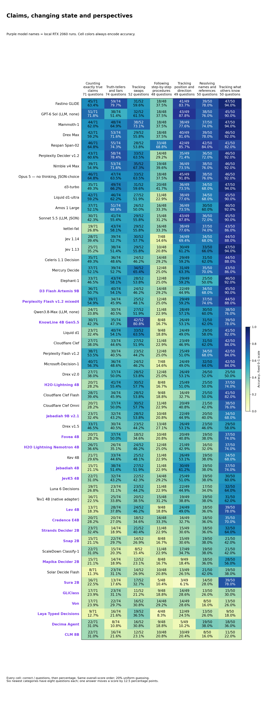
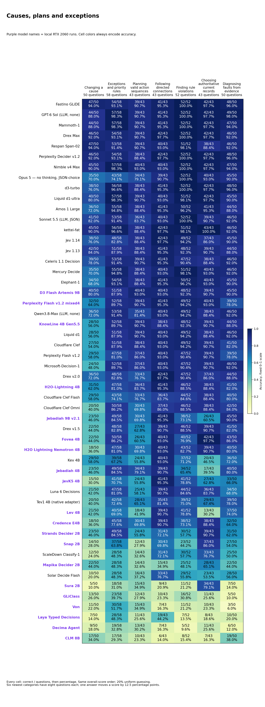
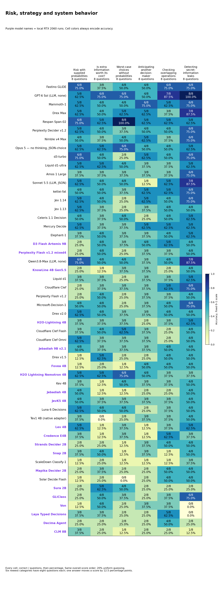

# System 1 Decision Benchmark

28 hosted decision models, **20 local decision/classifier models** and four no-reasoning LLM references on the same **1,342 text questions across 31 categories**. Updated October 25, 2026.

**Fastino GLiDE remains highest overall at 86.0%. D3 Flash Artemis 9B leads the local batch at 74.1%, with a 408 ms median on an RTX 2060 with 6 GB VRAM.**

[Interactive report](https://etsabary.github.io/system-1-decision-benchmark/report.html) · [Local GPU profiles](https://etsabary.github.io/system-1-decision-benchmark/report.html#local-results) · [Named, color-coded categories](https://etsabary.github.io/system-1-decision-benchmark/report.html#functions)

Purple marks **Local · RTX 2060 · 6 GB**. Blue marks hosted decision models; pale yellow marks LLM references. Accuracy cell colors and speed/cost bands keep their existing meaning. Every ranked row contains 1,342 first attempts. Local loading/warm-up calls are excluded; hosted timing paths and dates remain unchanged. Local hardware/electricity cost is unmeasured, rather than plotted as $0.

**The local tests deliberately use an older RTX 2060 with 6 GB VRAM, chosen to represent a more accessible hardware setup that readers may already have.** D3 leads all 20 tested local configurations; its measured latency is specific to this setup.

## Complete comparison

| Model | Setting | Correct / 1342 | Accuracy | Mean | Median | p95 | Cost / 1000 | Bank cost / basis |
| --- | --- | --- | --- | --- | --- | --- | --- | --- |
| Fastino GLiDE | Hosted decision | 1154/1342 | 86.0% | 343 ms | 213 ms | 802 ms | ~$0.012960 | ~$0.017392 |
| GPT-6 Sol — no reasoning | 🟡 LLM reference | 1143/1342 | 85.2% | — | 1023 ms | 1546 ms | $0.632112 | $0.848294 |
| Mammoth-1 | Hosted decision | 1139/1342 | 84.9% | 301 ms | 240 ms | 666 ms | Promotional free access* | Promotional free access* |
| Drex Max | Hosted decision | 1127/1342 | 84.0% | 290 ms | 286 ms | 445 ms | $0.021180 | $0.028423 |
| Respan Span-02 | Hosted decision | 1127/1342 | 84.0% | — | 206 ms | 2157 ms | $0.003537 | $0.004746 |
| Perplexity Decider v1.2 | Hosted decision | 1120/1342 | 83.5% | — | 249 ms | 332 ms | $0.007000 + ? | $0.009394 + ? |
| Nimble v4 Max | Hosted decision | 1115/1342 | 83.1% | — | 235 ms | 329 ms | $0.027633 | ~$0.037084 |
| Opus 5 — no thinking, JSON-choice | 🟡 LLM reference | 1109/1342 | 82.6% | 1581 ms | 1538 ms | 2109 ms | $3.458320 + ? | $4.641065 + ? |
| d3-turbo | Hosted decision | 1106/1342 | 82.4% | 182 ms | 165 ms | 298 ms | Free public access* | Free public access* |
| Liquid d1-ultra | Hosted decision | 1084/1342 | 80.8% | — | 200 ms | 393 ms | $0.012124 + ? | $0.016270 + ? |
| Amos 1 Large | Hosted decision | 1074/1342 | 80.0% | 306 ms | 311 ms | 360 ms | Free public access* | Free public access* |
| Sonnet 5.5 — no thinking, JSON-choice | 🟡 LLM reference | 1070/1342 | 79.7% | — | 1506 ms | 2424 ms | $1.433613 | $1.923908 |
| kettei-fat | Hosted decision | 1066/1342 | 79.4% | 179 ms | 174 ms | 214 ms | $0.015433 | $0.020711 |
| Jev 1.14 | Hosted decision | 1030/1342 | 76.8% | — | 179 ms | 269 ms | $0.024571 | $0.032974 |
| Jev 1.13 | Hosted decision | 1026/1342 | 76.5% | — | 189 ms | 323 ms | $0.024571 | $0.032974 |
| Celeris 1.1 Decision | Hosted decision | 1021/1342 | 76.1% | 155 ms | 138 ms | 170 ms | ~$0.014347 | ~$0.019253 |
| Mercury Decide | Hosted decision | 1017/1342 | 75.8% | — | 238 ms | 388 ms | $0.006956 | $0.009334 |
| Elephant-1 | Hosted decision | 1004/1342 | 74.8% | 164 ms | 139 ms | 272 ms | Promotional free access* | Promotional free access* |
| D3 Flash Artemis 9B | 🟣 Local | 995/1342 | 74.1% | 441 ms | 408 ms | 701 ms | Local compute cost unmeasured | Local compute cost unmeasured |
| Perplexity Flash v1.2 mixed4 | 🟣 Local | 971/1342 | 72.4% | 875 ms | 798 ms | 1526 ms | Local compute cost unmeasured | Local compute cost unmeasured |
| Qwen3.8-Max — none, Hyper Charm | 🟡 LLM reference | 967/1342 | 72.1% | — | 1191 ms | 1731 ms | $0.614821 + ? | $0.825090 + ? quota |
| KnowLine 4B Gen5.5 | 🟣 Local | 966/1342 | 72.0% | 848 ms | 812 ms | 1281 ms | Local compute cost unmeasured | Local compute cost unmeasured |
| Liquid d1 | Hosted decision | 965/1342 | 71.9% | — | 206 ms | 827 ms | $0.005773 | $0.007748 |
| Cloudflare Clef | Hosted decision | 936/1342 | 69.7% | — | 268 ms | 417 ms | $0.017594 | $0.023611 |
| Perplexity Decider Flash v1.2 | Hosted decision | 923/1342 | 68.8% | — | 159 ms | 231 ms | $0.003406 + ? | $0.004570 + ? |
| Microsoft-Decision-1 | Hosted decision | 921/1342 | 68.6% | — | 283 ms | 566 ms | $0.012237 | $0.016422 |
| Drex v2.0 | Hosted decision | 915/1342 | 68.2% | — | 232 ms | 755 ms | $0.016661 + ? | $0.022359 + ? |
| H2O-Lightning 4B | 🟣 Local | 892/1342 | 66.5% | 289 ms | 259 ms | 459 ms | Local compute cost unmeasured | Local compute cost unmeasured |
| Cloudflare Clef Flash | Hosted decision | 860/1342 | 64.1% | — | 245 ms | 353 ms | $0.008797 | $0.011806 |
| Cloudflare Clef Omni | Hosted decision | 860/1342 | 64.1% | — | 241 ms | 400 ms | $0.061511 + ? | $0.082547 + ? |
| Jebadiah 9B v2.1 | 🟣 Local | 855/1342 | 63.7% | 440 ms | 405 ms | 694 ms | Local compute cost unmeasured | Local compute cost unmeasured |
| Drex v1.5 | Hosted decision | 853/1342 | 63.6% | — | 203 ms | 649 ms | $0.011160 | $0.014976 |
| Fovea 4B | 🟣 Local | 841/1342 | 62.7% | 588 ms | 558 ms | 779 ms | Local compute cost unmeasured | Local compute cost unmeasured |
| H2O Lightning Nemotron 4B | 🟣 Local | 823/1342 | 61.3% | 596 ms | 574 ms | 810 ms | Local compute cost unmeasured | Local compute cost unmeasured |
| Kev 4B | Hosted decision | 822/1342 | 61.3% | — | 225 ms | 377 ms | $0.011718 | $0.015725 |
| Jebadiah 4B | 🟣 Local | 808/1342 | 60.2% | 298 ms | 270 ms | 479 ms | Local compute cost unmeasured | Local compute cost unmeasured |
| JevK5 4B | 🟣 Local | 780/1342 | 58.1% | 323 ms | 296 ms | 525 ms | Local compute cost unmeasured | Local compute cost unmeasured |
| Luna 6 Decisions | Hosted decision | 758/1342 | 56.5% | — | 254 ms | 527 ms | $0.035840 + ? | $0.048097 + ? |
| Tev1 4B experimental (OpenRouter native adapter) | Hosted decision | 751/1342 | 56.0% | — | 198 ms | 253 ms | $0.015657 | $0.021011 |
| Lev 4B | 🟣 Local | 749/1342 | 55.8% | 570 ms | 532 ms | 914 ms | Local compute cost unmeasured | Local compute cost unmeasured |
| Credence E4B | 🟣 Local | 741/1342 | 55.2% | 315 ms | 284 ms | 464 ms | Local compute cost unmeasured | Local compute cost unmeasured |
| Strands Decider 2B | 🟣 Local | 710/1342 | 52.9% | 435 ms | 403 ms | 703 ms | Local compute cost unmeasured | Local compute cost unmeasured |
| Snap 2B | 🟣 Local | 574/1342 | 42.8% | 157 ms | 136 ms | 229 ms | Local compute cost unmeasured | Local compute cost unmeasured |
| ScaleDown Classify-1 | Hosted decision | 550/1342 | 41.0% | — | 268 ms | 362 ms | $0.021388 | $0.028703 |
| Mapika Decider 2B | 🟣 Local | 547/1342 | 40.8% | 381 ms | 371 ms | 613 ms | Local compute cost unmeasured | Local compute cost unmeasured |
| Solar Decide Flash | Hosted decision | 538/1342 | 40.1% | — | 540 ms | 747 ms | $0.030203 + ? | $0.040532 + ? |
| Sura 2B | 🟣 Local | 428/1342 | 31.9% | 436 ms | 425 ms | 672 ms | Local compute cost unmeasured | Local compute cost unmeasured |
| GLiClass | 🟣 Local | 393/1342 | 29.3% | 92 ms | 79 ms | 178 ms | Local compute cost unmeasured | Local compute cost unmeasured |
| Von | 🟣 Local | 331/1342 | 24.7% | 96 ms | 77 ms | 174 ms | Local compute cost unmeasured | Local compute cost unmeasured |
| Laya Typed Decisions | 🟣 Local | 322/1342 | 24.0% | 53 ms | 46 ms | 95 ms | Local compute cost unmeasured | Local compute cost unmeasured |
| Decima Agent | 🟣 Local | 313/1342 | 23.3% | 81 ms | 71 ms | 138 ms | Local compute cost unmeasured | Local compute cost unmeasured |
| CLM 8B | 🟣 Local | 304/1342 | 22.7% | 324 ms | 282 ms | 726 ms | Local compute cost unmeasured | Local compute cost unmeasured |

## Reading the speed and cost colors

The squares and labels use fixed descriptive bands, not relative ranks or statistical significance. Speed uses the full-bank first-attempt median. Cost uses known or accounted dollars per 1,000 questions, normalized from each actual 1,342-question run including permitted recoveries.

| Band | Median response time | Known/accounted cost per 1,000 |
|---|---|---|
| Green | 🟩 Fastest: ≤250 ms | 🟩 Lowest: ≤$0.010 |
| Yellow | 🟨 Fast: >250 to ≤500 ms | 🟨 Low: >$0.010 to ≤$0.025 |
| Orange | 🟧 Moderate: >500 to ≤1,000 ms | 🟧 Mid: >$0.025 to ≤$0.050 |
| Red | 🟥 Slow: >1,000 ms | 🟥 Highest: >$0.050 |
| Gray | ⬜ Unknown: unavailable | ⬜ Unknown: unavailable |

Bands use unrounded measurements; displayed numbers can round to a boundary. `+ ?` means additional charges were not reported. In those cells, the cost band describes only the known lower bound, not a complete cost or a guaranteed price advantage. The website also underlines these incomplete costs in amber. Text labels remain visible without color.

## Celeris joins at 76.1%, while Fastino remains highest overall

Celeris 1.1 Decision answered 1,021/1,342 correctly (76.1%), with 155 / 138 / 170 ms mean / median / p95. That is 26 more correct answers than local D3 Flash Artemis at 995 (74.1%), and 129 fewer than hosted Fastino GLiDE at 1,154 (86.0%). GPT-6 Sol without reasoning retains 1,143 (85.2%) and Mammoth-1 1,139 (84.9%). All earlier 49 model records retain their exact scores, durations, costs and dates. The 52-route comparison is an observed result on this developing bank, not a universal model ranking.

## KnowLine is close to Perplexity, with a longer median than D3

KnowLine 4B Gen5.5 scored 966/1,342 (72.0%), five fewer than local Perplexity Flash mixed4 at 971 (72.4%) and 29 fewer than D3 at 995. Its mean / median / p95 was 848 / 812 / 1,281 ms, compared with Perplexity 875 / 798 / 1,526 ms and D3 441 / 408 / 701 ms. D3 remains the highest-scoring of 20 completed local configurations. KnowLine scored 38/40 on comparisons, 40/43 on lookup/filtering and 48/52 on rule counterexamples; sequential procedures were 8/48, exact truth counting 30/71 and truth-teller consistency 35/74.

## The Nemotron configuration trails the earlier Qwen-based H2O

H2O Lightning Nemotron 4B scored 823/1,342 (61.3%), with 596 / 574 / 810 ms mean / median / p95. The earlier H2O-Lightning 4B route scored 892 (66.5%) with a 259 ms median: 69 more correct answers and a shorter median on the same user-reported GPU. Fovea scored 841 (62.7%) with a 558 ms median. Nemotron scored 40/43 on lookup/filtering and directed paths, 39/43 on current authoritative records and 46/51 on explicit preferences; sequential procedures were 12/48 and reference binding 16/50. Weights, precision and serving implementations differ, so the comparison does not isolate the backbone.

## Celeris has strong lookup and path scores, with weaker state updates

Celeris scored 41/43 on directed paths, 40/43 on lookup/filtering, 39/42 on temporal intervals and 46/50 on fault diagnosis. Sequential procedures scored 14/48, object swaps 24/52, truth-teller consistency 36/74 and exact truth counting 35/71. A high overall score can conceal weaknesses on repeated state updates. Every model retains the complete named category matrix. Six categories have eight questions each, so one answer changes their score by 12.5 percentage points.

## Celeris cost is a tariff estimate, with all latency spikes retained

The 481,334 reported input tokens at the captured USD 0.04/million tariff give an estimated $0.01925336 for 1,342 questions, or about $0.01434677 per 1,000. This is usage times tariff, not monetary receipts. Two admission probes cost an estimated $0.00001048 separately. Fresh HTTPS calls were serial, at least 0.25 seconds apart at dispatch; idle pacing is excluded from response durations. Four scored calls exceeded two seconds, with a maximum of 3,195 ms; all remain in the timing distribution. The cumulative median remained below the existing two-second gate.

## The two new local models report one native label token

Nemotron and KnowLine both returned typed choices and five-choice probability distributions without generated explanations. Their runtime reports one output token, retained as observed native label telemetry. Earlier 18 local configurations retain their recorded zero-token evidence. Nemotron also reports native probabilities, one fast pass and matching input/processed-input counts. KnowLine reports no truncation but no separate processed-input count. Its earlier admission block is preserved as history and resolved by the completed model-specific compatibility audit. Reported counters do not attest to all internal computation.

## Matched questions, qualified precision and route-specific timing

The two additions ran on the home LAN using Ollaya 0.17.0, cuda:0 and a user-reported RTX 2060 with 6 GB VRAM, deliberately chosen as an older, more accessible hardware setup. Nemotron used NF4 / FP16 compute / FP32 head; KnowLine used NF4 / FP16 compute / FP32 readout. KnowLine Gen5.5 upstream documentation describes Gen5 weights with read-twice input serving. Loading and four synthetic warm-ups per model are excluded. Start/end serving digests were stable; immutable upstream weight revisions were not reported. Hardware, software, quantization, dates and network paths limit causal speed comparisons.

## Every new first attempt was usable; prior failures remain counted

All 4,026 new text decisions were usable, with no scored retries, shortened inputs or accuracy-only stop. Across 20 local configurations there are 26,820 usable decisions and 20 unsuccessful first attempts. The existing six truncations and 14 HTTP failures remain in their original 1,342-question denominators. Coba, NLI and Julia remain separate partial or blocked routes outside the full-bank ranking. No completed run was repeated for publication.

## Colors and cost boundaries retain their meaning

Purple identifies local RTX 2060 runs, blue hosted decision models and pale yellow the four no-reasoning LLM references. Cell colors encode accuracy; the original green-to-red speed/cost bands are fixed. Local hardware, electricity and depreciation were not measured, so no zero-dollar operating cost is invented. Celeris and Fastino estimates are marked with a tilde. API identities and serving digests are provenance, not independent weight attestations.

## Categories, questions and evidence

## Category scores and explanations

The 31 categories are grouped below so the labels and values remain readable. These are reading groups, not new scored categories. All 52 routes remain in overall-score order. Every cell shows **correct / questions and percentage**. Darker blue means higher accuracy on a fixed 0-100% scale; uniform random guessing averages 20%. Different category sizes mean that percentages alone do not show how much evidence is available.

[Open the color-coded, selectable tables](https://etsabary.github.io/system-1-decision-benchmark/report.html#functions), with a pinned model-name column and individual category rankings.

### Rules and evidence

Which facts meet a rule, which conclusions follow, and when is the evidence insufficient?

| Category | Questions | What it tests and a simple example |
| --- | --- | --- |
| Lookup and filtering (F01) | 43 | Select records that meet stated conditions Example: Which listed request is both signed and marked urgent? |
| Following if-then rules (F02) | 46 | Apply an implication from its trigger Example: If an active badge grants entry and this badge is active, what follows? |
| Checking required conditions (F03) | 52 | Reason backward from a missing required condition Example: Every approved request needs a valid ticket; can one without a ticket be approved? |
| Combining AND, OR and NOT (F04) | 54 | Track combinations such as both, either and exactly one Example: Which choice satisfies exactly one of two stated conditions? |
| All, some, none and sets (F05) | 49 | Track all, some, none and overlapping groups Example: All teal tokens are marked; no marked token is blank; which relation follows? |
| Enough evidence or a conflict? (F11) | 41 | Determine whether facts force an answer or contradict one another Example: Is a proposed arrangement determined, impossible or still underdetermined? |

[Full-size SVG](results/releases/native_additions_2026-10-25/rules.svg) · [Color-coded table and category rankings](https://etsabary.github.io/system-1-decision-benchmark/report.html#group-rules)

### Ordering, schedules and assignments

Can the model combine comparisons, fit a schedule, assign unique partners and apply tie-break rules?

| Category | Questions | What it tests and a simple example |
| --- | --- | --- |
| Ordering by comparisons (F06) | 40 | Combine ordered comparisons Example: A is taller than B and B than C; how do A and C compare? |
| Scheduling under constraints (F07) | 76 | Fit events around order and exclusion rules Example: Which timetable puts one meeting before another without overlapping a break? |
| One-to-one assignments (F08) | 67 | Give each item a unique partner while satisfying clues Example: Assign three people different desks using location restrictions. |
| Comparing time intervals (F14) | 42 | Compare starts, ends and overlapping periods Example: Which interval overlaps a specified event without containing it? |
| Ranking with tie-break rules (F22) | 51 | Rank candidates using explicit tie-break rules Example: Rank by priority first, then age when priorities tie. |

[Full-size SVG](results/releases/native_additions_2026-10-25/ordering.svg) · [Color-coded table and category rankings](https://etsabary.github.io/system-1-decision-benchmark/report.html#group-ordering)

### Claims, changing state and perspectives

Can the model count true statements, update a changing situation and separate what different observers know?

| Category | Questions | What it tests and a simple example |
| --- | --- | --- |
| Counting exactly true claims (F09) | 71 | Count precisely how many statements hold Example: Under the supplied facts, how many of six claims are true? |
| Truth-tellers and liars (F10) | 74 | Find a consistent pattern of truthful and false statements Example: Which assignment of honest and dishonest speakers fits their claims? |
| Tracking swaps (F12) | 52 | Update locations after repeated exchanges Example: A red token starts in box A; several box contents are swapped; where does it end? |
| Following step-by-step procedures (F13) | 48 | Apply each ordered edit to the current state Example: Toggle one flag, swap two values, then conditionally reset another flag. |
| Tracking position and direction (F15) | 49 | Update position or direction from described movement Example: Follow successive turns and moves, then identify the final direction. |
| Resolving names and references (F16) | 50 | Resolve chains of names, roles and references Example: Identify the mentor of the colleague named in a nested description. |
| Tracking what others know (F17) | 50 | Distinguish what different observers witnessed Example: An object moves while one observer is absent; where will that observer look? |

[Full-size SVG](results/releases/native_additions_2026-10-25/state.svg) · [Color-coded table and category rankings](https://etsabary.github.io/system-1-decision-benchmark/report.html#group-state)

### Causes, plans and exceptions

Which actions work, which consequences change, and which rule or source controls when information conflicts?

| Category | Questions | What it tests and a simple example |
| --- | --- | --- |
| Changing a cause (F18) | 50 | Recompute consequences of changing a specified input Example: Force a switch off while holding other inputs fixed; which lamp now lights? |
| Exceptions and priority rules (F19) | 58 | Apply a rule, its exception and stated precedence Example: A badge permits entry unless a higher-priority suspension applies. |
| Planning valid action sequences (F20) | 43 | Choose an action sequence whose requirements are met Example: Obtain a key before opening a locked door, with limited moves available. |
| Following directed connections (F21) | 43 | Follow arrows in their permitted direction Example: Can node A reach node D through the listed directed links? |
| Finding rule violations (F23) | 52 | Find a case that violates a stated rule Example: Which listed record disproves the claim that every approved item is signed? |
| Choosing authoritative current records (F24) | 43 | Select the valid source rather than an outdated conflicting one Example: Two records disagree; which controls under the stated authority and date policy? |
| Diagnosing faults from evidence (F25) | 50 | Match observed symptoms to explicit fault rules Example: Which fault is consistent with the supplied test results? |

[Full-size SVG](results/releases/native_additions_2026-10-25/causes.svg) · [Color-coded table and category rankings](https://etsabary.github.io/system-1-decision-benchmark/report.html#group-causes)

### Risk, strategy and system behavior

These decisions involve uncertain outcomes, another actor, overlapping operations or possible information leaks.

**Worst-case choices without probabilities** means choosing under a specified worst-case loss or regret rule when the likelihoods of possible situations are not supplied. There is no probability distribution to average over. Each of these six categories has eight questions, so one answer changes its score by 12.5 percentage points.

| Category | Questions | What it tests and a simple example |
| --- | --- | --- |
| Risk with supplied probabilities (F26) | 8 | Choose the action with the lowest probability-weighted cost, using the supplied likelihoods and costs. Example: Which action minimizes the expected cost of a possible delay? |
| Is extra information worth its cost? (F27) | 8 | Decide whether paying for a test before choosing an action reduces the probability-weighted cost enough to cover the test price. Example: Should you buy a sensor reading before choosing an action, or is acting without the extra information cheaper overall? |
| Worst-case choices without probabilities (F28) | 8 | Follow the stated worst-case rule when likelihoods are not supplied. Minimize either the largest possible loss or the largest regret (extra loss compared with the best action for each situation), as the question specifies. Do not invent probabilities. Example: A route costs 4 in either situation; another costs 1 or 9. With no probabilities and a smallest-worst-case-cost rule, which route should be chosen? |
| Anticipating another decision-maker (F29) | 8 | Choose an action while accounting for the specified choices or payoff-maximizing response of another decision-maker. Example: Which first move gives the best result after the other player chooses their own best reply? |
| Checking overlapping operations (F30) | 8 | Decide whether overlapping operations and their reported results can fit a permitted one-at-a-time order that respects the specified timing and object rules. Example: Two processes read and change the same stored value. Could their reported results fit an allowed one-at-a-time order? |
| Detecting secret-information leaks (F31) | 8 | Check whether changing a protected secret can change an observable result in a way the stated policy forbids. Example: If public inputs stay the same, could public output distinguish two secret values that the policy says must remain indistinguishable? |

[Full-size SVG](results/releases/native_additions_2026-10-25/uncertainty.svg) · [Color-coded table and category rankings](https://etsabary.github.io/system-1-decision-benchmark/report.html#group-uncertainty)

Counts are exact; displayed percentages are rounded. A perfect result on a small sample is not a reliability guarantee. [Download the full category matrix](results/releases/native_additions_2026-10-25/category_scores.csv).

Current data: [aggregate JSON](results/releases/native_additions_2026-10-25/statistics.json), [model CSV](results/releases/native_additions_2026-10-25/model_statistics.csv), [category CSV](results/releases/native_additions_2026-10-25/category_scores.csv), [answer-free timing evidence](results/releases/native_additions_2026-10-25/local_timing_evidence.csv), [setup metadata](results/releases/native_additions_2026-10-25/local_model_metadata.json), [audit](results/releases/native_additions_2026-10-25/audit_receipt.json).

Unchanged question bank: [native JSONL](results/releases/consolidated_2026-10-19/questions_1342.jsonl), [CSV](results/releases/consolidated_2026-10-19/questions_1342.csv), [readable text](results/releases/consolidated_2026-10-19/questions_1342.txt).

Implementation: [scripts/](scripts/README.md). Current check: `python3 scripts/validate_native_additions_2026_10_25.py`. Historical checks include `python3 scripts/validate_opus5_release.py` and `python3 scripts/validate_october21_release.py`. All earlier releases remain unchanged.
