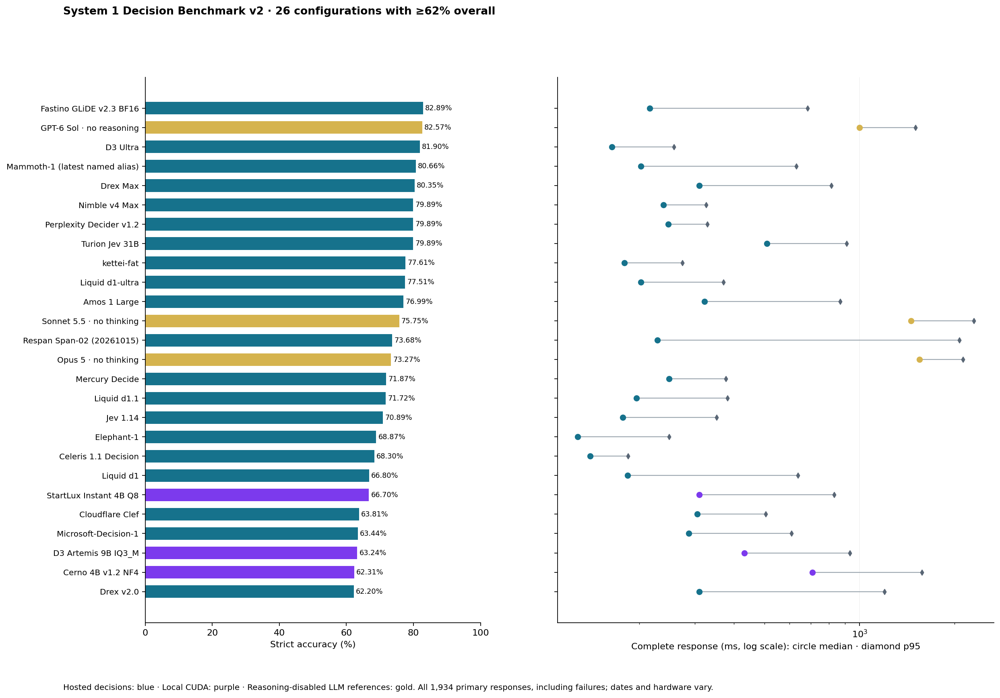

# System 1 Decision Benchmark v2

**1,934 questions across 41 categories. 26 configurations meet the 62% overall reporting cutoff:** 20 hosted decision models, 3 local configurations and 3 selected reasoning-disabled LLM references. Updated November 1, 2026.

**Fastino leads the observed overall score at 82.89%; D3 Ultra leads the 592 additions at 77.70%; StartLux Instant leads the measured local full-bank configurations at 66.70%.** Fastino's six-answer margin over GPT-6 Sol does not establish a reliable accuracy advantage; its median response is 216 ms versus 999 ms.

[Interactive report](https://etsabary.github.io/system-1-decision-benchmark/report.html) · [41 named categories](https://etsabary.github.io/system-1-decision-benchmark/report.html#functions) · [Model strengths and weaknesses](https://etsabary.github.io/system-1-decision-benchmark/report.html#profiles) · [Other models and historical scopes](https://etsabary.github.io/system-1-decision-benchmark/system1_v2_2026-11-01/not_in_main.html)



## Main comparison

| Configuration | Setting | Correct | Accuracy | Median | p95 |
| --- | --- | --- | --- | --- | --- |
| Fastino GLiDE v2.3 BF16 | Hosted native | 1603/1934 | 82.89% | 216 ms | 685 ms |
| GPT-6 Sol · no reasoning | LLM reference | 1597/1934 | 82.57% | 999 ms | 1502 ms |
| D3 Ultra | Hosted native | 1584/1934 | 81.90% | 164 ms | 257 ms |
| Mammoth-1 (latest named alias) | Hosted native | 1560/1934 | 80.66% | 203 ms | 630 ms |
| Drex Max | Hosted native | 1554/1934 | 80.35% | 310 ms | 813 ms |
| Nimble v4 Max | Hosted native | 1545/1934 | 79.89% | 239 ms | 326 ms |
| Perplexity Decider v1.2 | Hosted native | 1545/1934 | 79.89% | 248 ms | 329 ms |
| Turion Jev 31B | Hosted native | 1545/1934 | 79.89% | 509 ms | 909 ms |
| kettei-fat | Hosted native | 1501/1934 | 77.61% | 180 ms | 274 ms |
| Liquid d1-ultra | Hosted native | 1499/1934 | 77.51% | 203 ms | 370 ms |
| Amos 1 Large | Hosted native | 1489/1934 | 76.99% | 323 ms | 869 ms |
| Sonnet 5.5 · no thinking | LLM reference | 1465/1934 | 75.75% | 1454 ms | 2304 ms |
| Respan Span-02 (20261015) | Hosted native | 1425/1934 | 73.68% | 228 ms | 2069 ms |
| Opus 5 · no thinking | LLM reference | 1417/1934 | 73.27% | 1547 ms | 2124 ms |
| Mercury Decide | Hosted native | 1390/1934 | 71.87% | 249 ms | 376 ms |
| Liquid d1.1 | Hosted native | 1387/1934 | 71.72% | 196 ms | 381 ms |
| Jev 1.14 | Hosted native | 1371/1934 | 70.89% | 178 ms | 352 ms |
| Elephant-1 | Hosted native | 1332/1934 | 68.87% | 128 ms | 249 ms |
| Celeris 1.1 Decision | Hosted native | 1321/1934 | 68.30% | 140 ms | 184 ms |
| Liquid d1 | Hosted native | 1292/1934 | 66.80% | 184 ms | 638 ms |
| StartLux Instant 4B Q8 | Local native | 1290/1934 | 66.70% | 310 ms | 831 ms |
| Cloudflare Clef | Hosted native | 1234/1934 | 63.81% | 306 ms | 503 ms |
| Microsoft-Decision-1 | Hosted native | 1227/1934 | 63.44% | 287 ms | 608 ms |
| D3 Artemis 9B IQ3_M | Local native | 1223/1934 | 63.24% | 431 ms | 931 ms |
| Cerno 4B v1.2 NF4 | Local native | 1205/1934 | 62.31% | 708 ms | 1575 ms |
| Drex v2.0 | Hosted native | 1203/1934 | 62.20% | 310 ms | 1199 ms |


All 38 v2 measurements remain available. Main graphs, category tables and leaders use the same 26-model qualifying set. Individual category scores can be below 62%; the cutoff applies to overall accuracy. AutoThink is archival. Kev 4B, Nemotron, Qwen, plain H2O and older Jev are outside the main selection; latest Jev 1.14 is retained.

## Questions, categories and analysis

The expansion adds 192 questions to six existing categories (F26–F31), bringing each from 8 to 40, and 400 questions across ten new practical categories (P01–P10), 40 each. All 1,342 original native inputs remain exact. 120 companion diagnostics stay separate.

- [Exact native JSONL](results/releases/system1_v2_2026-11-01/questions_1934.jsonl), [CSV](results/releases/system1_v2_2026-11-01/questions_1934.csv), [readable text](results/releases/system1_v2_2026-11-01/questions_1934.txt) and [metadata](results/releases/system1_v2_2026-11-01/metadata_core.jsonl)
- [Category descriptions and scores](documents/FUNCTIONS.md), [v2 design and selection](documents/V2_DESIGN.md), [analysis](results/releases/system1_v2_2026-11-01/analysis.md) and [LLM settings](documents/LLM_REFERENCES.md)
- [Main aggregates](results/releases/system1_v2_2026-11-01/statistics.json), [all 38 records](results/releases/system1_v2_2026-11-01/all_statistics.json), [category CSV](results/releases/system1_v2_2026-11-01/category_scores.csv) and [model profiles](results/releases/system1_v2_2026-11-01/model_profiles.csv)
- [73,492 answer-free timing/status records](results/releases/system1_v2_2026-11-01/timing_evidence.csv.gz), [audit receipt](results/releases/system1_v2_2026-11-01/audit_receipt.json) and [release checksums](results/releases/system1_v2_2026-11-01/manifest.json)

## Measurement limits

Pooled timing uses individual primary responses, including failures; phase/category medians are not averaged. Hardware, routes, precision and dates differ. Wrong answers are distinguished from context limits, refusals and service errors. A complete v2 monetary ledger is not consolidated, and older tariffs are not extrapolated. Model-guided development and related variants limit generalization. Public data omits the scoring key, model choices and individual correctness; the answer key remains private under the existing policy.

## Reproduce the publication offline

The [scripts/](scripts/README.md) use only public captures for validation and report rebuilding. No API keys or live inference are needed.

```sh
python3 -m pip install -r scripts/requirements-reports.txt python-dotenv
python3 scripts/validate_system1_v2.py
python3 -m unittest discover -s scripts -p "test_system1_v2.py"
python3 scripts/publish_system1_v2.py --output /tmp/system1-v2-rebuild
```

Historical check: `python3 scripts/validate_october21_release.py`. All dated v1 releases and their original denominators remain archived. [Previous 1,342-question report](results/releases/local_updates_2026-10-31/report.html).
