# System 1 Decision Benchmark · provisional v5

This provisional successor contains **1,456 questions across 43 categories**. It removes the exact 701 questions answered correctly by all 26 configurations in the preceding main graph, while retaining every remaining question and recorded primary response. The prior 32 complete configurations retain their recorded answers. Morph Reflex and REAX 1.3 were newly tested on the unchanged 1,456-question bank. The complete v4 bank and reports remain unchanged.

**Inclusion threshold: 45% (at least 656/1,456 correct).** The user set this cutoff after reviewing Super Decider’s 669/1,456 (45.95%), the lowest score among the preceding graph models. Inclusion uses the exact rule **correct ×100 ≥45 ×1,456**, requiring at least **656 correct**, including ties. The prior 32 complete configurations are preserved and two new hosted models are added; 28 qualify.

[Interactive provisional v5 report](https://etsabary.github.io/system-1-decision-benchmark/v5/report.html) · [Category rankings](https://etsabary.github.io/system-1-decision-benchmark/v5/report.html#rankings) · [Cost evidence](https://etsabary.github.io/system-1-decision-benchmark/v5/report.html#cost) · [Archived full v4](https://etsabary.github.io/system-1-decision-benchmark/v4/report.html)

## Main comparison

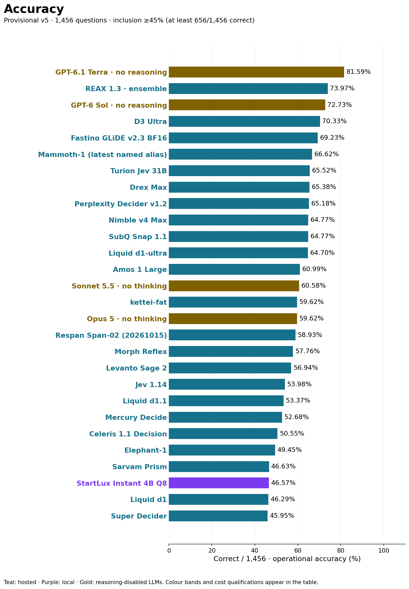

| Configuration | Correct / 1,456 | Accuracy | Median | p95 | Selected-record known cost | Cost / 1,000 | Usable | Cost evidence |
|---|---:|---:|---:|---:|---:|---:|---:|---|
| GPT-6.1 Terra · no reasoning | 1188/1,456 | 81.59% | 🟥 1,160 ms | 🟥 1,729 ms | 🟥 $0.75733 + ? | 🟥 $0.52014 + ? | 1454/1,456 | 1454 reported; 0 estimates; 0 free-access; 2 unknown |
| REAX 1.3 · ensemble | 1077/1,456 | 73.97% | 🟧 946 ms | 🟥 1,541 ms | 🟥 $1.14224 FX est. | 🟥 $0.78451 FX est. | 1456/1,456 | EUR 1.0204992 reported (1456 records); 1456 USD FX estimates; 0 unknown |
| GPT-6 Sol · no reasoning | 1059/1,456 | 72.73% | 🟧 986 ms | 🟥 1,520 ms | 🟥 $1.51532 | 🟥 $1.04074 | 1456/1,456 | 1456 reported; 0 estimates; 0 free-access; 0 unknown |
| D3 Ultra | 1024/1,456 | 70.33% | 🟩 172 ms | 🟨 338 ms | ⬜ Free access + ? | ⬜ Free access + ? | 1456/1,456 | 0 reported; 0 estimates; 1236 free-access; 220 unknown |
| Fastino GLiDE v2.3 BF16 | 1008/1,456 | 69.23% | 🟩 216 ms | 🟧 530 ms | 🟨 $0.02993 | 🟨 $0.02056 | 1456/1,456 | 0 reported; 1456 estimates; 0 free-access; 0 unknown |
| Mammoth-1 (latest named alias) | 970/1,456 | 66.62% | 🟩 188 ms | 🟧 727 ms | 🟧 $0.04833 + ? | 🟧 $0.03320 + ? | 1455/1,456 | 0 reported; 511 estimates; 724 free-access; 221 unknown |
| Turion Jev 31B | 954/1,456 | 65.52% | 🟧 510 ms | 🟥 1,029 ms | 🟩 $0.00110 + ? | 🟩 $0.00076 + ? | 1455/1,456 | 140 reported; 0 estimates; 0 free-access; 1316 unknown |
| Drex Max | 952/1,456 | 65.38% | 🟨 331 ms | 🟥 1,324 ms | 🟧 $0.04695 + ? | 🟧 $0.03225 + ? | 1447/1,456 | 1447 reported; 0 estimates; 0 free-access; 9 unknown |
| Perplexity Decider v1.2 | 949/1,456 | 65.18% | 🟩 246 ms | 🟨 416 ms | 🟨 $0.01572 + ? | 🟨 $0.01080 + ? | 1455/1,456 | 1455 reported; 0 estimates; 0 free-access; 1 unknown |
| Nimble v4 Max | 943/1,456 | 64.77% | 🟩 240 ms | 🟨 351 ms | 🟧 $0.03856 + ? | 🟧 $0.02648 + ? | 1455/1,456 | 0 reported; 1235 estimates; 0 free-access; 221 unknown |
| SubQ Snap 1.1 | 943/1,456 | 64.77% | 🟩 177 ms | 🟩 206 ms | 🟨 $0.03145 | 🟨 $0.02160 | 1456/1,456 | 0 reported; 1456 estimates; 0 free-access; 0 unknown |
| Liquid d1-ultra | 942/1,456 | 64.70% | 🟩 207 ms | 🟨 483 ms | 🟨 $0.02891 + ? | 🟨 $0.01985 + ? | 1454/1,456 | 1454 reported; 0 estimates; 0 free-access; 2 unknown |
| Amos 1 Large | 888/1,456 | 60.99% | 🟨 363 ms | 🟧 972 ms | ⬜ Free access + ? | ⬜ Free access + ? | 1456/1,456 | 0 reported; 0 estimates; 1236 free-access; 220 unknown |
| Sonnet 5.5 · no thinking | 882/1,456 | 60.58% | 🟥 1,412 ms | 🟥 2,271 ms | 🟥 $2.90409 | 🟥 $1.99456 | 1456/1,456 | 1456 reported; 0 estimates; 0 free-access; 0 unknown |
| kettei-fat | 868/1,456 | 59.62% | 🟩 188 ms | 🟨 447 ms | 🟧 $0.03953 | 🟧 $0.02715 | 1456/1,456 | 1456 reported; 0 estimates; 0 free-access; 0 unknown |
| Opus 5 · no thinking | 868/1,456 | 59.62% | 🟥 1,566 ms | 🟥 2,211 ms | 🟥 $5.94921 + ? | 🟥 $4.08600 + ? | 1271/1,456 | 1273 reported; 0 estimates; 0 free-access; 183 unknown |
| Respan Span-02 (20261015) | 858/1,456 | 58.93% | 🟨 484 ms | 🟥 2,176 ms | 🟩 $0.00820 | 🟩 $0.00563 | 1456/1,456 | 1456 reported; 0 estimates; 0 free-access; 0 unknown |
| Morph Reflex | 841/1,456 | 57.76% | 🟨 354 ms | 🟧 514 ms | 🟨 $0.03266 | 🟨 $0.02243 | 1456/1,456 | 1456 reported; 0 estimates; 0 free-access; 0 unknown |
| Levanto Sage 2 | 829/1,456 | 56.94% | 🟩 232 ms | 🟨 355 ms | 🟨 $0.03570 | 🟨 $0.02452 | 1456/1,456 | 0 reported; 1456 estimates; 0 free-access; 0 unknown |
| Jev 1.14 | 786/1,456 | 53.98% | 🟩 173 ms | 🟨 472 ms | 🟧 $0.04736 | 🟧 $0.03253 | 1456/1,456 | 1456 reported; 0 estimates; 0 free-access; 0 unknown |
| Liquid d1.1 | 777/1,456 | 53.37% | 🟩 190 ms | 🟧 529 ms | 🟩 $0.01377 + ? | 🟩 $0.00946 + ? | 1455/1,456 | 1455 reported; 0 estimates; 0 free-access; 1 unknown |
| Mercury Decide | 767/1,456 | 52.68% | 🟨 255 ms | 🟥 1,217 ms | 🟨 $0.01575 + ? | 🟨 $0.01082 + ? | 1455/1,456 | 1455 reported; 0 estimates; 0 free-access; 1 unknown |
| Celeris 1.1 Decision | 736/1,456 | 50.55% | 🟩 142 ms | 🟨 287 ms | 🟨 $0.03064 + ? | 🟨 $0.02105 + ? | 1456/1,456 | 0 reported; 1236 estimates; 0 free-access; 220 unknown |
| Elephant-1 | 720/1,456 | 49.45% | 🟩 124 ms | 🟨 268 ms | 🟨 $0.01697 + ? | 🟨 $0.01165 + ? | 1456/1,456 | 0 reported; 512 estimates; 724 free-access; 220 unknown |
| Sarvam Prism | 679/1,456 | 46.63% | 🟨 409 ms | 🟨 466 ms | 🟨 $0.03239 | 🟨 $0.02225 | 1456/1,456 | 0 reported; 1456 estimates; 0 free-access; 0 unknown |
| StartLux Instant 4B Q8 | 678/1,456 | 46.57% | 🟨 336 ms | 🟧 901 ms | ⬜ Unmetered local | ⬜ Unmetered local | 1456/1,456 | Hardware and electricity unmeasured |
| Liquid d1 | 674/1,456 | 46.29% | 🟩 175 ms | 🟧 768 ms | 🟩 $0.01378 | 🟩 $0.00946 | 1456/1,456 | 1456 reported; 0 estimates; 0 free-access; 0 unknown |
| Super Decider | 669/1,456 | 45.95% | 🟩 215 ms | 🟨 263 ms | 🟨 $0.02412 | 🟨 $0.01657 | 1456/1,456 | 0 reported; 1456 estimates; 0 free-access; 0 unknown |

## REAX: accuracy with an ensemble cost and latency trade-off

The provider describes REAX 1.3 as a large two-model native decision ensemble: it returns probabilities with zero generated answer tokens. In this full-bank test its cost and latency are closer to the LLM references than to the fastest inexpensive decision specialists. It scored 1077/1,456 (73.97%), versus Terra’s 1188/1,456 (81.59%); its median was 946 ms versus Terra’s 1,160 ms (18.4% faster). REAX’s FX-estimated USD cost is 50.8% higher than Terra’s known USD subtotal on the same 1,456 inputs. Terra has 2 unknown charges, so this compares available subtotals rather than complete final bills.

REAX’s FX-estimated selected-record USD cost is 38.2× Fastino’s tariff-estimated cost and 35.0× Morph Reflex’s API-reported cost. These ratios describe the recorded sessions and conversion rate, not guaranteed future prices. Its accuracy qualifies it for the graph; the ensemble’s resource trade-off remains visible.


Teal, purple and gold model names in the report and graphs indicate hosted decisions, local models and reasoning-disabled LLM references. Speed and cost use 🟩 green / 🟨 yellow / 🟧 orange / 🟥 red bands: ≤250 / ≤500 / ≤1,000 / >1,000 ms; ≤$0.010 / ≤$0.025 / ≤$0.050 / >$0.050 per 1,000 questions. ⬜ denotes unmetered or unknown cost. “+ ?” marks missing charges. API-reported USD, tariff estimates, EUR-to-USD FX estimates and free access remain distinct.

## Response time and cost

Timings and costs use individual selected primary records. The prior 32 configurations are unchanged, while Morph Reflex and REAX 1.3 have fresh full-bank sessions. Median and p95 include selected unsuccessful requests; they are never averages of category medians. Monetary amounts are selected-record charges or estimates, not guaranteed future prices.

Morph Reflex’s selected 1,456 primaries have API-reported USD charges of $0.032662362. REAX 1.3 reports EUR 1.0204992 across 1456 selected primaries. Its USD $1.14224475456 comparison is an FX estimate, using EUR 1 = USD 1.1193 from the ECB reference rate dated 2026-11-09. The converted USD amount was not reported by the provider. Exact native EUR nanos, conversion records and the captured rate receipt are downloadable. Readiness calls and other unscored requests remain outside these totals.

### Response time

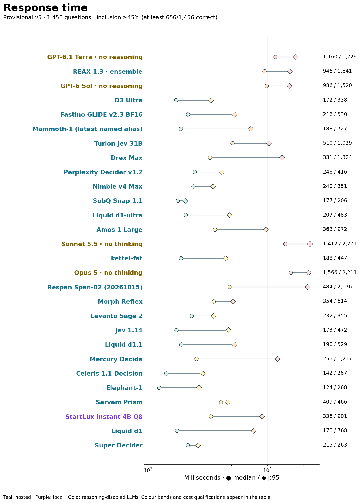

### Cost per 1,000 questions

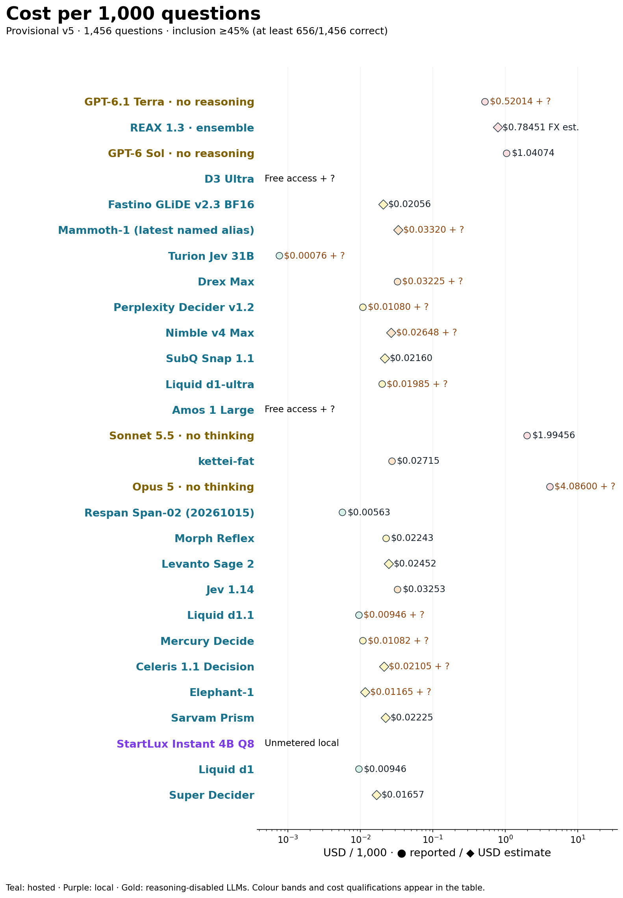

## Category results

The category scale is fixed at 0–100%. Each cell shows correct/retained total and percentage; ★ marks all tied leaders. Category sizes vary after removal.

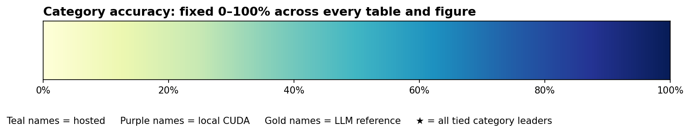

### Rules, evidence and logical scope

F01 Lookup and filtering (n=5); F02 Forward conditionals (n=22); F03 Necessary conditions (n=32); F04 Boolean scope (n=18); F05 Quantifiers and sets (n=9); F11 Sufficiency and inconsistency (n=29).

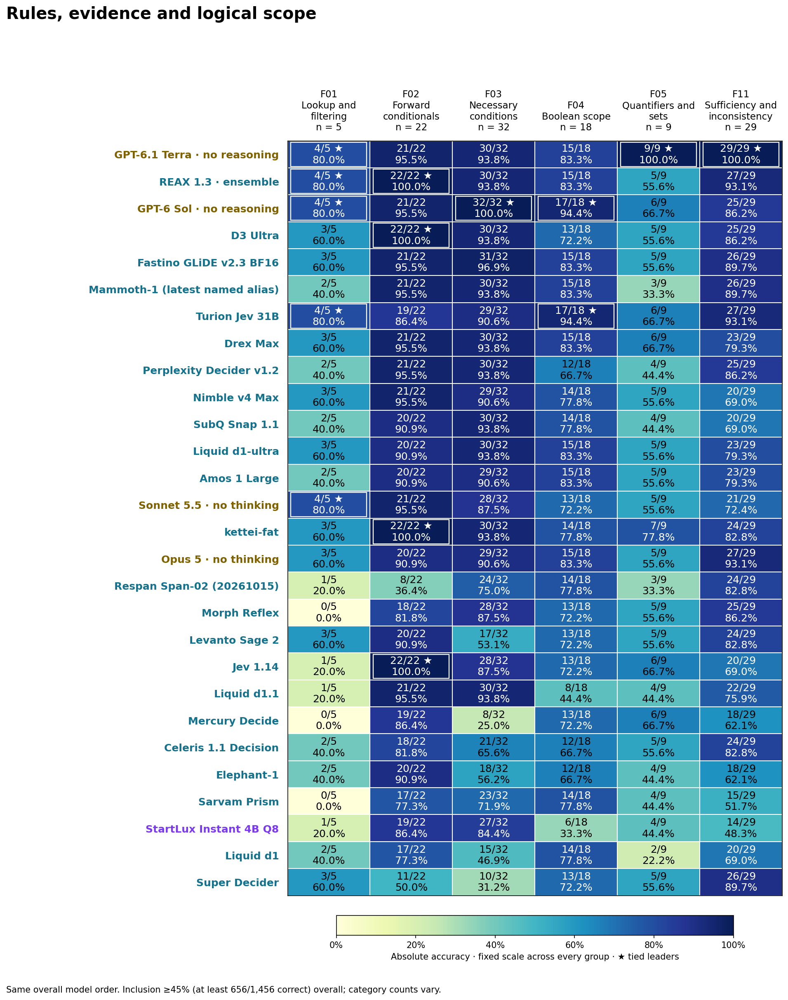

### Ordering, schedules and assignments

F06 Comparisons (n=7); F07 Scheduling (n=54); F08 One-to-one assignments (n=44); F14 Temporal intervals (n=25); F22 Preference ordering (n=9).

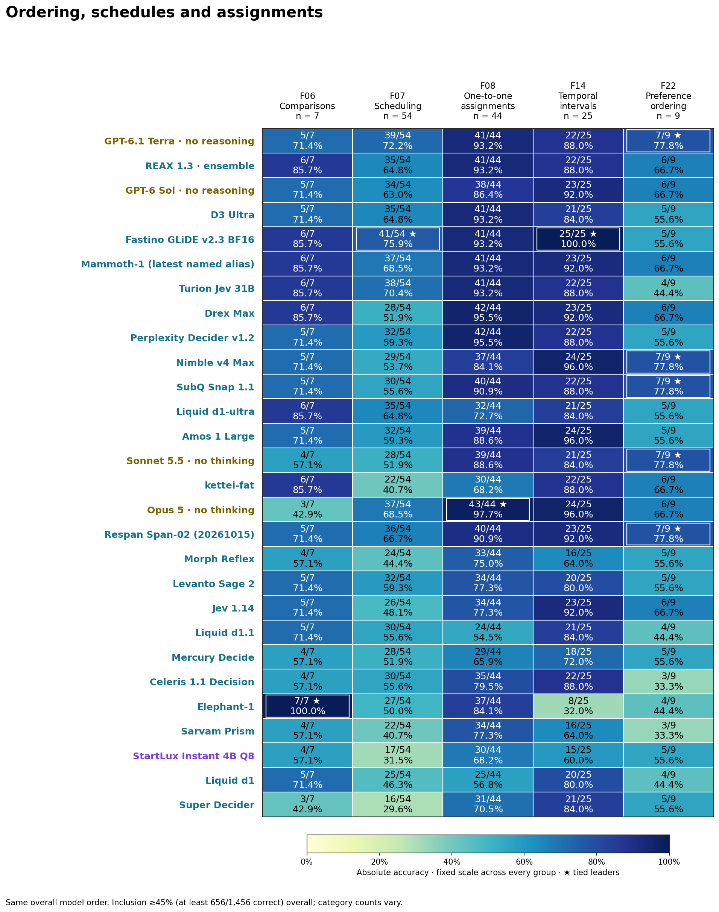

### State tracking and perspectives

F09 Exact truth counting (n=68); F10 Truth-teller consistency (n=69); F12 Object swaps (n=43); F13 Sequential procedures (n=47); F15 Spatial tracking (n=35); F16 Reference binding (n=35); F17 Beliefs and perspectives (n=19).

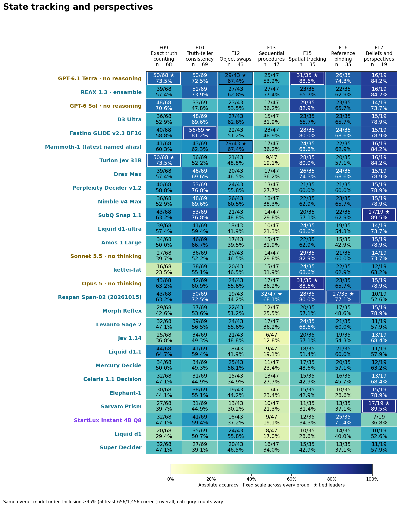

### Causes, plans and authoritative evidence

F18 Causal intervention (n=37); F19 Exceptions and priorities (n=24); F20 Planning (n=16); F21 Directed reachability (n=5); F23 Rule counterexamples (n=14); F24 Authority and stale records (n=8); F25 Fault diagnosis (n=11).

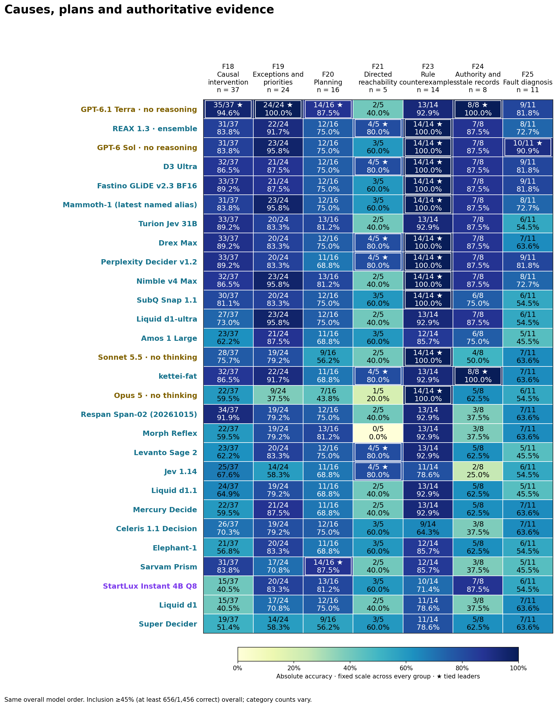

### Decisions under uncertainty

F26 Probabilistic risk (n=30); F27 Value of information (n=40); F28 Robust decisions without a prior (n=39); F29 Strategic decisions (n=39); F30 Concurrent-history consistency (n=38); F31 Information-flow security (n=36).

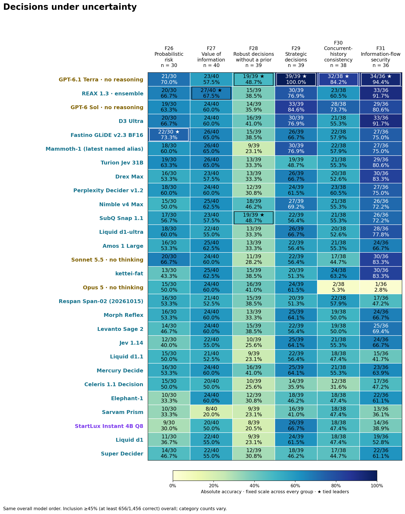

### Practical decisions: scope, policy and actions

P01 Understanding requests and routing (n=31); P02 Recognizing multiple requested actions (n=34); P03 Tracking current conversational intention (n=33); P04 Selecting a tool or requesting clarification (n=35); P05 Checking authorization and scope (n=35).

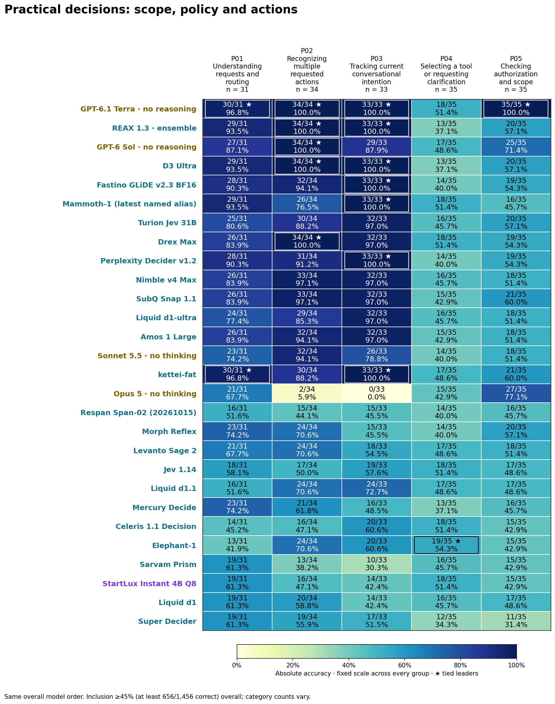

### Practical decisions: evidence, security and quality

P06 Making decisions with untrusted content (n=35); P07 Applying a contextual content policy (n=27); P08 Extracting and normalizing facts (n=36); P09 Checking claims against supplied evidence (n=32); P10 Assigning severity or priority from a rubric (n=31).

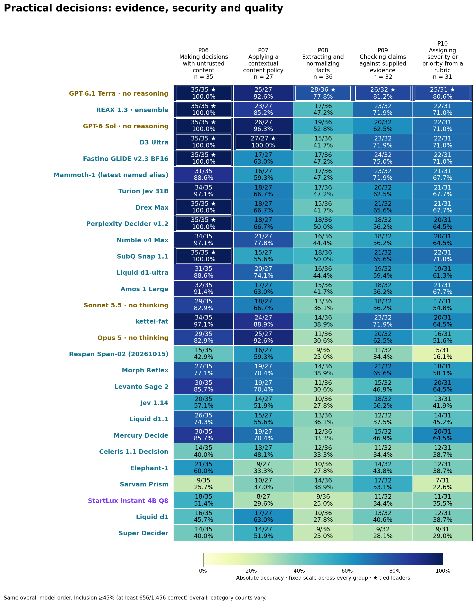

### IQ sequences and admissions-style mathematics

F32 Numerical pattern recognition (n=20); F33 Quantitative reasoning (n=200).

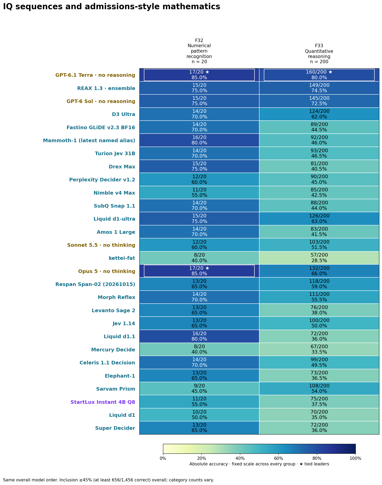

## Below the 45% cutoff

V5 uses the retained 1,456-question bank and 45% cutoff. Historical v4 scores below use its original 2,157 questions and former 62% cutoff.

- **Drex v2.0: v5 653/1,456 (44.85%)**; coverage 95.26%. Historical v4: 1296/2,157 (60.08%).
- **Microsoft-Decision-1: v5 637/1,456 (43.75%)**; coverage 100.00%. Historical v4: 1315/2,157 (60.96%).
- **D3 Artemis 9B IQ3_M: v5 631/1,456 (43.34%)**; coverage 88.74%. Historical v4: 1322/2,157 (61.29%).
- **Cloudflare Clef: v5 615/1,456 (42.24%)**; coverage 100.00%. Historical v4: 1299/2,157 (60.22%).
- **Cerno 4B v1.2 NF4: v5 598/1,456 (41.07%)**; coverage 89.90%. Historical v4: 1276/2,157 (59.16%).
- **meraGPT Decider 1: v5 338/1,456 (23.21%)**; coverage 100.00%. Historical v4: 620/2,157 (28.74%).

## Historical v4 exploratory screens

These are unchanged historical samples with their original denominators, not v5 scores or classifications against its threshold. No stopped test was resumed.

- **Strike 1:** 57/100 correct; free-tier screen stopped after 100 requests. [Historical method and limits](STRIKE_SCREEN_NOTES.md).
- **Hanzo Kai 1.9:** 46/244 correct; the free daily cap was followed by a separate eight-hour plan window after credits were purchased. The user stopped the test. [Historical method and limits](KAI_CASE_NOTE.md).
- **THIS/THAT 1.2 and GLiNER2.5-Decide:** THIS/THAT: 32/100 correct. GLiNER: 4/14 usable answers, plus 6 input-length rejections in 20 attempts. [Historical method and limits](LOCAL_SCREEN_NOTES.md).
- **Hindsight and Lumma:** Hindsight: 29/100 correct. Lumma: 452/799 attempts correct, including an unavailable request. [Historical method and limits](NEW_LOCAL_SCREEN_NOTES.md).
- **GPT-6 Luna Decisions:** 82/181 correct on the separately attempted additions; historical baseline 758/1,342. The expansion stopped below its recorded 50% rule. [Historical method and limits](OPENAI_DECISIONS_NOTES.md).

## Selection, scope and limitations

The removed set was chosen using the exact recorded answers of the preceding 26-model main graph, including four reasoning-disabled LLM references. This cohort-conditioned selection leaves the original cohort’s relative overall order unchanged and changes category weights unevenly. It is not an independent demonstration of general difficulty. Future configurations use the frozen 1,456 inputs and exact 45% threshold.

The quantitative category retains 60 questions selected for Fastino/D3 Artemis errors and 140 selected for an error by at least one of Fastino, Mammoth, GPT-6 Sol, D3 Ultra or Drex Max. Multiple selection models distribute that dependence without removing it. Public questions may appear in training data; these scores are not human IQ norms. The separate 120 companion diagnostics remain excluded.

The smaller bank reduces future requests by **701/2,157 (32.5%)**. Token charges need not fall by the same proportion. Costs and response times preserve differences in dates, routes, model settings, precision and hardware.

## Question origins and licenses

The retained bank has **1,236 questions from the project development bank, 20 MAIQ number sequences and 200 AQuA quantitative questions**. AQuA-RAT declares Apache-2.0 and contains crowdsourced admissions-style mathematics, not authenticated official GRE or SAT questions. MAIQ’s repository declares MIT, but original human-test item rights remain unestablished; inclusion retains that caveat. The development lineage does not fully establish individual authorship or possible external influences for every project-bank item. The project MIT license does not supersede third-party rights. The two noncommercial LogiQA items remain outside the bank. [Full source and license notices](SOURCE_AND_LICENSES.md).

## Download and reproducibility

- [Answer-free provisional v5 questions](questions_1456.jsonl)
- [Question-level origin and license metadata](source_metadata_1456.jsonl)
- [Source and license notes](SOURCE_AND_LICENSES.md)
- [All model summaries](statistics.json)
- [All models by 43 categories](all_category_scores.csv)
- [Retained timing and status evidence](timing_evidence.csv.gz)
- [Retained cost evidence](cost_evidence.csv.gz)
- [Retained cost summaries](cost_statistics.json)
- [Category guide](category_guide.json)
- [701 removed question IDs and categories](removed_items.csv)
- [1,456 retained question IDs and categories](retained_items.csv)
- [Fixed selection cohort and subset provenance](selection_provenance.json)
- [Retained correctness and usability booleans](correctness_evidence.csv.gz)
- [Removed-item correctness and usability booleans](removed_correctness_evidence.csv.gz)
- [Historical no-answer recovery evidence](transport_recoveries.json)
- [Historical collection recovery evidence](model_collection_recoveries.json)
- [Historical context diagnostics](model_context_diagnostics.json)
- [Subset audit receipt](audit_receipt.json)
- [Release checksums](manifest.json)
- [Morph and REAX configuration, collection and billing notes](HOSTED_MODEL_NOTES.md)
- [Independent new-model audit summaries](hosted_model_audits.json)
- [New-model cost summaries](hosted_cost_summaries.json)
- [Full-bank REAX, Terra, Fastino and Morph comparisons](new_model_comparison.json)
- [REAX ensemble accuracy, speed and cost trade-off](REAX_TERRA_COMPARISON.md)
- [Native EUR charges and separately estimated USD conversion](native_currency_cost_evidence.csv.gz)
- [Captured ECB rate receipt](fx_receipt.json)
- [Captured ECB exchange-rate XML](ecb_eurofxref_2026-11-09.xml)
- [Frozen initial v5 audit receipt](baseline_v5_audit_receipt.json)

The [scripts/](https://github.com/etsabary/system-1-decision-benchmark/blob/main/scripts/README.md) support offline validation without credentials. The [initial v5 report](https://github.com/etsabary/system-1-decision-benchmark/blob/main/results/releases/system1_v5_provisional_2026-11-09/report.html), [full v4 report](https://github.com/etsabary/system-1-decision-benchmark/blob/main/results/releases/system1_v4_openai_2026-11-06/report.html), [v3](https://github.com/etsabary/system-1-decision-benchmark/blob/main/results/releases/system1_v3_presentation_2026-11-01/report.html) and [v2](https://github.com/etsabary/system-1-decision-benchmark/blob/main/results/releases/system1_v2_presentation_2026-11-01/report.html) remain unchanged. Model-selected choices and the gold scoring key remain private.

```sh
python3 scripts/validate_system1_v5_hosted_2026_11_09.py results/releases/system1_v5_hosted_2026-11-09 results/releases/system1_v5_provisional_2026-11-09
python3 scripts/validate_october21_release.py
```
