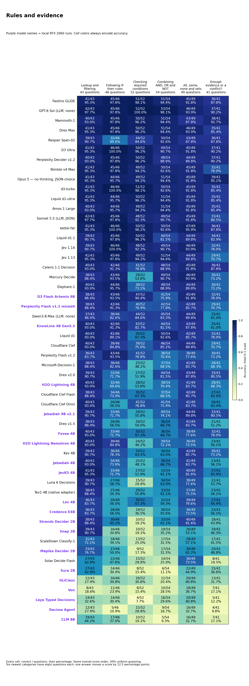
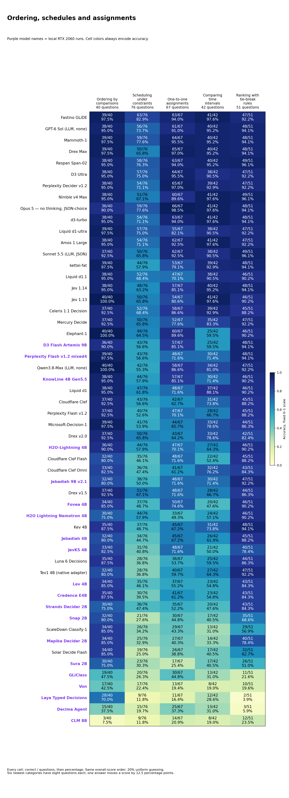
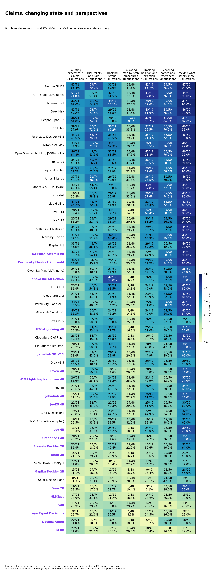
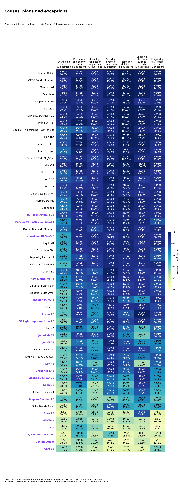
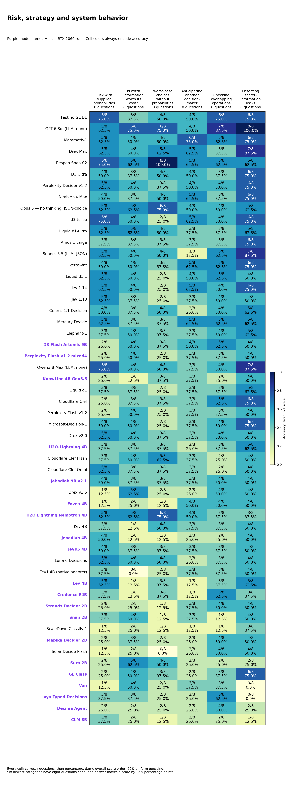

# All 31 categories: 54 full-bank routes

[Color-coded, named tables](https://etsabary.github.io/system-1-decision-benchmark/report.html#functions). Purple model-name badges identify local RTX 2060 runs; cell colors always encode accuracy.

## Category scores and explanations

The 31 categories are grouped below so the labels and values remain readable. These are reading groups, not new scored categories. All 54 routes remain in overall-score order. Every cell shows **correct / questions and percentage**. Darker blue means higher accuracy on a fixed 0-100% scale; uniform random guessing averages 20%. Different category sizes mean that percentages alone do not show how much evidence is available.

[Open the color-coded, selectable tables](https://etsabary.github.io/system-1-decision-benchmark/report.html#functions), with a pinned model-name column and individual category rankings.

### Rules and evidence

Which facts meet a rule, which conclusions follow, and when is the evidence insufficient?

| Category | Questions | What it tests and a simple example |
| --- | --- | --- |
| Lookup and filtering (F01) | 43 | Select records that meet stated conditions Example: Which listed request is both signed and marked urgent? |
| Following if-then rules (F02) | 46 | Apply an implication from its trigger Example: If an active badge grants entry and this badge is active, what follows? |
| Checking required conditions (F03) | 52 | Reason backward from a missing required condition Example: Every approved request needs a valid ticket; can one without a ticket be approved? |
| Combining AND, OR and NOT (F04) | 54 | Track combinations such as both, either and exactly one Example: Which choice satisfies exactly one of two stated conditions? |
| All, some, none and sets (F05) | 49 | Track all, some, none and overlapping groups Example: All teal tokens are marked; no marked token is blank; which relation follows? |
| Enough evidence or a conflict? (F11) | 41 | Determine whether facts force an answer or contradict one another Example: Is a proposed arrangement determined, impossible or still underdetermined? |

[Full-size SVG](../results/releases/native_updates_2026-10-27/rules.svg) · [Color-coded table and category rankings](https://etsabary.github.io/system-1-decision-benchmark/report.html#group-rules)

| Model | Lookup and filtering | Following if-then rules | Checking required conditions | Combining AND, OR and NOT | All, some, none and sets | Enough evidence or a conflict? |
| --- | --- | --- | --- | --- | --- | --- |
| Fastino GLiDE | 41/43 (95.3%) | 45/46 (97.8%) | 51/52 (98.1%) | 51/54 (94.4%) | 45/49 (91.8%) | 36/41 (87.8%) |
| GPT-6 Sol — no reasoning | 42/43 (97.7%) | 45/46 (97.8%) | 52/52 (100.0%) | 53/54 (98.1%) | 46/49 (93.9%) | 37/41 (90.2%) |
| Mammoth-1 | 40/43 (93.0%) | 45/46 (97.8%) | 50/52 (96.2%) | 51/54 (94.4%) | 43/49 (87.8%) | 38/41 (92.7%) |
| Drex Max | 41/43 (95.3%) | 45/46 (97.8%) | 50/52 (96.2%) | 51/54 (94.4%) | 46/49 (93.9%) | 35/41 (85.4%) |
| Respan Span-02 | 39/43 (90.7%) | 32/46 (69.6%) | 44/52 (84.6%) | 50/54 (92.6%) | 43/49 (87.8%) | 36/41 (87.8%) |
| D3 Ultra | 41/43 (95.3%) | 46/46 (100.0%) | 50/52 (96.2%) | 49/54 (90.7%) | 45/49 (91.8%) | 37/41 (90.2%) |
| Perplexity Decider v1.2 | 40/43 (93.0%) | 45/46 (97.8%) | 50/52 (96.2%) | 48/54 (88.9%) | 44/49 (89.8%) | 37/41 (90.2%) |
| Nimble v4 Max | 41/43 (95.3%) | 45/46 (97.8%) | 49/52 (94.2%) | 50/54 (92.6%) | 45/49 (91.8%) | 32/41 (78.0%) |
| Opus 5 — no thinking, JSON-choice | 41/43 (95.3%) | 44/46 (95.7%) | 49/52 (94.2%) | 51/54 (94.4%) | 45/49 (91.8%) | 39/41 (95.1%) |
| d3-turbo | 41/43 (95.3%) | 46/46 (100.0%) | 51/52 (98.1%) | 50/54 (92.6%) | 45/49 (91.8%) | 35/41 (85.4%) |
| Liquid d1-ultra | 41/43 (95.3%) | 44/46 (95.7%) | 50/52 (96.2%) | 51/54 (94.4%) | 45/49 (91.8%) | 35/41 (85.4%) |
| Amos 1 Large | 40/43 (93.0%) | 44/46 (95.7%) | 49/52 (94.2%) | 51/54 (94.4%) | 45/49 (91.8%) | 35/41 (85.4%) |
| Sonnet 5.5 — no thinking, JSON-choice | 42/43 (97.7%) | 45/46 (97.8%) | 48/52 (92.3%) | 49/54 (90.7%) | 45/49 (91.8%) | 33/41 (80.5%) |
| kettei-fat | 41/43 (95.3%) | 46/46 (100.0%) | 50/52 (96.2%) | 50/54 (92.6%) | 47/49 (95.9%) | 36/41 (87.8%) |
| Liquid d1.1 | 39/43 (90.7%) | 45/46 (97.8%) | 50/52 (96.2%) | 44/54 (81.5%) | 44/49 (89.8%) | 34/41 (82.9%) |
| Jev 1.14 | 39/43 (90.7%) | 46/46 (100.0%) | 48/52 (92.3%) | 49/54 (90.7%) | 46/49 (93.9%) | 32/41 (78.0%) |
| Jev 1.13 | 41/43 (95.3%) | 45/46 (97.8%) | 49/52 (94.2%) | 51/54 (94.4%) | 44/49 (89.8%) | 29/41 (70.7%) |
| Celeris 1.1 Decision | 40/43 (93.0%) | 42/46 (91.3%) | 41/52 (78.8%) | 48/54 (88.9%) | 45/49 (91.8%) | 36/41 (87.8%) |
| Mercury Decide | 38/43 (88.4%) | 43/46 (93.5%) | 28/52 (53.8%) | 49/54 (90.7%) | 46/49 (93.9%) | 30/41 (73.2%) |
| Elephant-1 | 40/43 (93.0%) | 44/46 (95.7%) | 38/52 (73.1%) | 48/54 (88.9%) | 44/49 (89.8%) | 30/41 (73.2%) |
| D3 Flash Artemis 9B | 38/43 (88.4%) | 43/46 (93.5%) | 47/52 (90.4%) | 41/54 (75.9%) | 45/49 (91.8%) | 32/41 (78.0%) |
| Perplexity Flash v1.2 mixed4 | 38/43 (88.4%) | 42/46 (91.3%) | 40/52 (76.9%) | 42/54 (77.8%) | 42/49 (85.7%) | 29/41 (70.7%) |
| Qwen3.8-Max — none, Hyper Charm | 37/43 (86.0%) | 38/46 (82.6%) | 44/52 (84.6%) | 45/54 (83.3%) | 44/49 (89.8%) | 25/41 (61.0%) |
| KnowLine 4B Gen5.5 | 40/43 (93.0%) | 42/46 (91.3%) | 43/52 (82.7%) | 44/54 (81.5%) | 43/49 (87.8%) | 25/41 (61.0%) |
| Liquid d1 | 40/43 (93.0%) | 41/46 (89.1%) | 35/52 (67.3%) | 50/54 (92.6%) | 42/49 (85.7%) | 32/41 (78.0%) |
| Cloudflare Clef | 40/43 (93.0%) | 39/46 (84.8%) | 39/52 (75.0%) | 46/54 (85.2%) | 44/49 (89.8%) | 29/41 (70.7%) |
| Perplexity Decider Flash v1.2 | 36/43 (83.7%) | 43/46 (93.5%) | 41/52 (78.8%) | 38/54 (70.4%) | 38/49 (77.6%) | 30/41 (73.2%) |
| Microsoft-Decision-1 | 38/43 (88.4%) | 38/46 (82.6%) | 25/52 (48.1%) | 37/54 (68.5%) | 41/49 (83.7%) | 28/41 (68.3%) |
| Drex v2.0 | 39/43 (90.7%) | 33/46 (71.7%) | 27/52 (51.9%) | 44/54 (81.5%) | 43/49 (87.8%) | 33/41 (80.5%) |
| H2O-Lightning 4B | 40/43 (93.0%) | 32/46 (69.6%) | 28/52 (53.8%) | 38/54 (70.4%) | 41/49 (83.7%) | 28/41 (68.3%) |
| Cloudflare Clef Flash | 38/43 (88.4%) | 34/46 (73.9%) | 35/52 (67.3%) | 37/54 (68.5%) | 42/49 (85.7%) | 27/41 (65.9%) |
| Cloudflare Clef Omni | 40/43 (93.0%) | 26/46 (56.5%) | 41/52 (78.8%) | 41/54 (75.9%) | 41/49 (83.7%) | 26/41 (63.4%) |
| Jebadiah 9B v2.1 | 39/43 (90.7%) | 33/46 (71.7%) | 29/52 (55.8%) | 40/54 (74.1%) | 44/49 (89.8%) | 33/41 (80.5%) |
| Drex v1.5 | 38/43 (88.4%) | 26/46 (56.5%) | 26/52 (50.0%) | 36/54 (66.7%) | 41/49 (83.7%) | 21/41 (51.2%) |
| Fovea 4B | 40/43 (93.0%) | 33/46 (71.7%) | 35/52 (67.3%) | 36/54 (66.7%) | 38/49 (77.6%) | 32/41 (78.0%) |
| H2O Lightning Nemotron 4B | 40/43 (93.0%) | 39/46 (84.8%) | 24/52 (46.2%) | 39/54 (72.2%) | 36/49 (73.5%) | 23/41 (56.1%) |
| Kev 4B | 39/43 (90.7%) | 36/46 (78.3%) | 33/52 (63.5%) | 34/54 (63.0%) | 42/49 (85.7%) | 30/41 (73.2%) |
| Jebadiah 4B | 40/43 (93.0%) | 34/46 (73.9%) | 25/52 (48.1%) | 36/54 (66.7%) | 41/49 (83.7%) | 23/41 (56.1%) |
| JevK5 4B | 41/43 (95.3%) | 33/46 (71.7%) | 27/52 (51.9%) | 33/54 (61.1%) | 40/49 (81.6%) | 27/41 (65.9%) |
| Luna 6 Decisions | 39/43 (90.7%) | 27/46 (58.7%) | 15/52 (28.8%) | 34/54 (63.0%) | 38/49 (77.6%) | 22/41 (53.7%) |
| Tev1 4B experimental (OpenRouter native adapter) | 38/43 (88.4%) | 25/46 (54.3%) | 29/52 (55.8%) | 33/54 (61.1%) | 37/49 (75.5%) | 23/41 (56.1%) |
| Lev 4B | 36/43 (83.7%) | 26/46 (56.5%) | 35/52 (67.3%) | 32/54 (59.3%) | 39/49 (79.6%) | 27/41 (65.9%) |
| Credence E4B | 36/43 (83.7%) | 26/46 (56.5%) | 19/52 (36.5%) | 30/54 (55.6%) | 36/49 (73.5%) | 23/41 (56.1%) |
| Strands Decider 2B | 38/43 (88.4%) | 30/46 (65.2%) | 10/52 (19.2%) | 33/54 (61.1%) | 40/49 (81.6%) | 18/41 (43.9%) |
| Snap 2B | 39/43 (90.7%) | 16/46 (34.8%) | 10/52 (19.2%) | 19/54 (35.2%) | 26/49 (53.1%) | 19/41 (46.3%) |
| ScaleDown Classify-1 | 31/43 (72.1%) | 18/46 (39.1%) | 13/52 (25.0%) | 17/54 (31.5%) | 28/49 (57.1%) | 17/41 (41.5%) |
| Mapika Decider 2B | 33/43 (76.7%) | 23/46 (50.0%) | 9/52 (17.3%) | 17/54 (31.5%) | 30/49 (61.2%) | 20/41 (48.8%) |
| Solar Decide Flash | 27/43 (62.8%) | 22/46 (47.8%) | 15/52 (28.8%) | 14/54 (25.9%) | 36/49 (73.5%) | 8/41 (19.5%) |
| Sura 2B | 27/43 (62.8%) | 14/46 (30.4%) | 8/52 (15.4%) | 6/54 (11.1%) | 22/49 (44.9%) | 15/41 (36.6%) |
| GLiClass | 12/43 (27.9%) | 16/46 (34.8%) | 16/52 (30.8%) | 11/54 (20.4%) | 20/49 (40.8%) | 13/41 (31.7%) |
| Von | 8/43 (18.6%) | 11/46 (23.9%) | 8/52 (15.4%) | 10/54 (18.5%) | 18/49 (36.7%) | 7/41 (17.1%) |
| Laya Typed Decisions | 14/43 (32.6%) | 14/46 (30.4%) | 4/52 (7.7%) | 16/54 (29.6%) | 20/49 (40.8%) | 5/41 (12.2%) |
| Decima Agent | 12/43 (27.9%) | 5/46 (10.9%) | 15/52 (28.8%) | 9/54 (16.7%) | 16/49 (32.7%) | 4/41 (9.8%) |
| CLM 8B | 19/43 (44.2%) | 17/46 (37.0%) | 10/52 (19.2%) | 5/54 (9.3%) | 16/49 (32.7%) | 7/41 (17.1%) |

### Ordering, schedules and assignments

Can the model combine comparisons, fit a schedule, assign unique partners and apply tie-break rules?

| Category | Questions | What it tests and a simple example |
| --- | --- | --- |
| Ordering by comparisons (F06) | 40 | Combine ordered comparisons Example: A is taller than B and B than C; how do A and C compare? |
| Scheduling under constraints (F07) | 76 | Fit events around order and exclusion rules Example: Which timetable puts one meeting before another without overlapping a break? |
| One-to-one assignments (F08) | 67 | Give each item a unique partner while satisfying clues Example: Assign three people different desks using location restrictions. |
| Comparing time intervals (F14) | 42 | Compare starts, ends and overlapping periods Example: Which interval overlaps a specified event without containing it? |
| Ranking with tie-break rules (F22) | 51 | Rank candidates using explicit tie-break rules Example: Rank by priority first, then age when priorities tie. |

[Full-size SVG](../results/releases/native_updates_2026-10-27/ordering.svg) · [Color-coded table and category rankings](https://etsabary.github.io/system-1-decision-benchmark/report.html#group-ordering)

| Model | Ordering by comparisons | Scheduling under constraints | One-to-one assignments | Comparing time intervals | Ranking with tie-break rules |
| --- | --- | --- | --- | --- | --- |
| Fastino GLiDE | 39/40 (97.5%) | 63/76 (82.9%) | 63/67 (94.0%) | 41/42 (97.6%) | 47/51 (92.2%) |
| GPT-6 Sol — no reasoning | 38/40 (95.0%) | 56/76 (73.7%) | 61/67 (91.0%) | 40/42 (95.2%) | 48/51 (94.1%) |
| Mammoth-1 | 39/40 (97.5%) | 59/76 (77.6%) | 64/67 (95.5%) | 40/42 (95.2%) | 48/51 (94.1%) |
| Drex Max | 39/40 (97.5%) | 50/76 (65.8%) | 65/67 (97.0%) | 40/42 (95.2%) | 48/51 (94.1%) |
| Respan Span-02 | 38/40 (95.0%) | 58/76 (76.3%) | 63/67 (94.0%) | 40/42 (95.2%) | 49/51 (96.1%) |
| D3 Ultra | 38/40 (95.0%) | 57/76 (75.0%) | 64/67 (95.5%) | 38/42 (90.5%) | 47/51 (92.2%) |
| Perplexity Decider v1.2 | 38/40 (95.0%) | 54/76 (71.1%) | 65/67 (97.0%) | 39/42 (92.9%) | 47/51 (92.2%) |
| Nimble v4 Max | 38/40 (95.0%) | 51/76 (67.1%) | 60/67 (89.6%) | 41/42 (97.6%) | 49/51 (96.1%) |
| Opus 5 — no thinking, JSON-choice | 36/40 (90.0%) | 59/76 (77.6%) | 66/67 (98.5%) | 41/42 (97.6%) | 48/51 (94.1%) |
| d3-turbo | 38/40 (95.0%) | 54/76 (71.1%) | 63/67 (94.0%) | 41/42 (97.6%) | 48/51 (94.1%) |
| Liquid d1-ultra | 39/40 (97.5%) | 57/76 (75.0%) | 55/67 (82.1%) | 38/42 (90.5%) | 47/51 (92.2%) |
| Amos 1 Large | 38/40 (95.0%) | 54/76 (71.1%) | 62/67 (92.5%) | 41/42 (97.6%) | 47/51 (92.2%) |
| Sonnet 5.5 — no thinking, JSON-choice | 37/40 (92.5%) | 50/76 (65.8%) | 62/67 (92.5%) | 38/42 (90.5%) | 49/51 (96.1%) |
| kettei-fat | 39/40 (97.5%) | 44/76 (57.9%) | 53/67 (79.1%) | 39/42 (92.9%) | 48/51 (94.1%) |
| Liquid d1.1 | 38/40 (95.0%) | 52/76 (68.4%) | 47/67 (70.1%) | 38/42 (90.5%) | 46/51 (90.2%) |
| Jev 1.14 | 38/40 (95.0%) | 48/76 (63.2%) | 57/67 (85.1%) | 40/42 (95.2%) | 48/51 (94.1%) |
| Jev 1.13 | 40/40 (100.0%) | 50/76 (65.8%) | 54/67 (80.6%) | 41/42 (97.6%) | 46/51 (90.2%) |
| Celeris 1.1 Decision | 37/40 (92.5%) | 52/76 (68.4%) | 58/67 (86.6%) | 39/42 (92.9%) | 45/51 (88.2%) |
| Mercury Decide | 37/40 (92.5%) | 50/76 (65.8%) | 52/67 (77.6%) | 35/42 (83.3%) | 47/51 (92.2%) |
| Elephant-1 | 40/40 (100.0%) | 49/76 (64.5%) | 60/67 (89.6%) | 25/42 (59.5%) | 46/51 (90.2%) |
| D3 Flash Artemis 9B | 36/40 (90.0%) | 43/76 (56.6%) | 57/67 (85.1%) | 25/42 (59.5%) | 48/51 (94.1%) |
| Perplexity Flash v1.2 mixed4 | 39/40 (97.5%) | 43/76 (56.6%) | 48/67 (71.6%) | 30/42 (71.4%) | 48/51 (94.1%) |
| Qwen3.8-Max — none, Hyper Charm | 40/40 (100.0%) | 42/76 (55.3%) | 58/67 (86.6%) | 34/42 (81.0%) | 47/51 (92.2%) |
| KnowLine 4B Gen5.5 | 38/40 (95.0%) | 44/76 (57.9%) | 57/67 (85.1%) | 30/42 (71.4%) | 46/51 (90.2%) |
| Liquid d1 | 38/40 (95.0%) | 47/76 (61.8%) | 48/67 (71.6%) | 37/42 (88.1%) | 46/51 (90.2%) |
| Cloudflare Clef | 37/40 (92.5%) | 43/76 (56.6%) | 42/67 (62.7%) | 31/42 (73.8%) | 45/51 (88.2%) |
| Perplexity Decider Flash v1.2 | 37/40 (92.5%) | 40/76 (52.6%) | 47/67 (70.1%) | 28/42 (66.7%) | 45/51 (88.2%) |
| Microsoft-Decision-1 | 39/40 (97.5%) | 41/76 (53.9%) | 44/67 (65.7%) | 33/42 (78.6%) | 44/51 (86.3%) |
| Drex v2.0 | 37/40 (92.5%) | 50/76 (65.8%) | 43/67 (64.2%) | 33/42 (78.6%) | 42/51 (82.4%) |
| H2O-Lightning 4B | 36/40 (90.0%) | 44/76 (57.9%) | 47/67 (70.1%) | 27/42 (64.3%) | 46/51 (90.2%) |
| Cloudflare Clef Flash | 32/40 (80.0%) | 35/76 (46.1%) | 48/67 (71.6%) | 22/42 (52.4%) | 45/51 (88.2%) |
| Cloudflare Clef Omni | 33/40 (82.5%) | 36/76 (47.4%) | 41/67 (61.2%) | 32/42 (76.2%) | 43/51 (84.3%) |
| Jebadiah 9B v2.1 | 32/40 (80.0%) | 38/76 (50.0%) | 48/67 (71.6%) | 30/42 (71.4%) | 47/51 (92.2%) |
| Drex v1.5 | 37/40 (92.5%) | 51/76 (67.1%) | 48/67 (71.6%) | 28/42 (66.7%) | 44/51 (86.3%) |
| Fovea 4B | 34/40 (85.0%) | 37/76 (48.7%) | 50/67 (74.6%) | 20/42 (47.6%) | 46/51 (90.2%) |
| H2O Lightning Nemotron 4B | 30/40 (75.0%) | 44/76 (57.9%) | 33/67 (49.3%) | 24/42 (57.1%) | 46/51 (90.2%) |
| Kev 4B | 35/40 (87.5%) | 37/76 (48.7%) | 45/67 (67.2%) | 31/42 (73.8%) | 48/51 (94.1%) |
| Jebadiah 4B | 32/40 (80.0%) | 34/76 (44.7%) | 45/67 (67.2%) | 26/42 (61.9%) | 45/51 (88.2%) |
| JevK5 4B | 33/40 (82.5%) | 31/76 (40.8%) | 48/67 (71.6%) | 21/42 (50.0%) | 40/51 (78.4%) |
| Luna 6 Decisions | 35/40 (87.5%) | 28/76 (36.8%) | 36/67 (53.7%) | 25/42 (59.5%) | 44/51 (86.3%) |
| Tev1 4B experimental (OpenRouter native adapter) | 32/40 (80.0%) | 28/76 (36.8%) | 40/67 (59.7%) | 27/42 (64.3%) | 47/51 (92.2%) |
| Lev 4B | 34/40 (85.0%) | 35/76 (46.1%) | 37/67 (55.2%) | 23/42 (54.8%) | 43/51 (84.3%) |
| Credence E4B | 35/40 (87.5%) | 30/76 (39.5%) | 41/67 (61.2%) | 23/42 (54.8%) | 43/51 (84.3%) |
| Strands Decider 2B | 30/40 (75.0%) | 36/76 (47.4%) | 35/67 (52.2%) | 20/42 (47.6%) | 43/51 (84.3%) |
| Snap 2B | 32/40 (80.0%) | 21/76 (27.6%) | 30/67 (44.8%) | 17/42 (40.5%) | 35/51 (68.6%) |
| ScaleDown Classify-1 | 34/40 (85.0%) | 26/76 (34.2%) | 29/67 (43.3%) | 13/42 (31.0%) | 29/51 (56.9%) |
| Mapika Decider 2B | 34/40 (85.0%) | 25/76 (32.9%) | 27/67 (40.3%) | 14/42 (33.3%) | 40/51 (78.4%) |
| Solar Decide Flash | 34/40 (85.0%) | 19/76 (25.0%) | 26/67 (38.8%) | 17/42 (40.5%) | 32/51 (62.7%) |
| Sura 2B | 30/40 (75.0%) | 23/76 (30.3%) | 17/67 (25.4%) | 17/42 (40.5%) | 26/51 (51.0%) |
| GLiClass | 19/40 (47.5%) | 20/76 (26.3%) | 30/67 (44.8%) | 13/42 (31.0%) | 11/51 (21.6%) |
| Von | 17/40 (42.5%) | 17/76 (22.4%) | 13/67 (19.4%) | 8/42 (19.0%) | 10/51 (19.6%) |
| Laya Typed Decisions | 28/40 (70.0%) | 9/76 (11.8%) | 11/67 (16.4%) | 12/42 (28.6%) | 2/51 (3.9%) |
| Decima Agent | 15/40 (37.5%) | 15/76 (19.7%) | 25/67 (37.3%) | 13/42 (31.0%) | 3/51 (5.9%) |
| CLM 8B | 3/40 (7.5%) | 9/76 (11.8%) | 14/67 (20.9%) | 8/42 (19.0%) | 12/51 (23.5%) |

### Claims, changing state and perspectives

Can the model count true statements, update a changing situation and separate what different observers know?

| Category | Questions | What it tests and a simple example |
| --- | --- | --- |
| Counting exactly true claims (F09) | 71 | Count precisely how many statements hold Example: Under the supplied facts, how many of six claims are true? |
| Truth-tellers and liars (F10) | 74 | Find a consistent pattern of truthful and false statements Example: Which assignment of honest and dishonest speakers fits their claims? |
| Tracking swaps (F12) | 52 | Update locations after repeated exchanges Example: A red token starts in box A; several box contents are swapped; where does it end? |
| Following step-by-step procedures (F13) | 48 | Apply each ordered edit to the current state Example: Toggle one flag, swap two values, then conditionally reset another flag. |
| Tracking position and direction (F15) | 49 | Update position or direction from described movement Example: Follow successive turns and moves, then identify the final direction. |
| Resolving names and references (F16) | 50 | Resolve chains of names, roles and references Example: Identify the mentor of the colleague named in a nested description. |
| Tracking what others know (F17) | 50 | Distinguish what different observers witnessed Example: An object moves while one observer is absent; where will that observer look? |

[Full-size SVG](../results/releases/native_updates_2026-10-27/state.svg) · [Color-coded table and category rankings](https://etsabary.github.io/system-1-decision-benchmark/report.html#group-state)

| Model | Counting exactly true claims | Truth-tellers and liars | Tracking swaps | Following step-by-step procedures | Tracking position and direction | Resolving names and references | Tracking what others know |
| --- | --- | --- | --- | --- | --- | --- | --- |
| Fastino GLiDE | 45/71 (63.4%) | 59/74 (79.7%) | 31/52 (59.6%) | 18/48 (37.5%) | 41/49 (83.7%) | 39/50 (78.0%) | 47/50 (94.0%) |
| GPT-6 Sol — no reasoning | 51/71 (71.8%) | 38/74 (51.4%) | 32/52 (61.5%) | 18/48 (37.5%) | 43/49 (87.8%) | 38/50 (76.0%) | 45/50 (90.0%) |
| Mammoth-1 | 44/71 (62.0%) | 48/74 (64.9%) | 38/52 (73.1%) | 18/48 (37.5%) | 38/49 (77.6%) | 37/50 (74.0%) | 47/50 (94.0%) |
| Drex Max | 42/71 (59.2%) | 53/74 (71.6%) | 29/52 (55.8%) | 18/48 (37.5%) | 40/49 (81.6%) | 39/50 (78.0%) | 46/50 (92.0%) |
| Respan Span-02 | 46/71 (64.8%) | 55/74 (74.3%) | 28/52 (53.8%) | 33/48 (68.8%) | 42/49 (85.7%) | 42/50 (84.0%) | 41/50 (82.0%) |
| D3 Ultra | 39/71 (54.9%) | 53/74 (71.6%) | 36/52 (69.2%) | 16/48 (33.3%) | 37/49 (75.5%) | 38/50 (76.0%) | 46/50 (92.0%) |
| Perplexity Decider v1.2 | 43/71 (60.6%) | 58/74 (78.4%) | 33/52 (63.5%) | 14/48 (29.2%) | 35/49 (71.4%) | 36/50 (72.0%) | 46/50 (92.0%) |
| Nimble v4 Max | 39/71 (54.9%) | 53/74 (71.6%) | 35/52 (67.3%) | 19/48 (39.6%) | 36/49 (73.5%) | 38/50 (76.0%) | 46/50 (92.0%) |
| Opus 5 — no thinking, JSON-choice | 46/71 (64.8%) | 47/74 (63.5%) | 33/52 (63.5%) | 18/48 (37.5%) | 45/49 (91.8%) | 38/50 (76.0%) | 46/50 (92.0%) |
| d3-turbo | 35/71 (49.3%) | 49/74 (66.2%) | 31/52 (59.6%) | 20/48 (41.7%) | 36/49 (73.5%) | 34/50 (68.0%) | 47/50 (94.0%) |
| Liquid d1-ultra | 42/71 (59.2%) | 46/74 (62.2%) | 27/52 (51.9%) | 11/48 (22.9%) | 38/49 (77.6%) | 34/50 (68.0%) | 45/50 (90.0%) |
| Amos 1 Large | 37/71 (52.1%) | 51/74 (68.9%) | 26/52 (50.0%) | 16/48 (33.3%) | 36/49 (73.5%) | 30/50 (60.0%) | 46/50 (92.0%) |
| Sonnet 5.5 — no thinking, JSON-choice | 30/71 (42.3%) | 41/74 (55.4%) | 29/52 (55.8%) | 15/48 (31.2%) | 43/49 (87.8%) | 36/50 (72.0%) | 45/50 (90.0%) |
| kettei-fat | 19/71 (26.8%) | 43/74 (58.1%) | 29/52 (55.8%) | 16/48 (33.3%) | 38/49 (77.6%) | 37/50 (74.0%) | 43/50 (86.0%) |
| Liquid d1.1 | 47/71 (66.2%) | 46/74 (62.2%) | 27/52 (51.9%) | 10/48 (20.8%) | 32/49 (65.3%) | 36/50 (72.0%) | 42/50 (84.0%) |
| Jev 1.14 | 28/71 (39.4%) | 39/74 (52.7%) | 30/52 (57.7%) | 7/48 (14.6%) | 34/49 (69.4%) | 34/50 (68.0%) | 44/50 (88.0%) |
| Jev 1.13 | 25/71 (35.2%) | 38/74 (51.4%) | 29/52 (55.8%) | 10/48 (20.8%) | 30/49 (61.2%) | 33/50 (66.0%) | 47/50 (94.0%) |
| Celeris 1.1 Decision | 35/71 (49.3%) | 36/74 (48.6%) | 24/52 (46.2%) | 14/48 (29.2%) | 29/49 (59.2%) | 31/50 (62.0%) | 44/50 (88.0%) |
| Mercury Decide | 37/71 (52.1%) | 39/74 (52.7%) | 34/52 (65.4%) | 12/48 (25.0%) | 31/49 (63.3%) | 35/50 (70.0%) | 43/50 (86.0%) |
| Elephant-1 | 33/71 (46.5%) | 43/74 (58.1%) | 28/52 (53.8%) | 12/48 (25.0%) | 29/49 (59.2%) | 25/50 (50.0%) | 46/50 (92.0%) |
| D3 Flash Artemis 9B | 36/71 (50.7%) | 40/74 (54.1%) | 24/52 (46.2%) | 14/48 (29.2%) | 22/49 (44.9%) | 34/50 (68.0%) | 45/50 (90.0%) |
| Perplexity Flash v1.2 mixed4 | 39/71 (54.9%) | 34/74 (45.9%) | 25/52 (48.1%) | 12/48 (25.0%) | 29/49 (59.2%) | 37/50 (74.0%) | 44/50 (88.0%) |
| Qwen3.8-Max — none, Hyper Charm | 24/71 (33.8%) | 30/74 (40.5%) | 27/52 (51.9%) | 11/48 (22.9%) | 28/49 (57.1%) | 30/50 (60.0%) | 38/50 (76.0%) |
| KnowLine 4B Gen5.5 | 30/71 (42.3%) | 35/74 (47.3%) | 42/52 (80.8%) | 8/48 (16.7%) | 26/49 (53.1%) | 31/50 (62.0%) | 39/50 (78.0%) |
| Liquid d1 | 23/71 (32.4%) | 40/74 (54.1%) | 33/52 (63.5%) | 9/48 (18.8%) | 24/49 (49.0%) | 29/50 (58.0%) | 41/50 (82.0%) |
| Cloudflare Clef | 27/71 (38.0%) | 33/74 (44.6%) | 27/52 (51.9%) | 11/48 (22.9%) | 23/49 (46.9%) | 31/50 (62.0%) | 42/50 (84.0%) |
| Perplexity Decider Flash v1.2 | 38/71 (53.5%) | 30/74 (40.5%) | 23/52 (44.2%) | 12/48 (25.0%) | 25/49 (51.0%) | 34/50 (68.0%) | 42/50 (84.0%) |
| Microsoft-Decision-1 | 40/71 (56.3%) | 36/74 (48.6%) | 24/52 (46.2%) | 7/48 (14.6%) | 24/49 (49.0%) | 32/50 (64.0%) | 42/50 (84.0%) |
| Drex v2.0 | 27/71 (38.0%) | 37/74 (50.0%) | 28/52 (53.8%) | 12/48 (25.0%) | 26/49 (53.1%) | 26/50 (52.0%) | 25/50 (50.0%) |
| H2O-Lightning 4B | 20/71 (28.2%) | 41/74 (55.4%) | 30/52 (57.7%) | 8/48 (16.7%) | 25/49 (51.0%) | 25/50 (50.0%) | 37/50 (74.0%) |
| Cloudflare Clef Flash | 28/71 (39.4%) | 34/74 (45.9%) | 28/52 (53.8%) | 9/48 (18.8%) | 16/49 (32.7%) | 25/50 (50.0%) | 41/50 (82.0%) |
| Cloudflare Clef Omni | 20/71 (28.2%) | 37/74 (50.0%) | 30/52 (57.7%) | 11/48 (22.9%) | 20/49 (40.8%) | 21/50 (42.0%) | 38/50 (76.0%) |
| Jebadiah 9B v2.1 | 23/71 (32.4%) | 32/74 (43.2%) | 28/52 (53.8%) | 10/48 (20.8%) | 22/49 (44.9%) | 20/50 (40.0%) | 34/50 (68.0%) |
| Drex v1.5 | 33/71 (46.5%) | 30/74 (40.5%) | 23/52 (44.2%) | 13/48 (27.1%) | 26/49 (53.1%) | 23/50 (46.0%) | 29/50 (58.0%) |
| Fovea 4B | 20/71 (28.2%) | 37/74 (50.0%) | 18/52 (34.6%) | 10/48 (20.8%) | 20/49 (40.8%) | 19/50 (38.0%) | 37/50 (74.0%) |
| H2O Lightning Nemotron 4B | 26/71 (36.6%) | 26/74 (35.1%) | 24/52 (46.2%) | 12/48 (25.0%) | 21/49 (42.9%) | 16/50 (32.0%) | 37/50 (74.0%) |
| Kev 4B | 21/71 (29.6%) | 33/74 (44.6%) | 25/52 (48.1%) | 11/48 (22.9%) | 26/49 (53.1%) | 19/50 (38.0%) | 34/50 (68.0%) |
| Jebadiah 4B | 15/71 (21.1%) | 38/74 (51.4%) | 27/52 (51.9%) | 11/48 (22.9%) | 30/49 (61.2%) | 19/50 (38.0%) | 37/50 (74.0%) |
| JevK5 4B | 22/71 (31.0%) | 32/74 (43.2%) | 22/52 (42.3%) | 14/48 (29.2%) | 25/49 (51.0%) | 19/50 (38.0%) | 30/50 (60.0%) |
| Luna 6 Decisions | 19/71 (26.8%) | 23/74 (31.1%) | 23/52 (44.2%) | 11/48 (22.9%) | 22/49 (44.9%) | 17/50 (34.0%) | 32/50 (64.0%) |
| Tev1 4B experimental (OpenRouter native adapter) | 16/71 (22.5%) | 25/74 (33.8%) | 20/52 (38.5%) | 15/48 (31.2%) | 19/49 (38.8%) | 19/50 (38.0%) | 31/50 (62.0%) |
| Lev 4B | 13/71 (18.3%) | 28/74 (37.8%) | 24/52 (46.2%) | 9/48 (18.8%) | 24/49 (49.0%) | 18/50 (36.0%) | 39/50 (78.0%) |
| Credence E4B | 20/71 (28.2%) | 20/74 (27.0%) | 18/52 (34.6%) | 16/48 (33.3%) | 16/49 (32.7%) | 18/50 (36.0%) | 35/50 (70.0%) |
| Strands Decider 2B | 23/71 (32.4%) | 14/74 (18.9%) | 21/52 (40.4%) | 11/48 (22.9%) | 15/49 (30.6%) | 18/50 (36.0%) | 32/50 (64.0%) |
| Snap 2B | 15/71 (21.1%) | 22/74 (29.7%) | 14/52 (26.9%) | 8/48 (16.7%) | 15/49 (30.6%) | 19/50 (38.0%) | 21/50 (42.0%) |
| ScaleDown Classify-1 | 22/71 (31.0%) | 15/74 (20.3%) | 8/52 (15.4%) | 11/48 (22.9%) | 17/49 (34.7%) | 19/50 (38.0%) | 21/50 (42.0%) |
| Mapika Decider 2B | 15/71 (21.1%) | 14/74 (18.9%) | 12/52 (23.1%) | 8/48 (16.7%) | 9/49 (18.4%) | 18/50 (36.0%) | 28/50 (56.0%) |
| Solar Decide Flash | 8/71 (11.3%) | 23/74 (31.1%) | 14/52 (26.9%) | 10/48 (20.8%) | 13/49 (26.5%) | 21/50 (42.0%) | 19/50 (38.0%) |
| Sura 2B | 16/71 (22.5%) | 13/74 (17.6%) | 17/52 (32.7%) | 5/48 (10.4%) | 3/49 (6.1%) | 14/50 (28.0%) | 39/50 (78.0%) |
| GLiClass | 17/71 (23.9%) | 23/74 (31.1%) | 11/52 (21.2%) | 9/48 (18.8%) | 14/49 (28.6%) | 13/50 (26.0%) | 15/50 (30.0%) |
| Von | 17/71 (23.9%) | 22/74 (29.7%) | 16/52 (30.8%) | 14/48 (29.2%) | 14/49 (28.6%) | 8/50 (16.0%) | 13/50 (26.0%) |
| Laya Typed Decisions | 9/71 (12.7%) | 16/74 (21.6%) | 19/52 (36.5%) | 4/48 (8.3%) | 12/49 (24.5%) | 13/50 (26.0%) | 9/50 (18.0%) |
| Decima Agent | 22/71 (31.0%) | 8/74 (10.8%) | 16/52 (30.8%) | 9/48 (18.8%) | 5/49 (10.2%) | 19/50 (38.0%) | 18/50 (36.0%) |
| CLM 8B | 22/71 (31.0%) | 16/74 (21.6%) | 12/52 (23.1%) | 10/48 (20.8%) | 10/49 (20.4%) | 8/50 (16.0%) | 11/50 (22.0%) |

### Causes, plans and exceptions

Which actions work, which consequences change, and which rule or source controls when information conflicts?

| Category | Questions | What it tests and a simple example |
| --- | --- | --- |
| Changing a cause (F18) | 50 | Recompute consequences of changing a specified input Example: Force a switch off while holding other inputs fixed; which lamp now lights? |
| Exceptions and priority rules (F19) | 58 | Apply a rule, its exception and stated precedence Example: A badge permits entry unless a higher-priority suspension applies. |
| Planning valid action sequences (F20) | 43 | Choose an action sequence whose requirements are met Example: Obtain a key before opening a locked door, with limited moves available. |
| Following directed connections (F21) | 43 | Follow arrows in their permitted direction Example: Can node A reach node D through the listed directed links? |
| Finding rule violations (F23) | 52 | Find a case that violates a stated rule Example: Which listed record disproves the claim that every approved item is signed? |
| Choosing authoritative current records (F24) | 43 | Select the valid source rather than an outdated conflicting one Example: Two records disagree; which controls under the stated authority and date policy? |
| Diagnosing faults from evidence (F25) | 50 | Match observed symptoms to explicit fault rules Example: Which fault is consistent with the supplied test results? |

[Full-size SVG](../results/releases/native_updates_2026-10-27/causes.svg) · [Color-coded table and category rankings](https://etsabary.github.io/system-1-decision-benchmark/report.html#group-causes)

| Model | Changing a cause | Exceptions and priority rules | Planning valid action sequences | Following directed connections | Finding rule violations | Choosing authoritative current records | Diagnosing faults from evidence |
| --- | --- | --- | --- | --- | --- | --- | --- |
| Fastino GLiDE | 47/50 (94.0%) | 54/58 (93.1%) | 39/43 (90.7%) | 41/43 (95.3%) | 52/52 (100.0%) | 42/43 (97.7%) | 48/50 (96.0%) |
| GPT-6 Sol — no reasoning | 44/50 (88.0%) | 57/58 (98.3%) | 39/43 (90.7%) | 41/43 (95.3%) | 52/52 (100.0%) | 42/43 (97.7%) | 49/50 (98.0%) |
| Mammoth-1 | 44/50 (88.0%) | 57/58 (98.3%) | 39/43 (90.7%) | 41/43 (95.3%) | 52/52 (100.0%) | 42/43 (97.7%) | 47/50 (94.0%) |
| Drex Max | 46/50 (92.0%) | 54/58 (93.1%) | 39/43 (90.7%) | 42/43 (97.7%) | 52/52 (100.0%) | 42/43 (97.7%) | 46/50 (92.0%) |
| Respan Span-02 | 47/50 (94.0%) | 53/58 (91.4%) | 39/43 (90.7%) | 40/43 (93.0%) | 51/52 (98.1%) | 38/43 (88.4%) | 46/50 (92.0%) |
| D3 Ultra | 45/50 (90.0%) | 55/58 (94.8%) | 39/43 (90.7%) | 42/43 (97.7%) | 52/52 (100.0%) | 42/43 (97.7%) | 48/50 (96.0%) |
| Perplexity Decider v1.2 | 46/50 (92.0%) | 54/58 (93.1%) | 38/43 (88.4%) | 42/43 (97.7%) | 52/52 (100.0%) | 42/43 (97.7%) | 48/50 (96.0%) |
| Nimble v4 Max | 45/50 (90.0%) | 57/58 (98.3%) | 40/43 (93.0%) | 40/43 (93.0%) | 52/52 (100.0%) | 42/43 (97.7%) | 47/50 (94.0%) |
| Opus 5 — no thinking, JSON-choice | 35/50 (70.0%) | 43/58 (74.1%) | 34/43 (79.1%) | 39/43 (90.7%) | 52/52 (100.0%) | 40/43 (93.0%) | 45/50 (90.0%) |
| d3-turbo | 38/50 (76.0%) | 56/58 (96.6%) | 38/43 (88.4%) | 41/43 (95.3%) | 52/52 (100.0%) | 42/43 (97.7%) | 48/50 (96.0%) |
| Liquid d1-ultra | 40/50 (80.0%) | 57/58 (98.3%) | 39/43 (90.7%) | 40/43 (93.0%) | 51/52 (98.1%) | 42/43 (97.7%) | 45/50 (90.0%) |
| Amos 1 Large | 36/50 (72.0%) | 55/58 (94.8%) | 38/43 (88.4%) | 41/43 (95.3%) | 50/52 (96.2%) | 41/43 (95.3%) | 44/50 (88.0%) |
| Sonnet 5.5 — no thinking, JSON-choice | 41/50 (82.0%) | 53/58 (91.4%) | 36/43 (83.7%) | 40/43 (93.0%) | 52/52 (100.0%) | 39/43 (90.7%) | 46/50 (92.0%) |
| kettei-fat | 45/50 (90.0%) | 56/58 (96.6%) | 38/43 (88.4%) | 42/43 (97.7%) | 51/52 (98.1%) | 43/43 (100.0%) | 46/50 (92.0%) |
| Liquid d1.1 | 37/50 (74.0%) | 53/58 (91.4%) | 38/43 (88.4%) | 40/43 (93.0%) | 51/52 (98.1%) | 40/43 (93.0%) | 44/50 (88.0%) |
| Jev 1.14 | 38/50 (76.0%) | 48/58 (82.8%) | 38/43 (88.4%) | 42/43 (97.7%) | 49/52 (94.2%) | 37/43 (86.0%) | 45/50 (90.0%) |
| Jev 1.13 | 42/50 (84.0%) | 51/58 (87.9%) | 38/43 (88.4%) | 41/43 (95.3%) | 48/52 (92.3%) | 39/43 (90.7%) | 44/50 (88.0%) |
| Celeris 1.1 Decision | 39/50 (78.0%) | 53/58 (91.4%) | 39/43 (90.7%) | 41/43 (95.3%) | 47/52 (90.4%) | 38/43 (88.4%) | 46/50 (92.0%) |
| Mercury Decide | 35/50 (70.0%) | 55/58 (94.8%) | 38/43 (88.4%) | 40/43 (93.0%) | 51/52 (98.1%) | 40/43 (93.0%) | 46/50 (92.0%) |
| Elephant-1 | 34/50 (68.0%) | 54/58 (93.1%) | 38/43 (88.4%) | 41/43 (95.3%) | 50/52 (96.2%) | 40/43 (93.0%) | 45/50 (90.0%) |
| D3 Flash Artemis 9B | 40/50 (80.0%) | 51/58 (87.9%) | 40/43 (93.0%) | 40/43 (93.0%) | 48/52 (92.3%) | 39/43 (90.7%) | 45/50 (90.0%) |
| Perplexity Flash v1.2 mixed4 | 32/50 (64.0%) | 52/58 (89.7%) | 39/43 (90.7%) | 41/43 (95.3%) | 49/52 (94.2%) | 40/43 (93.0%) | 39/50 (78.0%) |
| Qwen3.8-Max — none, Hyper Charm | 36/50 (72.0%) | 53/58 (91.4%) | 35/43 (81.4%) | 40/43 (93.0%) | 49/52 (94.2%) | 38/43 (88.4%) | 46/50 (92.0%) |
| KnowLine 4B Gen5.5 | 28/50 (56.0%) | 52/58 (89.7%) | 39/43 (90.7%) | 38/43 (88.4%) | 48/52 (92.3%) | 39/43 (90.7%) | 44/50 (88.0%) |
| Liquid d1 | 28/50 (56.0%) | 51/58 (87.9%) | 39/43 (90.7%) | 40/43 (93.0%) | 49/52 (94.2%) | 38/43 (88.4%) | 46/50 (92.0%) |
| Cloudflare Clef | 27/50 (54.0%) | 51/58 (87.9%) | 38/43 (88.4%) | 40/43 (93.0%) | 49/52 (94.2%) | 39/43 (90.7%) | 41/50 (82.0%) |
| Perplexity Decider Flash v1.2 | 29/50 (58.0%) | 47/58 (81.0%) | 37/43 (86.0%) | 40/43 (93.0%) | 47/52 (90.4%) | 39/43 (90.7%) | 39/50 (78.0%) |
| Microsoft-Decision-1 | 24/50 (48.0%) | 52/58 (89.7%) | 37/43 (86.0%) | 40/43 (93.0%) | 47/52 (90.4%) | 39/43 (90.7%) | 46/50 (92.0%) |
| Drex v2.0 | 36/50 (72.0%) | 48/58 (82.8%) | 33/43 (76.7%) | 42/43 (97.7%) | 47/52 (90.4%) | 37/43 (86.0%) | 44/50 (88.0%) |
| H2O-Lightning 4B | 31/50 (62.0%) | 47/58 (81.0%) | 36/43 (83.7%) | 41/43 (95.3%) | 46/52 (88.5%) | 38/43 (88.4%) | 41/50 (82.0%) |
| Cloudflare Clef Flash | 29/50 (58.0%) | 43/58 (74.1%) | 33/43 (76.7%) | 36/43 (83.7%) | 44/52 (84.6%) | 38/43 (88.4%) | 40/50 (80.0%) |
| Cloudflare Clef Omni | 20/50 (40.0%) | 50/58 (86.2%) | 30/43 (69.8%) | 37/43 (86.0%) | 46/52 (88.5%) | 38/43 (88.4%) | 42/50 (84.0%) |
| Jebadiah 9B v2.1 | 23/50 (46.0%) | 49/58 (84.5%) | 30/43 (69.8%) | 41/43 (95.3%) | 38/52 (73.1%) | 26/43 (60.5%) | 45/50 (90.0%) |
| Drex v1.5 | 22/50 (44.0%) | 48/58 (82.8%) | 27/43 (62.8%) | 39/43 (90.7%) | 46/52 (88.5%) | 39/43 (90.7%) | 41/50 (82.0%) |
| Fovea 4B | 22/50 (44.0%) | 50/58 (86.2%) | 26/43 (60.5%) | 40/43 (93.0%) | 40/52 (76.9%) | 42/43 (97.7%) | 43/50 (86.0%) |
| H2O Lightning Nemotron 4B | 18/50 (36.0%) | 47/58 (81.0%) | 30/43 (69.8%) | 40/43 (93.0%) | 43/52 (82.7%) | 39/43 (90.7%) | 40/50 (80.0%) |
| Kev 4B | 29/50 (58.0%) | 39/58 (67.2%) | 24/43 (55.8%) | 40/43 (93.0%) | 37/52 (71.2%) | 20/43 (46.5%) | 36/50 (72.0%) |
| Jebadiah 4B | 23/50 (46.0%) | 49/58 (84.5%) | 34/43 (79.1%) | 39/43 (90.7%) | 34/52 (65.4%) | 17/43 (39.5%) | 40/50 (80.0%) |
| JevK5 4B | 15/50 (30.0%) | 41/58 (70.7%) | 24/43 (55.8%) | 41/43 (95.3%) | 41/52 (78.8%) | 27/43 (62.8%) | 33/50 (66.0%) |
| Luna 6 Decisions | 21/50 (42.0%) | 47/58 (81.0%) | 25/43 (58.1%) | 39/43 (90.7%) | 44/52 (84.6%) | 36/43 (83.7%) | 34/50 (68.0%) |
| Tev1 4B experimental (OpenRouter native adapter) | 20/50 (40.0%) | 42/58 (72.4%) | 28/43 (65.1%) | 35/43 (81.4%) | 39/52 (75.0%) | 29/43 (67.4%) | 39/50 (78.0%) |
| Lev 4B | 21/50 (42.0%) | 40/58 (69.0%) | 18/43 (41.9%) | 39/43 (90.7%) | 41/52 (78.8%) | 13/43 (30.2%) | 37/50 (74.0%) |
| Credence E4B | 18/50 (36.0%) | 45/58 (77.6%) | 30/43 (69.8%) | 39/43 (90.7%) | 38/52 (73.1%) | 38/43 (88.4%) | 32/50 (64.0%) |
| Strands Decider 2B | 23/50 (46.0%) | 49/58 (84.5%) | 24/43 (55.8%) | 31/43 (72.1%) | 30/52 (57.7%) | 39/43 (90.7%) | 31/50 (62.0%) |
| Snap 2B | 14/50 (28.0%) | 37/58 (63.8%) | 12/43 (27.9%) | 30/43 (69.8%) | 23/52 (44.2%) | 37/43 (86.0%) | 27/50 (54.0%) |
| ScaleDown Classify-1 | 12/50 (24.0%) | 28/58 (48.3%) | 14/43 (32.6%) | 31/43 (72.1%) | 30/52 (57.7%) | 33/43 (76.7%) | 25/50 (50.0%) |
| Mapika Decider 2B | 22/50 (44.0%) | 28/58 (48.3%) | 14/43 (32.6%) | 15/43 (34.9%) | 25/52 (48.1%) | 28/43 (65.1%) | 22/50 (44.0%) |
| Solar Decide Flash | 10/50 (20.0%) | 28/58 (48.3%) | 16/43 (37.2%) | 33/43 (76.7%) | 29/52 (55.8%) | 23/43 (53.5%) | 28/50 (56.0%) |
| Sura 2B | 5/50 (10.0%) | 18/58 (31.0%) | 15/43 (34.9%) | 9/43 (20.9%) | 11/52 (21.2%) | 34/43 (79.1%) | 7/50 (14.0%) |
| GLiClass | 13/50 (26.0%) | 23/58 (39.7%) | 12/43 (27.9%) | 10/43 (23.3%) | 16/52 (30.8%) | 11/43 (25.6%) | 5/50 (10.0%) |
| Von | 11/50 (22.0%) | 30/58 (51.7%) | 15/43 (34.9%) | 7/43 (16.3%) | 11/52 (21.2%) | 10/43 (23.3%) | 3/50 (6.0%) |
| Laya Typed Decisions | 7/50 (14.0%) | 28/58 (48.3%) | 11/43 (25.6%) | 19/43 (44.2%) | 7/52 (13.5%) | 8/43 (18.6%) | 10/50 (20.0%) |
| Decima Agent | 9/50 (18.0%) | 19/58 (32.8%) | 13/43 (30.2%) | 7/43 (16.3%) | 5/52 (9.6%) | 11/43 (25.6%) | 6/50 (12.0%) |
| CLM 8B | 17/50 (34.0%) | 17/58 (29.3%) | 10/43 (23.3%) | 6/43 (14.0%) | 8/52 (15.4%) | 7/43 (16.3%) | 19/50 (38.0%) |

### Risk, strategy and system behavior

These decisions involve uncertain outcomes, another actor, overlapping operations or possible information leaks.

**Worst-case choices without probabilities** means choosing under a specified worst-case loss or regret rule when the likelihoods of possible situations are not supplied. There is no probability distribution to average over. Each of these six categories has eight questions, so one answer changes its score by 12.5 percentage points.

| Category | Questions | What it tests and a simple example |
| --- | --- | --- |
| Risk with supplied probabilities (F26) | 8 | Choose the action with the lowest probability-weighted cost, using the supplied likelihoods and costs. Example: Which action minimizes the expected cost of a possible delay? |
| Is extra information worth its cost? (F27) | 8 | Decide whether paying for a test before choosing an action reduces the probability-weighted cost enough to cover the test price. Example: Should you buy a sensor reading before choosing an action, or is acting without the extra information cheaper overall? |
| Worst-case choices without probabilities (F28) | 8 | Follow the stated worst-case rule when likelihoods are not supplied. Minimize either the largest possible loss or the largest regret (extra loss compared with the best action for each situation), as the question specifies. Do not invent probabilities. Example: A route costs 4 in either situation; another costs 1 or 9. With no probabilities and a smallest-worst-case-cost rule, which route should be chosen? |
| Anticipating another decision-maker (F29) | 8 | Choose an action while accounting for the specified choices or payoff-maximizing response of another decision-maker. Example: Which first move gives the best result after the other player chooses their own best reply? |
| Checking overlapping operations (F30) | 8 | Decide whether overlapping operations and their reported results can fit a permitted one-at-a-time order that respects the specified timing and object rules. Example: Two processes read and change the same stored value. Could their reported results fit an allowed one-at-a-time order? |
| Detecting secret-information leaks (F31) | 8 | Check whether changing a protected secret can change an observable result in a way the stated policy forbids. Example: If public inputs stay the same, could public output distinguish two secret values that the policy says must remain indistinguishable? |

[Full-size SVG](../results/releases/native_updates_2026-10-27/uncertainty.svg) · [Color-coded table and category rankings](https://etsabary.github.io/system-1-decision-benchmark/report.html#group-uncertainty)

| Model | Risk with supplied probabilities | Is extra information worth its cost? | Worst-case choices without probabilities | Anticipating another decision-maker | Checking overlapping operations | Detecting secret-information leaks |
| --- | --- | --- | --- | --- | --- | --- |
| Fastino GLiDE | 6/8 (75.0%) | 3/8 (37.5%) | 4/8 (50.0%) | 4/8 (50.0%) | 6/8 (75.0%) | 6/8 (75.0%) |
| GPT-6 Sol — no reasoning | 5/8 (62.5%) | 6/8 (75.0%) | 6/8 (75.0%) | 4/8 (50.0%) | 7/8 (87.5%) | 8/8 (100.0%) |
| Mammoth-1 | 5/8 (62.5%) | 4/8 (50.0%) | 4/8 (50.0%) | 6/8 (75.0%) | 5/8 (62.5%) | 6/8 (75.0%) |
| Drex Max | 5/8 (62.5%) | 4/8 (50.0%) | 5/8 (62.5%) | 5/8 (62.5%) | 3/8 (37.5%) | 7/8 (87.5%) |
| Respan Span-02 | 6/8 (75.0%) | 5/8 (62.5%) | 8/8 (100.0%) | 5/8 (62.5%) | 5/8 (62.5%) | 5/8 (62.5%) |
| D3 Ultra | 4/8 (50.0%) | 3/8 (37.5%) | 4/8 (50.0%) | 4/8 (50.0%) | 3/8 (37.5%) | 6/8 (75.0%) |
| Perplexity Decider v1.2 | 5/8 (62.5%) | 4/8 (50.0%) | 3/8 (37.5%) | 4/8 (50.0%) | 4/8 (50.0%) | 6/8 (75.0%) |
| Nimble v4 Max | 4/8 (50.0%) | 3/8 (37.5%) | 4/8 (50.0%) | 5/8 (62.5%) | 3/8 (37.5%) | 6/8 (75.0%) |
| Opus 5 — no thinking, JSON-choice | 5/8 (62.5%) | 5/8 (62.5%) | 6/8 (75.0%) | 4/8 (50.0%) | 4/8 (50.0%) | 5/8 (62.5%) |
| d3-turbo | 6/8 (75.0%) | 4/8 (50.0%) | 2/8 (25.0%) | 5/8 (62.5%) | 4/8 (50.0%) | 6/8 (75.0%) |
| Liquid d1-ultra | 5/8 (62.5%) | 5/8 (62.5%) | 4/8 (50.0%) | 3/8 (37.5%) | 3/8 (37.5%) | 5/8 (62.5%) |
| Amos 1 Large | 3/8 (37.5%) | 3/8 (37.5%) | 3/8 (37.5%) | 3/8 (37.5%) | 3/8 (37.5%) | 6/8 (75.0%) |
| Sonnet 5.5 — no thinking, JSON-choice | 5/8 (62.5%) | 4/8 (50.0%) | 4/8 (50.0%) | 1/8 (12.5%) | 5/8 (62.5%) | 7/8 (87.5%) |
| kettei-fat | 4/8 (50.0%) | 4/8 (50.0%) | 3/8 (37.5%) | 5/8 (62.5%) | 5/8 (62.5%) | 6/8 (75.0%) |
| Liquid d1.1 | 5/8 (62.5%) | 4/8 (50.0%) | 2/8 (25.0%) | 4/8 (50.0%) | 5/8 (62.5%) | 4/8 (50.0%) |
| Jev 1.14 | 5/8 (62.5%) | 4/8 (50.0%) | 2/8 (25.0%) | 5/8 (62.5%) | 4/8 (50.0%) | 6/8 (75.0%) |
| Jev 1.13 | 5/8 (62.5%) | 3/8 (37.5%) | 2/8 (25.0%) | 3/8 (37.5%) | 4/8 (50.0%) | 4/8 (50.0%) |
| Celeris 1.1 Decision | 4/8 (50.0%) | 3/8 (37.5%) | 4/8 (50.0%) | 2/8 (25.0%) | 4/8 (50.0%) | 5/8 (62.5%) |
| Mercury Decide | 5/8 (62.5%) | 3/8 (37.5%) | 3/8 (37.5%) | 5/8 (62.5%) | 5/8 (62.5%) | 5/8 (62.5%) |
| Elephant-1 | 3/8 (37.5%) | 4/8 (50.0%) | 3/8 (37.5%) | 3/8 (37.5%) | 4/8 (50.0%) | 5/8 (62.5%) |
| D3 Flash Artemis 9B | 2/8 (25.0%) | 4/8 (50.0%) | 3/8 (37.5%) | 4/8 (50.0%) | 5/8 (62.5%) | 4/8 (50.0%) |
| Perplexity Flash v1.2 mixed4 | 2/8 (25.0%) | 4/8 (50.0%) | 2/8 (25.0%) | 3/8 (37.5%) | 3/8 (37.5%) | 4/8 (50.0%) |
| Qwen3.8-Max — none, Hyper Charm | 6/8 (75.0%) | 4/8 (50.0%) | 4/8 (50.0%) | 3/8 (37.5%) | 4/8 (50.0%) | 7/8 (87.5%) |
| KnowLine 4B Gen5.5 | 2/8 (25.0%) | 1/8 (12.5%) | 3/8 (37.5%) | 3/8 (37.5%) | 2/8 (25.0%) | 4/8 (50.0%) |
| Liquid d1 | 3/8 (37.5%) | 3/8 (37.5%) | 2/8 (25.0%) | 3/8 (37.5%) | 3/8 (37.5%) | 5/8 (62.5%) |
| Cloudflare Clef | 2/8 (25.0%) | 3/8 (37.5%) | 3/8 (37.5%) | 3/8 (37.5%) | 5/8 (62.5%) | 6/8 (75.0%) |
| Perplexity Decider Flash v1.2 | 2/8 (25.0%) | 4/8 (50.0%) | 2/8 (25.0%) | 3/8 (37.5%) | 3/8 (37.5%) | 4/8 (50.0%) |
| Microsoft-Decision-1 | 4/8 (50.0%) | 4/8 (50.0%) | 2/8 (25.0%) | 3/8 (37.5%) | 4/8 (50.0%) | 6/8 (75.0%) |
| Drex v2.0 | 5/8 (62.5%) | 4/8 (50.0%) | 3/8 (37.5%) | 3/8 (37.5%) | 4/8 (50.0%) | 4/8 (50.0%) |
| H2O-Lightning 4B | 3/8 (37.5%) | 3/8 (37.5%) | 3/8 (37.5%) | 2/8 (25.0%) | 3/8 (37.5%) | 5/8 (62.5%) |
| Cloudflare Clef Flash | 3/8 (37.5%) | 4/8 (50.0%) | 5/8 (62.5%) | 3/8 (37.5%) | 2/8 (25.0%) | 4/8 (50.0%) |
| Cloudflare Clef Omni | 5/8 (62.5%) | 3/8 (37.5%) | 3/8 (37.5%) | 3/8 (37.5%) | 2/8 (25.0%) | 4/8 (50.0%) |
| Jebadiah 9B v2.1 | 4/8 (50.0%) | 3/8 (37.5%) | 3/8 (37.5%) | 3/8 (37.5%) | 4/8 (50.0%) | 4/8 (50.0%) |
| Drex v1.5 | 1/8 (12.5%) | 5/8 (62.5%) | 2/8 (25.0%) | 2/8 (25.0%) | 4/8 (50.0%) | 4/8 (50.0%) |
| Fovea 4B | 1/8 (12.5%) | 2/8 (25.0%) | 1/8 (12.5%) | 4/8 (50.0%) | 4/8 (50.0%) | 4/8 (50.0%) |
| H2O Lightning Nemotron 4B | 5/8 (62.5%) | 5/8 (62.5%) | 6/8 (75.0%) | 4/8 (50.0%) | 3/8 (37.5%) | 3/8 (37.5%) |
| Kev 4B | 3/8 (37.5%) | 1/8 (12.5%) | 4/8 (50.0%) | 3/8 (37.5%) | 3/8 (37.5%) | 4/8 (50.0%) |
| Jebadiah 4B | 4/8 (50.0%) | 1/8 (12.5%) | 1/8 (12.5%) | 2/8 (25.0%) | 2/8 (25.0%) | 4/8 (50.0%) |
| JevK5 4B | 4/8 (50.0%) | 3/8 (37.5%) | 3/8 (37.5%) | 3/8 (37.5%) | 3/8 (37.5%) | 4/8 (50.0%) |
| Luna 6 Decisions | 5/8 (62.5%) | 4/8 (50.0%) | 4/8 (50.0%) | 2/8 (25.0%) | 3/8 (37.5%) | 4/8 (50.0%) |
| Tev1 4B experimental (OpenRouter native adapter) | 3/8 (37.5%) | 0/8 (0.0%) | 2/8 (25.0%) | 3/8 (37.5%) | 3/8 (37.5%) | 4/8 (50.0%) |
| Lev 4B | 5/8 (62.5%) | 1/8 (12.5%) | 3/8 (37.5%) | 1/8 (12.5%) | 3/8 (37.5%) | 5/8 (62.5%) |
| Credence E4B | 3/8 (37.5%) | 1/8 (12.5%) | 3/8 (37.5%) | 1/8 (12.5%) | 5/8 (62.5%) | 3/8 (37.5%) |
| Strands Decider 2B | 2/8 (25.0%) | 2/8 (25.0%) | 1/8 (12.5%) | 3/8 (37.5%) | 4/8 (50.0%) | 4/8 (50.0%) |
| Snap 2B | 3/8 (37.5%) | 4/8 (50.0%) | 1/8 (12.5%) | 3/8 (37.5%) | 1/8 (12.5%) | 4/8 (50.0%) |
| ScaleDown Classify-1 | 1/8 (12.5%) | 2/8 (25.0%) | 1/8 (12.5%) | 1/8 (12.5%) | 1/8 (12.5%) | 3/8 (37.5%) |
| Mapika Decider 2B | 2/8 (25.0%) | 3/8 (37.5%) | 2/8 (25.0%) | 2/8 (25.0%) | 4/8 (50.0%) | 4/8 (50.0%) |
| Solar Decide Flash | 1/8 (12.5%) | 2/8 (25.0%) | 0/8 (0.0%) | 2/8 (25.0%) | 4/8 (50.0%) | 4/8 (50.0%) |
| Sura 2B | 2/8 (25.0%) | 5/8 (62.5%) | 4/8 (50.0%) | 2/8 (25.0%) | 2/8 (25.0%) | 2/8 (25.0%) |
| GLiClass | 2/8 (25.0%) | 4/8 (50.0%) | 3/8 (37.5%) | 2/8 (25.0%) | 3/8 (37.5%) | 6/8 (75.0%) |
| Von | 1/8 (12.5%) | 4/8 (50.0%) | 2/8 (25.0%) | 3/8 (37.5%) | 3/8 (37.5%) | 0/8 (0.0%) |
| Laya Typed Decisions | 3/8 (37.5%) | 3/8 (37.5%) | 2/8 (25.0%) | 2/8 (25.0%) | 5/8 (62.5%) | 0/8 (0.0%) |
| Decima Agent | 2/8 (25.0%) | 2/8 (25.0%) | 2/8 (25.0%) | 2/8 (25.0%) | 4/8 (50.0%) | 2/8 (25.0%) |
| CLM 8B | 3/8 (37.5%) | 2/8 (25.0%) | 1/8 (12.5%) | 2/8 (25.0%) | 2/8 (25.0%) | 1/8 (12.5%) |

Counts are exact; displayed percentages are rounded. A perfect result on a small sample is not a reliability guarantee. [Download the full category matrix](../results/releases/native_updates_2026-10-27/category_scores.csv).
