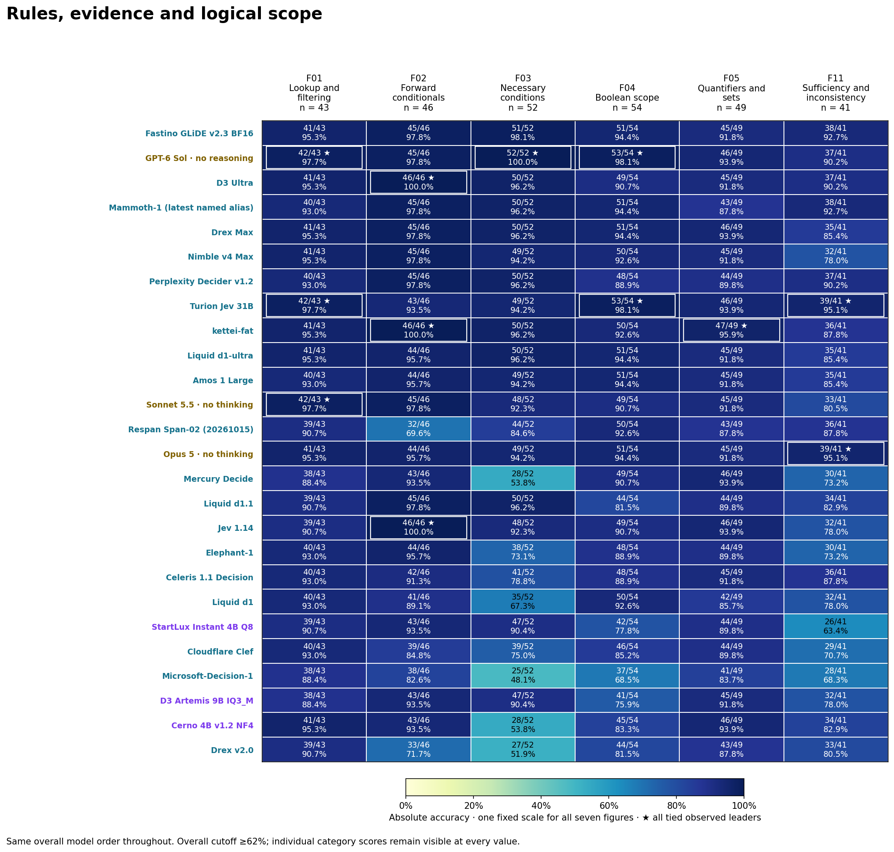
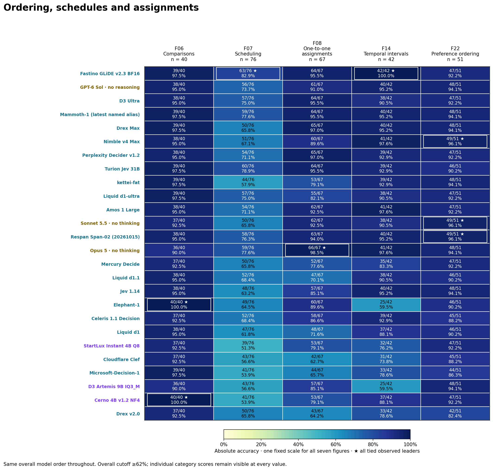
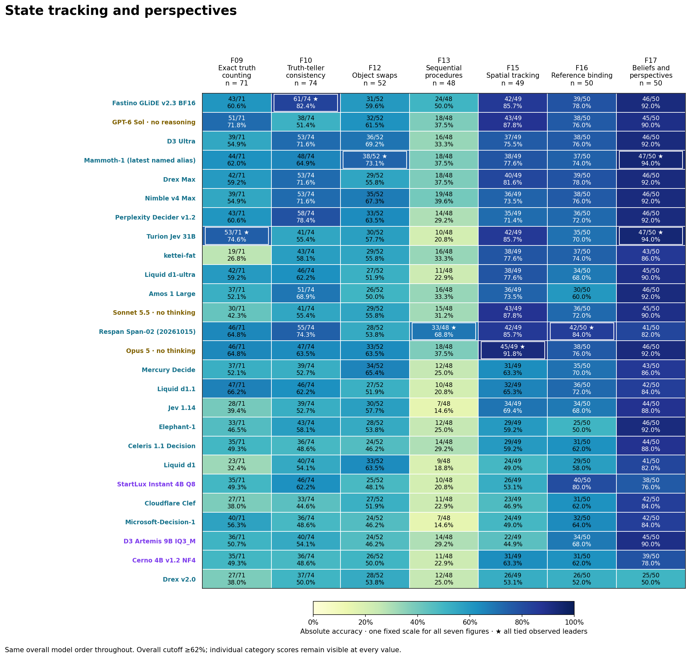
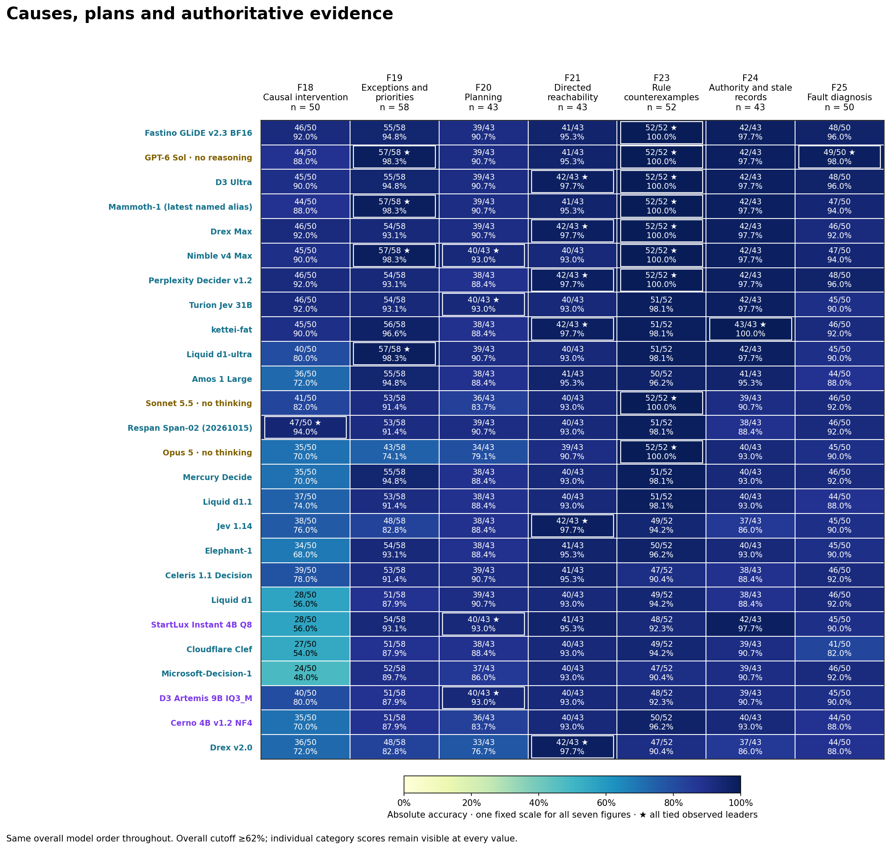
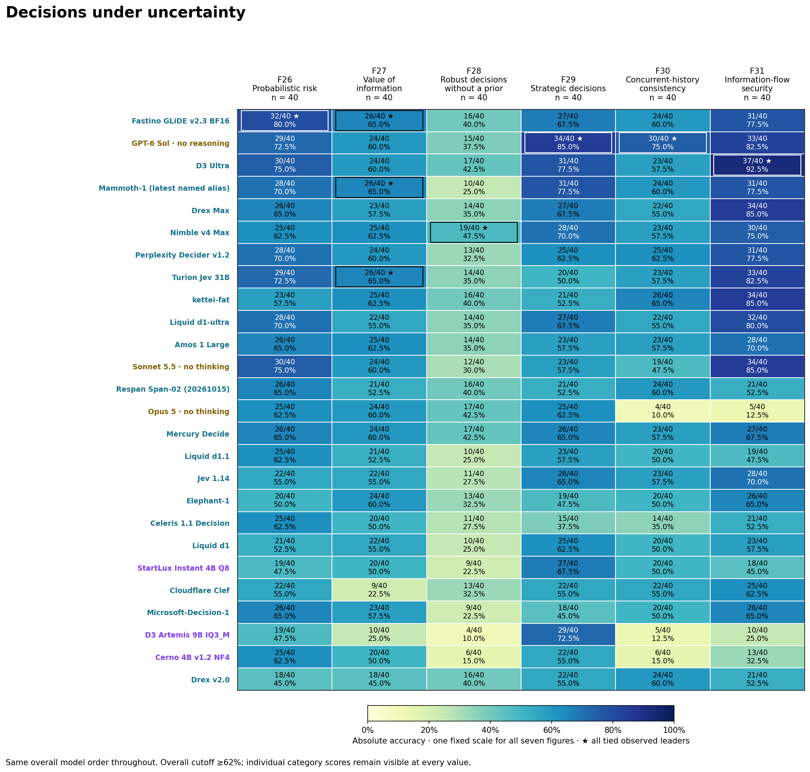
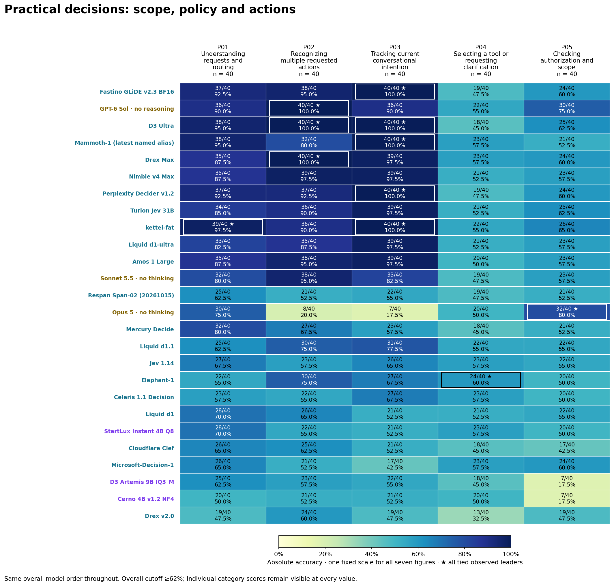
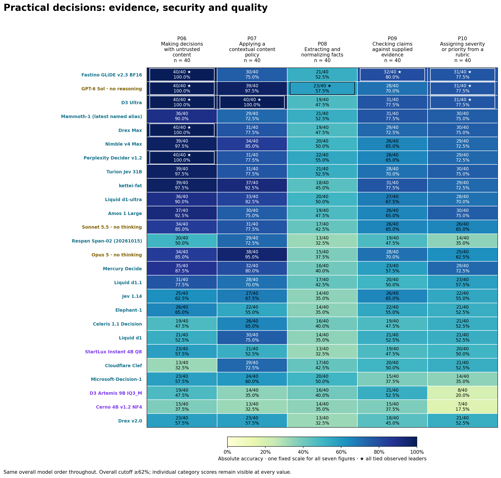

# The 41 categories: coloured rankings and explanations

[Interactive category matrices](https://etsabary.github.io/system-1-decision-benchmark/report.html#functions) · [Sorted individual rankings](https://etsabary.github.io/system-1-decision-benchmark/report.html#rankings). Every category uses the same 26 configurations meeting 62% overall.

The colours answer different questions; their scales stay fixed across every model and category.

| Encoding | Meaning and rationale |
| --- | --- |
| Teal model names / bars | Hosted native decision models |
| Purple model names / bars | Local CUDA decision configurations |
| Gold model names / pale gold bars | Reasoning-disabled LLM reference configurations |
| Pale yellow → green → dark blue cells | Absolute category accuracy, fixed 0–100%. Each cell also prints correct / tested and percentage. Darker blue means more correct answers. Black or white text follows contrast. A border and ★ mark all tied leaders. |
| Blue → white → red in the relative-profile figure | Below → near → above the score expected after removing model and category averages. Fixed −30 to +30 percentage points. This shows descriptive specialties; it is a different scale from absolute accuracy. |
| Green / yellow / orange / red timing | ≤250 / ≤500 / ≤1,000 / >1,000 ms. Median and p95 are classified separately. |
| Green / yellow / orange / red cost | ≤$0.010 / ≤$0.025 / ≤$0.050 / >$0.050 per 1,000 questions. Uses the unrounded known subtotal / 1,934 × 1,000. |
| ● / ◆ cost marks | API-reported charges / captured tariff estimates. Free-access and local costs are labelled separately. |
| + ? / grey | Additional charges missing / no comparable monetary measurement. A partial cost is a known subtotal, not a complete price. |

These speed and cost bands restore the earlier fixed thresholds. They make slow tails and expensive configurations easy to find; they are descriptive bands, not statistical outlier tests or significance claims. Displayed numbers can round to a boundary. Role colours identify deployment, not quality; only accuracy cells encode correctness. Category leaders share a rank when their counts tie.

## Rules, evidence and logical scope

### F01 · Lookup and filtering

43 questions. Select records that meet stated conditions

Illustration: Which listed request is both signed and marked urgent?

[Sorted coloured ranking](https://etsabary.github.io/system-1-decision-benchmark/report.html#category-F01).

### F02 · Forward conditionals

46 questions. Apply an implication from its trigger

Illustration: If an active badge grants entry and this badge is active, what follows?

[Sorted coloured ranking](https://etsabary.github.io/system-1-decision-benchmark/report.html#category-F02).

### F03 · Necessary conditions

52 questions. Reason backward from a missing required condition

Illustration: Every approved request needs a valid ticket; can one without a ticket be approved?

[Sorted coloured ranking](https://etsabary.github.io/system-1-decision-benchmark/report.html#category-F03).

### F04 · Boolean scope

54 questions. Track combinations such as both, either and exactly one

Illustration: Which choice satisfies exactly one of two stated conditions?

[Sorted coloured ranking](https://etsabary.github.io/system-1-decision-benchmark/report.html#category-F04).

### F05 · Quantifiers and sets

49 questions. Track all, some, none and overlapping groups

Illustration: All teal tokens are marked; no marked token is blank; which relation follows?

[Sorted coloured ranking](https://etsabary.github.io/system-1-decision-benchmark/report.html#category-F05).

### F11 · Sufficiency and inconsistency

41 questions. Determine whether facts force an answer or contradict one another

Illustration: Is a proposed arrangement determined, impossible or still underdetermined?

[Sorted coloured ranking](https://etsabary.github.io/system-1-decision-benchmark/report.html#category-F11).

## Ordering, schedules and assignments

### F06 · Comparisons

40 questions. Combine ordered comparisons

Illustration: A is taller than B and B than C; how do A and C compare?

[Sorted coloured ranking](https://etsabary.github.io/system-1-decision-benchmark/report.html#category-F06).

### F07 · Scheduling

76 questions. Fit events around order and exclusion rules

Illustration: Which timetable puts one meeting before another without overlapping a break?

[Sorted coloured ranking](https://etsabary.github.io/system-1-decision-benchmark/report.html#category-F07).

### F08 · One-to-one assignments

67 questions. Give each item a unique partner while satisfying clues

Illustration: Assign three people different desks using location restrictions.

[Sorted coloured ranking](https://etsabary.github.io/system-1-decision-benchmark/report.html#category-F08).

### F14 · Temporal intervals

42 questions. Compare starts, ends and overlapping periods

Illustration: Which interval overlaps a specified event without containing it?

[Sorted coloured ranking](https://etsabary.github.io/system-1-decision-benchmark/report.html#category-F14).

### F22 · Preference ordering

51 questions. Rank candidates using explicit tie-break rules

Illustration: Rank by priority first, then age when priorities tie.

[Sorted coloured ranking](https://etsabary.github.io/system-1-decision-benchmark/report.html#category-F22).

## State tracking and perspectives

### F09 · Exact truth counting

71 questions. Count precisely how many statements hold

Illustration: Under the supplied facts, how many of six claims are true?

[Sorted coloured ranking](https://etsabary.github.io/system-1-decision-benchmark/report.html#category-F09).

### F10 · Truth-teller consistency

74 questions. Find a consistent pattern of truthful and false statements

Illustration: Which assignment of honest and dishonest speakers fits their claims?

[Sorted coloured ranking](https://etsabary.github.io/system-1-decision-benchmark/report.html#category-F10).

### F12 · Object swaps

52 questions. Update locations after repeated exchanges

Illustration: A red token starts in box A; several box contents are swapped; where does it end?

[Sorted coloured ranking](https://etsabary.github.io/system-1-decision-benchmark/report.html#category-F12).

### F13 · Sequential procedures

48 questions. Apply each ordered edit to the current state

Illustration: Toggle one flag, swap two values, then conditionally reset another flag.

[Sorted coloured ranking](https://etsabary.github.io/system-1-decision-benchmark/report.html#category-F13).

### F15 · Spatial tracking

49 questions. Update position or direction from described movement

Illustration: Follow successive turns and moves, then identify the final direction.

[Sorted coloured ranking](https://etsabary.github.io/system-1-decision-benchmark/report.html#category-F15).

### F16 · Reference binding

50 questions. Resolve chains of names, roles and references

Illustration: Identify the mentor of the colleague named in a nested description.

[Sorted coloured ranking](https://etsabary.github.io/system-1-decision-benchmark/report.html#category-F16).

### F17 · Beliefs and perspectives

50 questions. Distinguish what different observers witnessed

Illustration: An object moves while one observer is absent; where will that observer look?

[Sorted coloured ranking](https://etsabary.github.io/system-1-decision-benchmark/report.html#category-F17).

## Causes, plans and authoritative evidence

### F18 · Causal intervention

50 questions. Recompute consequences of changing a specified input

Illustration: Force a switch off while holding other inputs fixed; which lamp now lights?

[Sorted coloured ranking](https://etsabary.github.io/system-1-decision-benchmark/report.html#category-F18).

### F19 · Exceptions and priorities

58 questions. Apply a rule, its exception and stated precedence

Illustration: A badge permits entry unless a higher-priority suspension applies.

[Sorted coloured ranking](https://etsabary.github.io/system-1-decision-benchmark/report.html#category-F19).

### F20 · Planning

43 questions. Choose an action sequence whose requirements are met

Illustration: Obtain a key before opening a locked door, with limited moves available.

[Sorted coloured ranking](https://etsabary.github.io/system-1-decision-benchmark/report.html#category-F20).

### F21 · Directed reachability

43 questions. Follow arrows in their permitted direction

Illustration: Can node A reach node D through the listed directed links?

[Sorted coloured ranking](https://etsabary.github.io/system-1-decision-benchmark/report.html#category-F21).

### F23 · Rule counterexamples

52 questions. Find a case that violates a stated rule

Illustration: Which listed record disproves the claim that every approved item is signed?

[Sorted coloured ranking](https://etsabary.github.io/system-1-decision-benchmark/report.html#category-F23).

### F24 · Authority and stale records

43 questions. Select the valid source rather than an outdated conflicting one

Illustration: Two records disagree; which controls under the stated authority and date policy?

[Sorted coloured ranking](https://etsabary.github.io/system-1-decision-benchmark/report.html#category-F24).

### F25 · Fault diagnosis

50 questions. Match observed symptoms to explicit fault rules

Illustration: Which fault is consistent with the supplied test results?

[Sorted coloured ranking](https://etsabary.github.io/system-1-decision-benchmark/report.html#category-F25).

## Decisions under uncertainty

### F26 · Probabilistic risk

40 questions. Choose the action with the lowest probability-weighted cost, using the supplied likelihoods and costs.

Illustration: Which action minimizes the expected cost of a possible delay?

[Sorted coloured ranking](https://etsabary.github.io/system-1-decision-benchmark/report.html#category-F26).

### F27 · Value of information

40 questions. Decide whether paying for a test before choosing an action reduces the probability-weighted cost enough to cover the test price.

Illustration: Should you buy a sensor reading before choosing an action, or is acting without the extra information cheaper overall?

[Sorted coloured ranking](https://etsabary.github.io/system-1-decision-benchmark/report.html#category-F27).

### F28 · Robust decisions without a prior

40 questions. Follow the stated worst-case rule when likelihoods are not supplied. Minimize either the largest possible loss or the largest regret (extra loss compared with the best action for each situation), as the question specifies. Do not invent probabilities.

Illustration: A route costs 4 in either situation; another costs 1 or 9. With no probabilities and a smallest-worst-case-cost rule, which route should be chosen?

[Sorted coloured ranking](https://etsabary.github.io/system-1-decision-benchmark/report.html#category-F28).

### F29 · Strategic decisions

40 questions. Choose an action while accounting for the specified choices or payoff-maximizing response of another decision-maker.

Illustration: Which first move gives the best result after the other player chooses their own best reply?

[Sorted coloured ranking](https://etsabary.github.io/system-1-decision-benchmark/report.html#category-F29).

### F30 · Concurrent-history consistency

40 questions. Decide whether overlapping operations and their reported results can fit a permitted one-at-a-time order that respects the specified timing and object rules.

Illustration: Two processes read and change the same stored value. Could their reported results fit an allowed one-at-a-time order?

[Sorted coloured ranking](https://etsabary.github.io/system-1-decision-benchmark/report.html#category-F30).

### F31 · Information-flow security

40 questions. Check whether changing a protected secret can change an observable result in a way the stated policy forbids.

Illustration: If public inputs stay the same, could public output distinguish two secret values that the policy says must remain indistinguishable?

[Sorted coloured ranking](https://etsabary.github.io/system-1-decision-benchmark/report.html#category-F31).

## Practical decisions: scope, policy and actions

### P01 · Understanding requests and routing

40 questions. Identify the governing request and route it under explicit priority and exception rules.

Illustration: Choose a destination when several routing signals conflict.

[Sorted coloured ranking](https://etsabary.github.io/system-1-decision-benchmark/report.html#category-P01).

### P02 · Recognizing multiple requested actions

40 questions. Recognize all currently requested actions, including cancellations and scoped revisions.

Illustration: Select the remaining action set after a later request withdraws one part.

[Sorted coloured ranking](https://etsabary.github.io/system-1-decision-benchmark/report.html#category-P02).

### P03 · Tracking current conversational intention

40 questions. Track the current intention after conversational corrections and changes of scope.

Illustration: Determine what the user now wants after an earlier instruction is revised.

[Sorted coloured ranking](https://etsabary.github.io/system-1-decision-benchmark/report.html#category-P03).

### P04 · Selecting a tool or requesting clarification

40 questions. Choose a tool or ask for necessary clarification using the stated prerequisites.

Illustration: Decide whether available information suffices to call the appropriate tool.

[Sorted coloured ranking](https://etsabary.github.io/system-1-decision-benchmark/report.html#category-P04).

### P05 · Checking authorization and scope

40 questions. Apply authorization boundaries, revocations, delegated scope and external constraints.

Illustration: Distinguish user-overridable permission from an external rule.

[Sorted coloured ranking](https://etsabary.github.io/system-1-decision-benchmark/report.html#category-P05).

## Practical decisions: evidence, security and quality

### P06 · Making decisions with untrusted content

40 questions. Keep instructions in untrusted documents separate from the authorized task.

Illustration: Treat a quoted instruction as data while completing the actual request.

[Sorted coloured ranking](https://etsabary.github.io/system-1-decision-benchmark/report.html#category-P06).

### P07 · Applying a contextual content policy

40 questions. Apply an explicit contextual content-policy rubric to the facts provided.

Illustration: Use the supplied policy and context to choose the allowed response class.

[Sorted coloured ranking](https://etsabary.github.io/system-1-decision-benchmark/report.html#category-P07).

### P08 · Extracting and normalizing facts

40 questions. Extract facts and normalize aliases, units or representations under explicit rules.

Illustration: Resolve two differently represented records to the required normalized value.

[Sorted coloured ranking](https://etsabary.github.io/system-1-decision-benchmark/report.html#category-P08).

### P09 · Checking claims against supplied evidence

40 questions. Check whether supplied evidence supports, contradicts or leaves a claim unresolved.

Illustration: Separate a supported claim from an overstatement of the source.

[Sorted coloured ranking](https://etsabary.github.io/system-1-decision-benchmark/report.html#category-P09).

### P10 · Assigning severity or priority from a rubric

40 questions. Assign severity or priority using the supplied rubric and precedence rules.

Illustration: Apply severity thresholds and escalation exceptions to a concrete case.

[Sorted coloured ranking](https://etsabary.github.io/system-1-decision-benchmark/report.html#category-P10).
